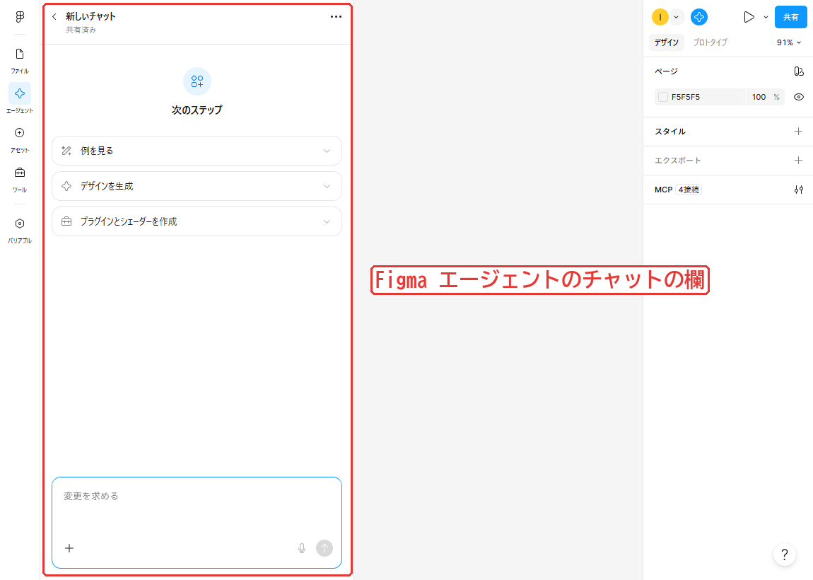
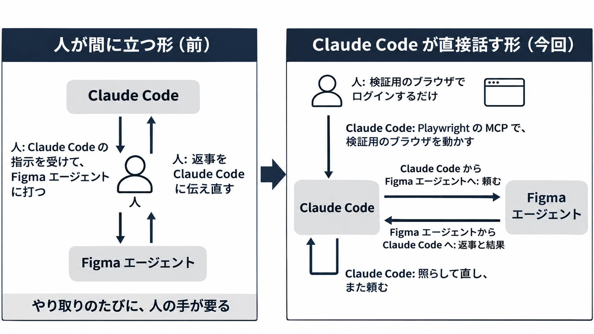
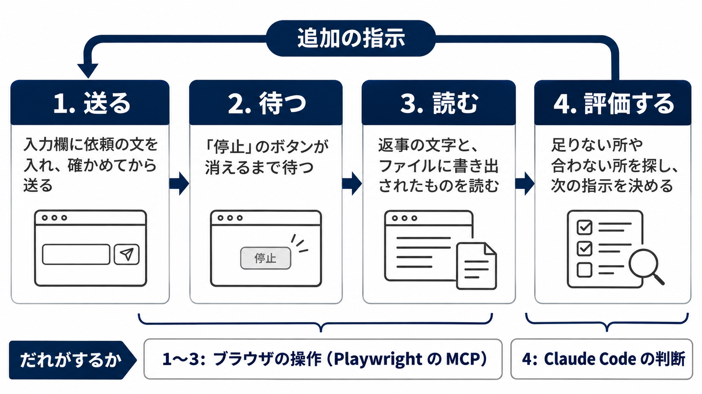
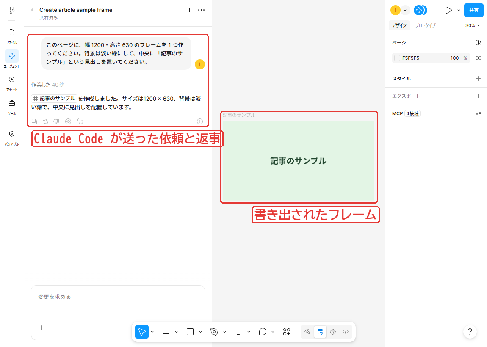
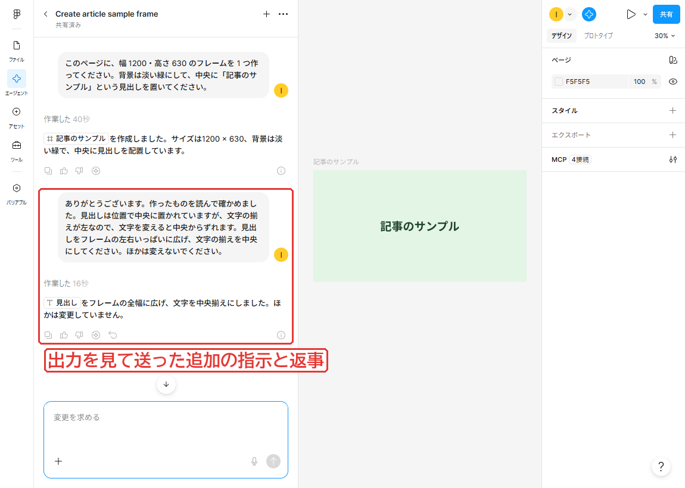

Figma エージェントのように画面の中でしか話せない AI とも、人が仲介せずに Claude Code に対話させられます。
Claude Code にブラウザを持たせ、依頼を打つ・返事を待つ・出力を読む・次の指示を送るまでを任せます。

私はこの形で、自作のスキルを Figma エージェントで動かす検証を任せました。
最初の 2 日でスキルを頭から通した回数は 52 回で、そのあいだ私が画面でしたのはログインだけです。

この記事で分かること

- 画面でしか話せない AI に、Claude Code から話しかける構成
- 送る・待つ・読むの 1 往復を、ブラウザの操作で組む方法（実物のコードつき）
- Figma エージェントの出力を Claude Code が評価し、追加の指示を送れるか
- ブラウザを渡す前に決めておくこと

Figma エージェントで何ができたかと、スキルの作りは、前の記事に書きました。
この記事では繰り返さず、夜通し回す運用と、道具の承認の扱いも書きません。

https://zenn.dev/akaringo1109/articles/figma-agent-skill-external-library

## Figma エージェントとの対話を人が仲介する手間

Figma エージェントはデザインファイルを開いた画面の中で対話する AI です。
デザインの作成や修正、細かな作業の代行、デザインへのフィードバックなどを頼めます。
公式のヘルプには、使える場所が次のように書かれています。

> The agent is currently only available in Figma Design from the desktop app or web browser.
>
> 訳: このエージェントは今のところ、Figma Design のデスクトップアプリか Web ブラウザでだけ使えます。

https://help.figma.com/hc/en-us/articles/37998629035799-Work-with-the-Figma-agent-in-design-files

同じヘルプには、外のプログラムから Figma エージェントに話しかける方法は書かれていません。
話しかけるには、Figma の画面を開き、チャットの欄に打つことになります。



*Figma エージェントのチャットの欄（記事用のダミーのファイル）*

2026年10月23日、私は自作のスキルが Figma エージェントで動くかを調べ始めました。
確かめたいのは Figma エージェントの中で動くかなので、Claude Code から MCP で Figma のファイルを触るだけでは足りず、話しかけて試す必要がありました。

ただ、私が間に立つと、Claude Code の指示を私が Figma エージェントに打ち、返事を Claude Code に伝え直すことになり、やり取りのたびに私の手が要ります。
そこで、Claude Code に次のように頼みました。

> 私があなたから指示を受けて都度Figmaエージェントと対話するのは非常に効率が悪いので、あなたの方でエージェントと対話して、実際の画面でできること・できないことを把握しながら、このスキルがどうあるべきかを検討して進めてほしいと思っています。

相手は画面の中にしかいないので、Claude Code にブラウザを渡し、画面を直接操作させることにしました。

## 人と Claude Code の分担

登場するのは次の 3 者です。

- **人**: 検証用のブラウザでログインする。検証の方針を決め、結果を見て判断する
- **Claude Code**: そのブラウザで Figma エージェントに頼み、返事と書き出されたものを読んで評価し、次の指示を送る
- **Figma エージェント**: ブラウザの中で動く相手

Claude Code にはブラウザを操作する道具（Playwright の MCP。次の節）を持たせます。



*上が前の形、下が今回の形*

:::message
2026年10月23〜26日に、Windows 11 の Edge、Playwright の MCP（版は記録していない）、Figma の Web 版（日本語の表示）で試した内容です。画面のスクショは、2026年11月4日に記事用のダミーのファイルで撮りました。画面の作りは変わることがあります。
:::

## 検証用のブラウザの用意

### 検証用のプロファイル

渡すブラウザは普段の Edge と分け、検証用のプロファイルを新しく作りました。
普段の Edge につなぐと、私が使っている画面を Claude Code が直接操作し、私の作業とぶつかるためです。
普段のプロファイルは、Edge を開いているあいだロックがかかり、Playwright からは開けないこともあります。

Claude Code が新しいプロファイルのフォルダを指定して Edge を起動し、Figma のログインの画面を開きました。
実際に使ったものから、パスを伏せています。

```powershell
$prof = "$env:LOCALAPPDATA\<検証用のフォルダ>\edge-profile"
New-Item -ItemType Directory -Force -Path $prof | Out-Null
Start-Process -FilePath "<msedge.exe のパス>" -ArgumentList @(
  "--user-data-dir=$prof", "--no-first-run", "--no-default-browser-check",
  "https://www.figma.com/login"
)
```

私はこのウィンドウでログインを済ませ、いったん閉じます。
開いたままだと、同じプロファイルを Playwright の側から開けないためです。

### Playwright の MCP の設定

このプロファイルを Claude Code から操作するために、Playwright の MCP（Playwright でブラウザを自動で操作する MCP サーバー）を使いました。

https://github.com/microsoft/playwright-mcp

README によると、ログインの情報は `--user-data-dir` で決めたフォルダに残り、ブラウザは `--browser` で `msedge` も選べます。
そこで、検証用のプロファイルを指す設定のファイルを作りました。

```json:mcp-edge.json
{
  "mcpServers": {
    "playwright": {
      "command": "cmd",
      "args": [
        "/c", "npx", "-y", "@playwright/mcp",
        "--browser", "msedge",
        "--user-data-dir", "<検証用のプロファイルのフォルダ>",
        "--output-dir", "<スクショの置き場所>"
      ]
    }
  }
}
```

Windows のパスは JSON の中では `\` を `\\` と重ねて書きます。
プロジェクトにある別の Playwright の MCP を読ませないよう、`--strict-mcp-config` を付け、`--mcp-config` でこのファイルだけを渡して Claude Code を起動しました。

## Figma エージェントとの 1 往復

相手の返事を見て次の操作を決めるので、操作の手順は決めず、確かめることと守ることだけを指示書にして渡しました。
Claude Code がくり返すのは次の流れです。



*くり返す 4 つの手順*

送ると待つは `browser_run_code_unsafe`（Playwright のコードをそのまま動かす道具）で組みました。



*送る・待つ・読むの 1 往復（記事用のダミーのファイルと依頼）*

### 依頼を送る

スキルは入力欄で `/` のあとに名前の頭を打って出る候補から選びます。
絞り込みが間に合わずに別のスキルが入ったことがあるので、送る前に次の 3 つを照らさせています。

- 候補の先頭
- 入力欄に入ったスキルの名前
- チャットの公開範囲（このときは「非公開」）

次は 10月23日の送り方から、依頼の文とスキルの名前を伏せ、添付のファイルの確かめを省いた形です。
この形のままでは動かしていません。

```js
// 依頼の文を入れ、スキルを候補から選び、確かめてから送る
async (page) => {
  const box = page.locator('[data-testid="code-chat-chat-box"]');
  await box.click();
  await page.keyboard.press('Control+End');
  await page.keyboard.insertText('<依頼の文>');
  await page.keyboard.type(' /<スキルの名前の頭>', { delay: 60 });  // ここから先は 1 字ずつ打つ
  await page.waitForTimeout(900);
  const rows = page.locator('[data-testid="skill-invocation-row"]');
  const first = (await rows.first().innerText()).replace(/\s+/g, ' ').trim();
  if (first !== '/<スキルの名前>') return 'unexpected first row: ' + first;  // 候補の先頭が違えば送らない
  await rows.first().click();
  await page.waitForTimeout(500);
  const chip = await page.evaluate(() => document.querySelector('[data-testid="code-chat-chat-box"] [aria-label*="<スキルの名前>"]')?.getAttribute('aria-label'));
  const hdr = await page.evaluate(() => { const h = document.querySelector('[aria-label="左サイドバー"] h2'); return h ? h.parentElement.innerText : null; });
  if (chip !== '/<スキルの名前>、スキル' || !/非公開/.test(hdr || '')) return JSON.stringify({ chip, hdr });  // 札と公開範囲が違えば送らない
  await page.locator('role=region[name="左サイドバー"]').getByRole('button', { name: '送信' }).click();
  return 'sent ' + new Date().toISOString();
}
```

照らしたものが 1 つでも違えば送らずに返し、Claude Code が入れ直すか止まるかを決めます。
スキルを使わない依頼なら、入力欄に文を入れて「送信」を押すだけです。
あとで書く追加の指示はこの形で送りました。

### 返事を待って読む

返事は少しずつ書き足されるので、終わる前に読むと欠けます。
書いているあいだは「停止」のボタンが出るので、消えるまで待ってから文字を取り出させました。
次は 10月24日の待ち方から、時刻を返す所を省いた形です。

```js
// 「停止」のボタンが消えるまで待ち、チャットの欄の文字の終わりのほうを返す
async (page) => {
  const t0 = Date.now();
  while (Date.now() - t0 < 110000) {  // 最長 110 秒待って返す
    if (!(await page.getByRole('button', { name: '停止' }).count())) break;
    await page.waitForTimeout(8000);
  }
  const running = !!(await page.getByRole('button', { name: '停止' }).count());
  const all = await page.locator('[data-testid="chat-slide-carousel"]').first().innerText();
  const j = all.indexOf('チャットにスキップ');  // この文字から先は切る
  const body = all.slice(0, j > 0 ? j : undefined);
  return { running, len: body.length, tail: body.slice(-1400) };
}
```

110 秒たっても終わらなければ `running` が残るので、もう一度呼んで待ちます。
ボタンが出る前に呼ぶとすぐ抜けるので、返事が終わったかは、返り値の `tail` を読んで Claude Code が決めます。

### 書き出されたものを読む

Figma エージェントは頼まれたことをファイルにも書き出します。
Figma の Web 版では、ファイルを開いたページに `window.figma` と `figma.root` があり、Plugin API（プラグイン用の API）と同じ書き方でファイルの中を読めました。
公式に案内された使い方かは、確かめていません。

次は 10月24日に `browser_evaluate` に渡したものを短くした形で、この形のままでは動かしていません。

```js
// 書き出されたフレームの中の文字を、全部つないで返す
async () => {
  const f = await figma.getNodeByIdAsync('<読みたいフレームの node id>');  // URL の node-id の「-」を「:」にしたもの
  return f.findAll(n => n.type === 'TEXT').map(n => n.characters).join('\n');
}
```

## Claude Code による評価と追加の指示

1 往復が組めたら、Claude Code が読んだものを評価し、そこから追加の指示を Figma エージェントに送れるかを試しました。

指示書には「相手が言った『できる』は鵜呑みにせず、実際に試して確かめる」と書いてあります。
Claude Code は出力に想定と合わない所を見つけると、同じチャットで根拠を出させました。

- 10月23日の夜: いくつかの項目が想定と食い違ったので、判定とよりどころにした決まりを項目ごとに並べさせた。Figma エージェントはファイルを読み直し、表で返した
- 10月24日の 0 時すぎ: 出力の中の画像の数が 0 だった。Figma エージェントが使う作業場所のフォルダの中身を聞くと、見ていないと返った。そこで、作業場所のシェルで `ls -la` を打たせ、出力を貼らせた。画像はあり、数えたあとに置かれたと Claude Code は判断した

次は送った 2 つの文から、項目の名前とパスを伏せ、1 つ目の問いの一部を省いたものです。

```text
ありがとうございます。Figma は変えずに、確かめのために教えてください。<食い違った項目> について、項目ごとに次を短く並べてください。(1) あなたの判定、(2) よりどころにした決まり（節の番号か見出しと、その文の要約）。ファイルは読むだけにしてください。
```

```text
ありがとうございます。読むだけの確かめを 1 つお願いします（Figma は変えないでください）。シェルで ls -la <作業場所のフォルダ> を実行し、出力をそのまま貼ってください。
```

どちらにも Figma を変えないことと、読むだけにすることを添えました。
評価をもとにスキルを直し、頭から頼み直すこともさせました。

記事用のダミーのファイルでも、同じ流れを試しました。
Claude Code が書き出されたフレームを読むと、見出しは位置で中央に置かれていましたが、文字の揃えは左でした。
そこで同じチャットで直す指示を送り、直ったことをもう一度読んで確かめています。



*出力を読んで送った追加の指示（記事用のダミーのファイル）*

## ブラウザを渡す前に決めておくこと

ログインしたままのブラウザを渡すと、そのアカウントでできる操作の多くは Claude Code にもできます。
そこで、次の決まりを指示書に書いて渡しました。
仕組みでは縛っていません。

- 普段のプロファイルは渡さず、検証用のプロファイルにだけログインする
- 試すのは、検証用に作ったファイルか、評価用に複製したファイルだけにする
- パスワードや API キーは入力させない。ログインが切れたら何も入力せずに止める
- スキルの公開、ファイルの共有、人の招待、有料の操作をしない
- チャットの公開範囲を確かめる。最初の節の公式のヘルプによると、2026年6月23日からの新しいチャットは、Full シートを持ちファイルを編集できる人に既定で見える

`browser_run_code_unsafe` も、README で「RCE-equivalent」（遠隔からのコード実行と同等）とされているので、MCP サーバーを動かすユーザーの権限で何でも動かせる道具として扱います。

## まとめ: Claude Code は Figma エージェントとも直接話せる

- **何ができたか**: 人の仲介なしに Figma エージェントと対話させ、出力の評価と追加の指示まで任せられた
- **どう組んだか**: 検証用のプロファイルを Playwright の MCP に渡し、送る・待つ・読むを Playwright のコードで組んだ
- **人がすること**: ログインと、検証の方針を決めて結果を判断すること
- **何に気をつけるか**: 普段のプロファイルは渡さない。触る範囲は指示書の決まりで絞るだけで、アカウントの権限はそのまま使える

限界は、画面の部品（`data-testid` やボタンの名前）に頼るので、画面の作りや表示の言語が変わると動かなくなることです。

画面でしか使えないほかの Web のサービスの AI でも、送り方と待ち方をその画面に合わせれば、同じ形が使えると考えています。
まずは検証用のプロファイルで 1 回ログインし、相手の返事を 1 つ読ませるところから試してみてください。

## Trellis のこと

Trellis は、福岡でホームページの制作と、AI による業務の自動化をしている会社です。
記事は Zenn と、Trellis のサイトのブログの両方に載せています。

https://trellis-grow.com/?utm_source=zenn&utm_medium=referral&utm_campaign=browser-profile-handoff-agent&utm_content=card
