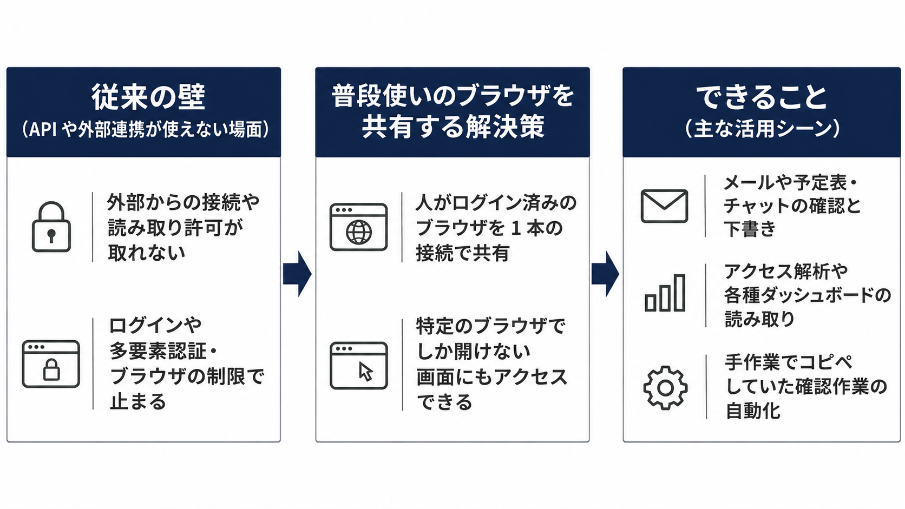
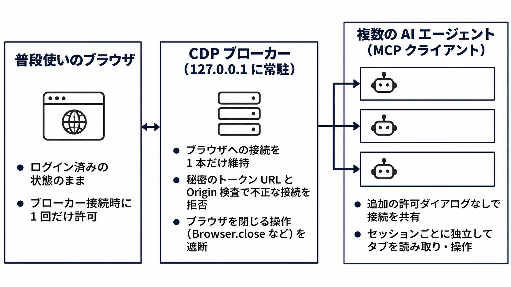

メールの確認、予定表のチェック、チャットの下書き、アクセス解析や各種ダッシュボードからの情報収集。
普段パソコンで AI エージェントに任せたい作業ほど、ログイン済みのブラウザの中に閉じていることが多いものです。

ところが、AI にブラウザ操作を任せようとすると「ログイン状態で毎回引っかかる」「接続のたびに許可ダイアログが出る」という壁にぶつかります。
そこで私は、**普段使いのブラウザを AI エージェントと安全に共有する仕組み（CDP ブローカー）** を用意して運用しています。

福岡で AI による業務改善や自動化、Web 制作などに取り組んでいる Trellis です。

:::message
**この記事で分かること**

- 普段使いのブラウザを AI エージェントと共有すると、どんな作業が自動化できるのか
- API や外部連携の MCP が使えない環境でも、ブラウザ経由なら情報へアクセスできる強み
- 許可ダイアログを 1 回に抑えつつ、複数エージェントから安全に共有する CDP ブローカーの仕組み

OS や環境ごとの細かなコマンド手順の網羅ではなく、使いどころと設計のポイントを中心に書きます。
:::

## 普段使いのブラウザを共有すると何ができるか

ブラウザ操作の自動化というと「テスト用の新しいブラウザを裏で立ち上げる」形が一般的です。
しかし、実務で役に立つ場面の多くは、**すでに自分がログインして開いている普段使いのブラウザ**にこそあります。

### 特定のブラウザ・ログインセッションを引き継げる

たとえば、次のような作業はテスト用の素のブラウザでは進められません。

- **特定のブラウザでしか開けない画面**: ログインセッションや端末側の認証が紐づいた Web サービス、特定のブラウザ指定がある各種コンソール
- **ログイン状態を維持したまま進めたい作業**: メール、カレンダー（予定表）、チャットツール、アクセス解析や各種 Web ダッシュボードの確認・下書き作成

AI 専用の別プロファイルでログインし直す方法もありますが、多要素認証やパスキー、自動操作フラグ（`navigator.webdriver`）による Bot 判定で弾かれるケースが増えています。

普段使いのブラウザをそのまま共有できれば、人間が一度開いてログインしている状態をそのまま引き継いで作業を進められます。

### API や外部 MCP が使えない環境での強み

普段使いのブラウザを共有する一番の強みは、**API や外部連携用の MCP が使えない環境でも、エージェントが情報にアクセスできる点**にあります。

利用環境のセキュリティ方針や権限の都合で、次のような制約があるケースは珍しくありません。

- 外部サービスと接続する公式 API キーの発行やアプリ連携が許可されていない
- 外部 SaaS とつなぐ新しい MCP サーバーを追加・許可できない

こうした環境でも、「ブラウザで自分が開いて見られる情報」であれば、エージェントはブラウザ経由で画面を読み取り、要約や転記、下書き作成まで進められます。
API 連携を待つことなく、今すぐ目の前の作業をエージェントに任せられるのが大きなメリットです。

## 素直につなぐと起きる 2 つの課題

Chrome や Edge には、起動中のブラウザへ開発者ツール経由で接続する仕組み（Chrome DevTools MCP の `--autoConnect` など）が公式に用意されています。

https://developer.chrome.com/docs/devtools/agents/use-cases/auto-connect

https://github.com/ChromeDevTools/chrome-devtools-mcp

ただ、この仕組みを複数の AI エージェントからそのまま使うと、実用上で次の 2 つが困ります。

1. **接続のたびに許可ダイアログが出る**: エージェントのセッションを増やしたり再起動したりするたび、ブラウザ側に「リモートデバッグを許可しますか」という確認が出て作業が止まります
2. **複数エージェントで同時に使いにくい**: 接続の取り合いや、誤ってブラウザ本体を閉じる操作（`Browser.close` など）が走るリスクを抱えたままになります

この「許可のやり直し」と「安全の境界」をまとめて引き受けるのが、間に挟む **CDP ブローカー** です。

## CDP ブローカーの仕組みと安全の工夫

CDP ブローカーは、手元の PC のローカル環境（`127.0.0.1`）に常駐する小さな中継サーバーです。
ブラウザ本体と各 AI エージェント（MCP クライアント）の間に入り、接続を 1 本に束ねます。

### 許可は最初の 1 回だけ、接続は複数で共有

ブラウザと直接つながるのは、常駐している CDP ブローカーの 1 本だけです。

- ユーザーがブラウザ上で許可を押すのは、ブローカーが最初に接続するとき（PC 起動直後やブラウザ再起動時）の **1 回だけ**
- 各 AI エージェントの MCP クライアントは、ブラウザではなくブローカーへ接続する
- ブローカー内部でセッションごとに ID を振り分けているため、複数のエージェントが同時に別々のタブを読み書きしても干渉しない

これにより、ターミナルやチャット画面でいくつエージェントを並列起動しても、毎回許可を押しに行く必要がなくなります。

### 普段使いのブラウザを守る 3 つの歯止め

ログイン済みの普段使いブラウザを開放する以上、安全面の歯止めもブローカー側に組み込んでいます。

| 守り方 | 仕組み | 狙い |
| --- | --- | --- |
| 接続元の制限 | `127.0.0.1` / `localhost` のみ許可し、秘密のトークン付き URL で待ち受ける | 同じ PC 内の正規の MCP クライアント以外からつながせない |
| `Origin` ヘッダーの拒否 | `Origin` ヘッダーが付いた WebSocket 接続を 403 で弾く | 開いている悪意ある Web ページからの不正接続を防ぐ |
| 破壊的操作の遮断 | `Browser.close` やクラッシュ系コマンドを途中でブロックする | エージェントの誤操作で作業中のブラウザごと閉じさせない |

設定ファイル（`.mcp.json` 等）には秘密のトークンを直書きせず、ブローカー起動時に生成されるローカルの状態ファイルから読み取る形にしておけば、設定をそのまま管理しても秘密が漏れません。

### 運用で押さえておきたいポイント

実際に運用して分かった、安定稼働のためのポイントも 2 つだけ触れておきます。

- **親プロセスから切り離して起動する**: エージェントの実行環境から直接ブローカーのサーバーを起動すると、そのエージェントのセッションが終了したときにブローカーも一緒に落ち、次の接続でまた許可が必要になります。起動専用のラッパー（`detached` で切り離してすぐ終了するスクリプト）経由で常駐させるか、OS ログオン時に自動起動しておくのが安定します。
- **裏タブや最小化状態での停止に備える**: ブラウザのタブが背面にあると、ページ側の描画や処理が省電力で止まることがあります。バックグラウンドのまま読み取りや撮影を行いたい場合は、CDP の `Emulation.setFocusEmulationEnabled` でフォーカス状態を擬似的に有効にしておくと安定して動きます。

## まとめ: ブラウザを入り口にすれば自動化の範囲が広がる

- 普段使いのブラウザを AI と共有すると、特定ブラウザ指定の画面やログイン済みサービス（メール・予定表・チャット等）をそのまま自動化できる
- 外部 API や SaaS 連携 MCP の許可が取れない環境でも、ブラウザ経由なら現実的に画面上の情報を扱える
- CDP ブローカーを間に挟むことで、許可を 1 回に抑えつつ、複数エージェントからの安全な同時利用を実現できる

「API が用意されていないから自動化できない」と諦めていた定型作業があるなら、まずは普段使っているブラウザの 1 画面を読み取らせるところから試してみてください。

## Trellis のこと

Trellis は、福岡でホームページの制作と、AI による業務の自動化に取り組んでいます。
記事は Zenn と、Trellis のサイトのブログの両方に載せています。

https://trellis-grow.com/?utm_source=zenn&utm_medium=referral&utm_campaign=cdp-broker-shared-browser&utm_content=card
