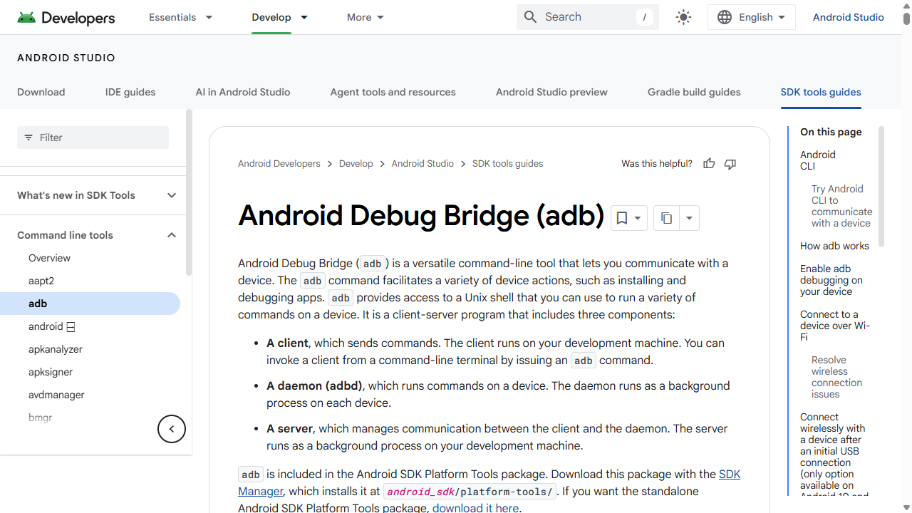
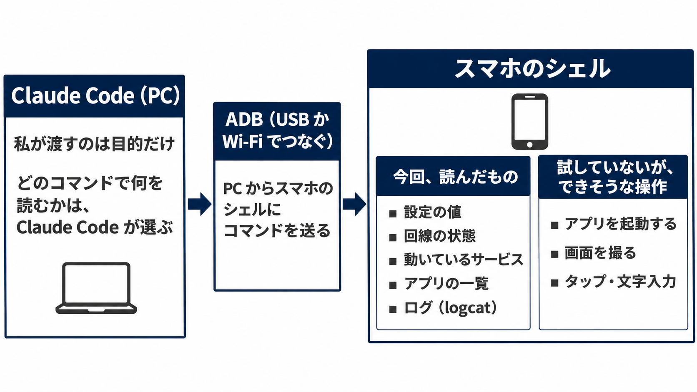
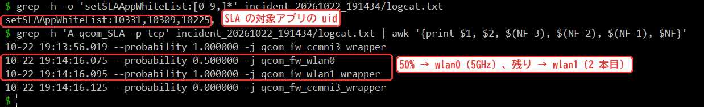
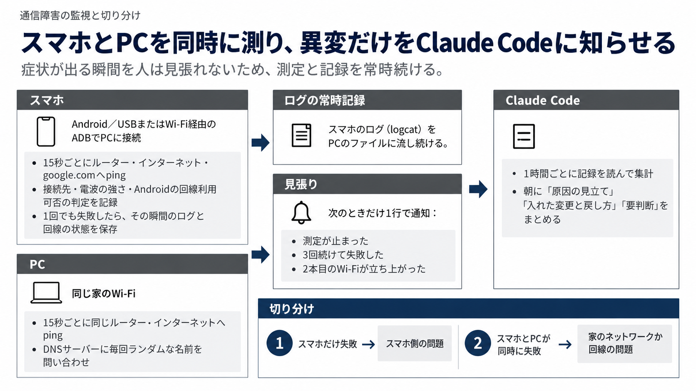

スマホを ADB で PC につなぐと、Claude Code はスマホのシェルでコマンドを打ち、画面に出ない設定やログを自分で読めます。
設定画面を見ても分からない不具合の手がかりも、Claude Code に調べさせれば見つけられます。

私の Android では、Wi-Fi はつながっているのにアプリだけが読み込まなくなる不調が、時々起きていました。
Claude Code に一晩任せると、端末固有の機能が一部のアプリの通信を 2 本目の Wi-Fi に回していた記録を、ログから見つけてきました。

この記事で分かるのは、次の 3 つです。

- Claude Code が ADB で読めたものと、実際に打ったコマンド
- 人が張り付けない不調を、一晩見張らせる仕組み
- ADB でほかにできそうなこと（公式のドキュメントで確かめた操作）

端末固有の機能の細かい仕組みと、ADB を使えるようにする手順は書きません。

## ADB とは

ADB（Android Debug Bridge）は、PC から Android の端末にコマンドを送る、開発者向けの道具です。

> Android Debug Bridge (`adb`) is a versatile command-line tool that lets you communicate with a device.
>
> `adb` provides access to a Unix shell that you can use to run a variety of commands on a device.
>
> （訳: adb は、端末とやり取りするための多用途のコマンドラインツール。adb は端末の Unix シェルにアクセスでき、さまざまなコマンドを実行できる。）

https://developer.android.com/tools/adb



*出典: Android Developers「Android Debug Bridge (adb)」（2026 年 11 月 4 日に撮影）*

スマホの開発者向けオプションで「USB デバッグ」をオンにして USB でつなぐと、PC からスマホのシェルを使えます。
初めてつなぐときは、この PC からのデバッグを許可するかの確認がスマホに出ます。

```bash
adb devices                                  # つながっている端末を確かめる
adb shell getprop ro.build.version.release   # スマホのシェルでコマンドを打つ（Android のバージョン）
adb tcpip 5555                               # Wi-Fi 経由の ADB に切り替える（USB を外しても使える）
adb connect <スマホのIP>:5555
```

### Claude Code に ADB を使わせるのに要るもの

Claude Code はターミナルでコマンドを打てるので、PC に adb が入っていれば、そのまま adb を使えます。
今回、スマホとやり取りするための MCP や専用の連携は使っていません。



:::message
前提: Android 15 のスマホ、Windows の PC（Windows PowerShell 5.1 と Git Bash）、Claude Code、Android SDK Platform Tools（adb）。2026 年 10 月に試しました。ADB は Android 専用なので、iPhone ではできません。
:::

## Claude Code が ADB で読めたスマホの中身

### 設定画面と ADB のシェルで見えるものの違い

スマホの設定画面に出るのは、利用者向けに用意された項目だけです。
ADB のシェルからなら、その裏にある設定の値、回線の状態、動いているサービス、ログまで読めます。
私の不調でも、症状が出た瞬間に設定画面を開くと、どこにも異常は見当たりませんでした。

### Claude Code が打ったコマンドと、読めた・記録できた情報

Claude Code が実際に打ったコマンドを、読んだものと記録したものごとに並べます。
私が渡したのは「原因を調べて」という目的だけで、どのコマンドで何を読むかは Claude Code が選びました。

| 読んだもの | コマンド | 分かること |
| --- | --- | --- |
| 端末 | `getprop ro.product.marketname`・`getprop ro.build.version.release` | 機種と Android のバージョン |
| 設定の値 | `settings get global mobile_data_always_on` など 13 項目、`settings list global` | 設定画面に無い項目の値 |
| 回線の状態 | `cmd wifi status`・`dumpsys connectivity` | つないでいる Wi-Fi、電波の強さ、Android がその回線を使えると判定しているか |
| DNS と経路 | `dumpsys dnsresolver`・`ip -6 addr`・`ip rule show` | 問い合わせ先の DNS、IPv6 のアドレス、経路の規則 |
| サービス | `dumpsys -l`・`dumpsys <サービス名>` | 動いているサービスの名前と、その中の状態 |
| アプリ | `cmd package list packages -U` | アプリの名前と uid（Android がアプリごとに割り当てる番号）の対応 |
| 電池と容量 | `dumpsys battery`・`df -h /data` | 電源につながっているか、空き容量 |
| 通信 | `ping -I wlan0 -c1 <ルーターのIP>` | スマホから見た疎通 |
| 記録（その瞬間） | `adb logcat -d -v threadtime -t 4000`・`dumpsys wifi` | その時点までのログ 4,000 行と、Wi-Fi の状態をファイルに残す |
| 記録（流し続ける） | `adb logcat -v threadtime -T 1 <タグ>:S ...` | ログを PC のファイルに流し続ける。`<タグ>:S` で量の多いタグを黙らせる |

:::message alert
TODO スクショ: Claude Code（T3 Code のスレッド）が adb shell のコマンドを打ち、結果を読んでいる画面。IP・端末のシリアル・SSID が写らないように（公開の前にブログスタジオで差し替える）
:::

`adb logcat` のほかは、`adb shell` のあとに続けてスマホの中で動かすコマンドです。
どれも読むか記録するだけのコマンドで、Claude Code はスマホの設定を変えていません。

ログを流し続けるときは、1 分ほど流して出現回数の多いタグを Claude Code に数えさせ、描画まわりなどのタグを外しました。
それでも 1 時間に 35MB ほど増えるので、スマホではなく PC に保存しています。

## 実例: 時々通信が止まる不調を調べさせた

私のスマホでは、Wi-Fi はつながっているのに Kindle や Instagram だけが読み込まなくなる不調が、時々起きていました。
Claude Code に頼んだのは「朝まで見張りを続け、自分で原因を調べ、遮断が再発しないようにしておく」ことです。

スマホのシェルから打つ ping は、症状が出た瞬間も正常でした。
そこで Claude Code は「止まっているのはアプリの通信だけ」と見て、アプリごとに通信を扱う端末固有の機能を、次の型で探しました。

1. 設定の一覧を語で絞る（`settings list` を `dual`・`sla`・`boost` などの語で）
2. 見つかった機能の状態を読む（`dumpsys -l` でサービスの名前を探し、`dumpsys <サービス名>` で中を読む）
3. 設定に出てきた番号（uid）から、持ち主のアプリを引く（`cmd package list packages -U`）
4. その機能が動いていた時間帯のログを見る（異常の瞬間に保存してあった logcat）

3 で引いた持ち主は Kindle・Instagram・YouTube で、不調が出ていたアプリと重なりました。

4 のログには、これらのアプリの通信の一部を 2 本目の Wi-Fi に回す規則が残っていました。
Claude Code の見立ては、原因はデュアル Wi-Fi（2 本の Wi-Fi に同時につなぐ端末固有の機能）で、確度は中〜高です。



*4 で見たログの行（`wlan1` が 2 本目の Wi-Fi）*

デュアル Wi-Fi は、前に調べていた別の AI の提案で、頼む前に私がオフにしていました。
残りの夜は、同じことがまた起きないかを見張らせました。

## 任せる前に決めた「やらないこと」

スマホを AI に操作させるなら、元に戻せなくなる操作を先に禁じておきます。
Wi-Fi 経由の ADB だけでつないでいるときに Wi-Fi を切られると、ADB も切れて誰も戻せなくなるためです。
夜通し任せる前に渡した決まりは、次のとおりです（4 行目は、寝る前に USB でつなぎ直したあとに足しました）。

```text
- Wi-Fi のオン・オフ、ネットワークの削除・再接続、MAC アドレスの変更、
  再起動、初期化、アプリの削除はしない
- スマホへの変更は、Wi-Fi を切らずに戻せる設定だけにする。
  変更前の値・戻すコマンド・変更前後の測定結果をログに残す
- ルーターの設定は変えない（家全体に効く）。必要なら朝の「要判断」に回す
- USB でつないでいる間は、Wi-Fi の再接続を伴う切り分けまではしてよい（USB が残るので戻せる）
```

ツールで止めたのではなく指示として渡しただけですが、夜の間に Claude Code がスマホの設定を変えた記録はありませんでした。

## 一晩見張らせる仕組み

不調は 20〜30 分おきに出ては消えるので、その瞬間を人が待ち構えるのは無理です。
Claude Code に「測る」「記録する」「異変を知らせる」を分けて組ませれば、一晩見張らせて状態を捕まえられます。

- 測る: スマホのシェルから約 15 秒おきに疎通と回線の状態を測り、CSV に書く。失敗した瞬間は logcat も保存する。同じ家の PC からも同じ所を測り、家のネットワークの不調と見分ける
- 記録する: logcat を PC のファイルに流し続ける。測定も記録も Claude Code のセッションとは別のプロセスで動かし、セッションが止まっても止まらないようにする
- 知らせる: 記録を読み、異変のときだけ 1 行を出すスクリプトを、Claude Code の Monitor に渡す



Monitor は、バックグラウンドで動かしたスクリプトの出力を 1 行ずつ Claude に届ける、Claude Code に組み込まれたツールです。
渡した見張りのスクリプトは、次のとおりです（Git Bash。要点の抜粋）。

```bash
f="$HOME/wifi-diag/probe.csv"
lc="$HOME/wifi-diag/logcat_stream.txt"

# 2 本目の Wi-Fi や回線の振り分けが再発したら知らせる（1 分に 1 行まで）
tail -n 0 -F "$lc" 2>/dev/null \
  | grep --line-buffered -E 'CMD_REQUEST_ADDITIONAL_CLIENT_MODE_MANAGER|setMultiInternetConnectionState|qcom_SLA|calcSlaRatios|wlan0: CTRL-EVENT-DISCONNECTED' \
  | awk '{ now = systime(); if (now - last >= 60) { print "LOGCAT: " substr($0, 1, 220); fflush(); last = now } }' &

stale=0; sus=0
while true; do
  now=$(date +%s)
  line=$(tail -n 1 "$f" | tr -d '\r'); ts=${line%%,*}
  age=$(( now - $(date -d "$ts" +%s 2>/dev/null || echo 0) ))

  # 90 秒記録が増えなければ、測定が止まったとみなす
  if [ "$age" -gt 90 ] && [ "$stale" -eq 0 ]; then
    echo "STALE: probe.csv not updated for ${age}s (last $ts)"; stale=1
  elif [ "$age" -le 90 ]; then stale=0; fi

  # 3 回続けて失敗したら、数分続く遮断の始まりかもしれない
  streak=$(tail -n 3 "$f" | tr -d '\r' | awk -F, '$NF == "BAD" { c++ } END { print c + 0 }')
  if [ "$streak" -ge 3 ] && [ "$sus" -eq 0 ]; then
    echo "SUSTAINED: 3 consecutive BAD up to $ts"; sus=1
  elif [ "$streak" -lt 3 ]; then sus=0; fi

  sleep 30
done
```

https://code.claude.com/docs/en/tools-reference

:::details Monitor で見張るときの注意
- 公式の説明では、Claude が始める見張りには期限があり、既定は 5 分、長くて 30 分。今回は Claude Code が 30 分ごとに自分でかけ直した
- Windows では、Git Bash が入っているときだけ使える
- `tail -n 0 -F` は起動より前の行を読まないので、かけ直しの間に出た行は拾えない。1 時間ごとの集計で、記録とログを読み直して補った
- logcat の語は、ログに出た 2 本目の Wi-Fi の要求と機能の行から選んだ。自分の端末で拾いたいことに合わせて置き換える
- 実際には、ADB の切断と復帰、logcat の停止、C ドライブの空き、1 時間ごとの集計の検知も足して使った
:::

朝まで約 8.5 時間見張らせ、オフにしたあとは振り分けは一度も出ませんでした。
言えるのはそこまでで、日中に使ったときに直ったかは、まだ確かめきれていません。

## まとめ: ADB でつなげば、スマホの中は Claude Code が読める

- PC に adb があれば、Claude Code は特別な連携なしにスマホのシェルを使える
- 設定の値・サービス・ログまで読めるので、設定画面からは分からない不具合の手がかりが取れる
- 名前を知らない機能でも、「設定の一覧を語で絞る → 状態を読む → 番号から持ち主のアプリを引く → ログを見る」の型で Claude Code が探し当てた
- 夜通し任せるなら、戻せない操作を先に禁じ、「測る・記録する・異変を知らせる」を分けて組ませる

今回の見立ては確度が中〜高どまりで、日中の再発は確かめきれていません。
次に症状が出たら、その場で Wi-Fi 経由の ADB から記録を取らせるつもりです。

## ADB でほかにできそうなこと

今回は読むだけで、スマホを操作するコマンドは試していません。
公式のドキュメントにある操作から、Claude Code に任せるとよさそうなものを挙げます。

| したいこと | 公式のドキュメントにあるコマンド | 任せられそうなこと |
| --- | --- | --- |
| アプリを起動する | `adb shell am start -n com.example.app/.ExampleActivity` | 決まった画面を開かせ、そのあとのログを読ませる |
| URL を開く | `adb shell am start -a android.intent.action.VIEW -d <URL>` | スマホのブラウザで、ページの表示を確かめさせる |
| 画面を撮る・録る | `adb shell screencap /sdcard/screen.png` のあと `adb pull /sdcard/screen.png`、`adb shell screenrecord /sdcard/demo.mp4` | 撮った画面を Claude Code に見せ、表示の崩れを探させる |
| クラッシュのログを読む | `adb logcat -b crash` | アプリが落ちた理由をログから探させる |
| 権限を変える | `adb shell pm grant <パッケージ> <権限>`・`pm revoke` | 権限が無いときの動きを確かめさせる |

これらを組み合わせれば、「アプリを起動する → 画面を撮る → クラッシュのログを読む」を Claude Code に繰り返させ、実機での表示や落ち方を確かめる作業も任せられそうです。
今回の調べ方と同じく、結果を読んで次に打つコマンドを選ぶ所まで Claude Code に任せられるかを、次に試すつもりです。

`am`・`screencap`・`screenrecord`・`pm` は ADB のページ、`-b crash` は logcat のページにあります。
URL を開く例は、ADB のページの `am start -a android.intent.action.VIEW` に、同じページにある `-d`（データの URI）を足した形です。

https://developer.android.com/tools/logcat

公式には画面を 1 行で PC に保存する `adb exec-out screencap -p > screen.png` もあります。
ただ、PowerShell の `>` がコマンドの出力をバイトのまま書くのは 7.4 からで、Windows PowerShell 5.1 では画像が崩れます。

そのため表では、端末に保存してから `adb pull` で取る形にしました。

https://learn.microsoft.com/en-us/powershell/module/microsoft.powershell.core/about/about_redirection

タップや文字入力は、Android の公式の Android CLI でもできそうです。
公式のページには Claude Code のプラグインとしても入れられると書かれています。

> Android CLI is available to install as an official plugin for Antigravity, Claude Code, and OpenAI's Codex.
>
> （訳: Android CLI は、Antigravity、Claude Code、OpenAI の Codex の公式プラグインとして入れられる。）

https://developer.android.com/tools/agents

Android CLI の `android input` は、つないだ実機かエミュレーターで、画面の部品を文字や ID で指してタップや入力をする命令です（例: `android input tap 'text=Submit'`）。

公式の説明には、AI のエージェントが `android layout` や `android screen` で画面の部品を見つけ、`android input` で操作する使い方が書かれています。

https://developer.android.com/tools/agents/android-cli/commands/input

ただし、アプリの自動操作を規約で禁じているサービスもあります。
操作を任せるときも、この記事の「やらないこと」と同じく、アプリのデータの消去や削除のような戻せない操作を先に禁じてから渡します。

## Trellis のこと

Trellis は、福岡でホームページの制作と、AI による業務の自動化をしている会社です。
記事は Zenn と、Trellis のサイトのブログの両方に載せています。

https://trellis-grow.com/?utm_source=zenn&utm_medium=referral&utm_campaign=claude-code-adb-android-debug&utm_content=card
