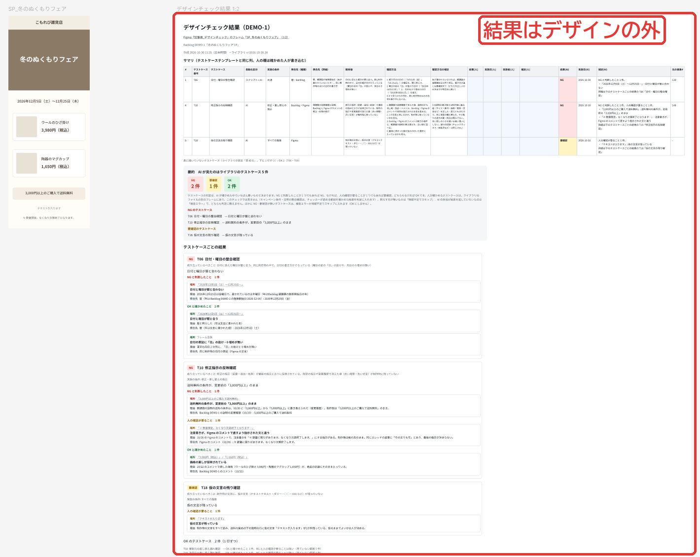
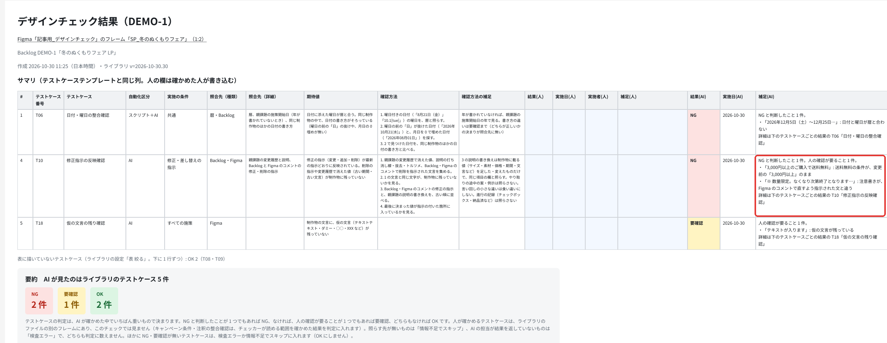
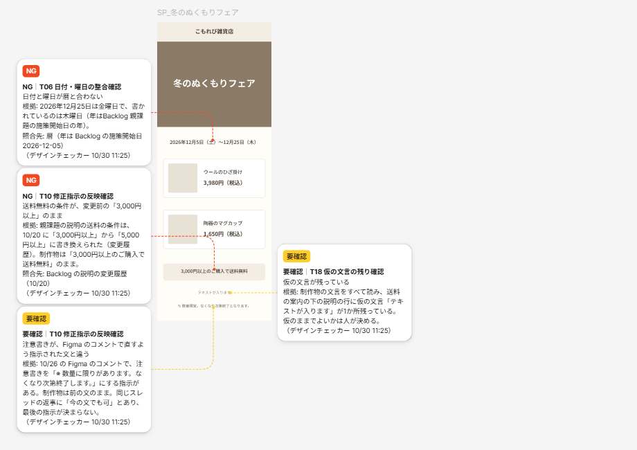
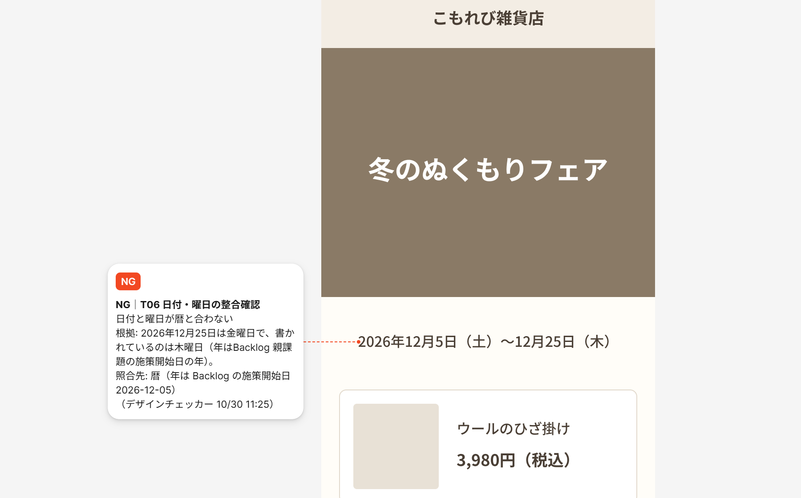
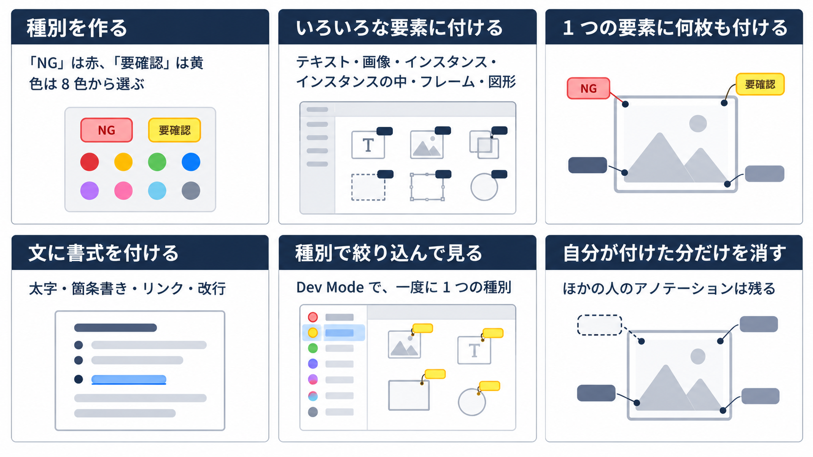
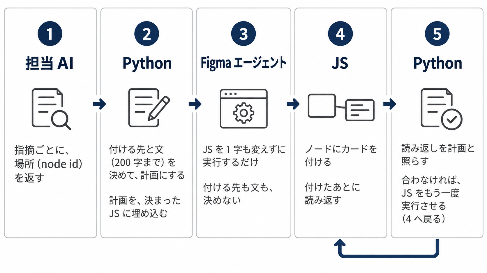

前回、Claude Code で作ったデザインチェックのスキルを、Figma エージェントで動かせるようにしました。

https://zenn.dev/akaringo1109/articles/figma-agent-skill-external-library

そのときは、チェックの結果をデザインの横に表として描いていました。
今回はこれをやめて、指摘を Figma のアノテーションにし、デザインの該当箇所に付けるようにしました。
デザイナーがふだん Figma で受け取るレビューと、同じ形で指摘が届きます。

この記事で分かるのは、次の 3 つです。判定の中身と、AI クレジットの細かい数字は書きません。

- 結果の表（As-is）と、アノテーション（To-be）の違い
- チェックの結果を、アノテーションのカードにするときの工夫
- Figma エージェントから、JS で Plugin API を動かしてアノテーションを扱う方法

## 結果の表をアノテーションに変えた理由

前回の作りでは、チェックしたフレームの右に、テストケースの表と作業の記録を描いていました。



*記事のために、架空の LP で再現した画面。表とカードは、チェッカーの実際のスクリプトで描いた*

表を見れば、どの項目が OK で、どれが NG かは分かります。
ただ、その指摘がデザインのどこの話かは、表の行から辿ることになります。



*表の行の場所は、文言を引用して書くだけ。デザインのどこかは、読む人が探す*

デザイナーとの定例で、この出し方を見直しました。
人がデザインをレビューするときは、ふつう別に表を作らず、直してほしい所にコメントやアノテーションを残します。
AI のチェックも、デザイナーがふだん受け取るレビューと同じ形で返したほうが、読んでから直すまでが短くなると考えました。

定例では、デザインの上に吹き出しを描く案、Figma のコメント、Figma のアノテーションの 3 つを比べました。
吹き出しやコメントは、デザインを動かしたり直したりすると、指摘の場所からずれることがあります。

アノテーションは、デザインのノード（文字・画像・フレームなどの要素）に説明を結びつける、Figma の標準の機能です。
文字や画像を指したまま、デザインを直しても付いてきます。

> With annotations, designers can communicate and connect key details directly to designs
>
> 訳: アノテーションを使うと、デザイナーは大事な詳細をデザインに直接結びつけて伝えられる。

https://help.figma.com/hc/en-us/articles/20774752502935

そこで、詳しい表は描かず、指摘をアノテーションで残すことにしました。
同じデザインに付けると、次のようになります。



*As-is と同じフレーム。カードは指摘した要素を点線で指す*

## チェック結果をアノテーションのカードにする工夫

表なら、何行でも並べられます。
アノテーションは 1 枚ずつデザインの上に出るので、多すぎても長すぎても、デザインのほうが読めなくなります。
人がレビューで残すときと同じく、直してほしい所に、短く付ける必要がありました。

### 付けるのは NG と要確認だけ

アノテーションの種別（カテゴリ）は「NG」（赤）と「要確認」（黄）の 2 つにして、OK の項目には付けません。
要確認は、AI だけでは決めきれず、人に見てほしいものです。
デザインの上には、直す所と、人が見る所だけが出ます。

### 1 枚を 200 字に収める文の組み立て

カードの文は、上から次の順に組みます。

- 1 行目は太字で「NG｜T06 日付・曜日の整合確認」の形（種別と、確かめる項目の番号・名前）
- 2 行目から、何が問題か・根拠・照らした先
- 最後に、署名「（デザインチェッカー 10/30 11:25）」

200 字を超えるときは文の切れ目で切って「…」を付け、項目の名前と「何が問題か」は切りません。

同じ指摘が何か所にもあるときは、最初の 1 か所だけを全文のカードにし、ほかは「同じ指摘 7 か所のうちの 1 つ」のような短いカードにします。
同じ指摘と見なすのは、項目だけでなく「何が問題か」の文まで同じときです（付録の「Plugin API とカードの文でつまずいた所」）。



*架空の LP の期間の行に付いた、NG のカード*

### カードが無い所を「OK」と読ませない

カードには、AI が場所を決めて判断できるものしか出せません。
表の頃は、AI が見られない項目にも、人が確かめた結果を書く欄がありました。

これは、「そこは割り切って『AI がチェックできることだけをチェックした』という形にしておくのがいい気がします。」と私が決めました。
人が確かめる項目は別のフレームに分け、チャットの報告に、AI が見た項目の数と、人が確かめる項目の置き場所を 1 行で出します。

### 2 回目のチェックでの付け直しと後片付け

2 回目のチェックでは、前回このチェッカーが付けた分だけを消して、付け直します。
表の頃のように、結果のフレームが回ごとに増えることはありません。
チャットで「チェックのアノテーションを消して」と頼めば、このチェッカーの分だけが消えます（見分け方と、その限界は付録）。

## Figma エージェントから JS でアノテーションを扱う方法

### Figma エージェントの JS の道具でできること

Figma エージェントは、Figma のファイルを開いた画面の中で、チャットで頼めるエージェントです。
道具の 1 つに、Figma の Plugin API（ファイルの中身を JavaScript で読み書きする API）を実行するものがあります。

https://help.figma.com/hc/en-us/articles/37998629035799-Work-with-the-Figma-agent-in-design-files

Plugin API には、種別を扱う `figma.annotations` と、ノードごとの `annotations` があります。
検証用に複製したファイルで、この JS の道具から直接動かして確かめたことは、次の 6 つです。



### 付ける先と文は Python が決める

アノテーションの操作そのものは、エージェントの道具でできます。
ただ、付ける先や文をエージェントに考えさせると、写し間違いや、隣のノードへの付け間違いが起こりえます。
私が一番気にしていたのも、「確実に指定した場所にアノテーションを貼れる仕様になっているかが気になっています。」という所でした。

そこで、**エージェントには付ける先も文も決めさせず、決まった JS を実行させるだけ**にしました。



1. 担当 AI（確かめる項目ごとに判定を受け持つ、別のエージェント）が、指摘ごとに場所（node id）を返す
2. Python（Figma エージェントの実行環境で動く）がその場所から、付ける先と文を決めて計画にし、ライブラリにある決まった JS に埋め込む
3. Figma エージェントは、その JS を 1 字も変えずに実行する（写し間違えると、行ごとの指紋〔文から計算した短いハッシュ〕が合わず、JS 自身が止まる）
4. JS はカードを付けたあとに読み返し、付いた先・種別・文の指紋を返す
5. Python が読み返しを計画と照らし、合わなければ JS をもう一度実行させる

ライブラリは、スキルの中身を置いた Figma のファイルで、前回の記事で作ったものです。
付いた先が計画どおりかは、こうして毎回確かめられます。
担当 AI が挙げた場所そのものが正しいかは確かめられませんが、これは表の頃も同じでした。

### 付けて読み返す JS

JS の芯の部分を、実物から抜き出して短くしました。
種別を用意し、もとからあるアノテーションを残したまま 1 枚足して、読み返します。
Figma エージェントの JS の道具では、最上位で `await` と `return` が使えます。

計画の値は Python が埋めるので、このままでは動きません。
実物は、前回このチェッカーが付けた分を先に消してから付けるので、もう一度実行しても同じカードが重なりません。

```js
// 種別「NG」（赤）と「要確認」（黄）。同じ名前の種別がファイルにあれば、色が違ってもそれを使う
const cats = [...await figma.annotations.getAnnotationCategoriesAsync()];
const cat = {};
for (const [name, color] of [['NG', 'red'], ['要確認', 'yellow']]) {
  let c = cats.find(x => x.label === name);
  if (!c) { c = await figma.annotations.addAnnotationCategoryAsync({ label: name, color }); cats.push(c); }
  cat[name] = c.id;
}

// 書き戻す形: 読むと label と labelMarkdown の両方が返るが、書くときは 1 つだけにする
const keep = a => {
  const o = {};
  if (a.labelMarkdown) o.labelMarkdown = a.labelMarkdown; else if (a.label) o.label = a.label;
  if (a.properties && a.properties.length) o.properties = a.properties;
  if (a.categoryId) o.categoryId = a.categoryId;
  return o;
};

// 付ける: もとからあるアノテーションを残したまま 1 枚足し、付いたものを読み返す
const n = await figma.getNodeByIdAsync('<付ける先の node id>');
n.annotations = [...n.annotations.map(keep), { labelMarkdown: '<Python が決めた文>', categoryId: cat['NG'] }];
const now = n.annotations;
return JSON.stringify({ id: n.id, text: now[now.length - 1].labelMarkdown, total: now.length });
```

`annotations` は配列ごと書き換える作りなので、1 枚足すときも、もとからある分を一緒に書き戻します。
このとき `keep` を通さないと失敗します（付録の「Plugin API とカードの文でつまずいた所」）。

## 通しのチェックで確かめた結果

検証用に複製した 7 件のファイルで、Figma エージェントに通しで 10 回チェックさせました。

- 付けた 69 枚は、すべて計画どおりのノード・種別・項目に付いた。計画と違うノードに付いたものは 0
- 判定は、出し方を変える前と同じだった
- 本番に上げた版を私が自分で回した回でも、カード 14 枚はすべて計画どおりのノードに付いた（このとき見つけた、カードの文の不具合は付録）
- 2 回目のチェックでは、前回の分を消して同じノードに付け直し、「消して」と頼むとこのチェッカーの分だけが消えた
- AI クレジットは、表を描く段がカードを付ける段に代わったぶん、1 回のチェックあたり 1 割強減った（6 件の平均）

## まとめ: AI のチェックも、人のレビューと同じ場所に返す

- **誰のためか**: デザイナーが、ふだん Figma で読むレビューと同じ形で、指摘をその場所で読める
- **何を変えたか**: 結果の表をやめ、NG と要確認だけを 200 字までのカードにして、指摘のノードに付けた
- **どう付けたか**: 付ける先と文は Python が決め、Figma エージェントは決まった JS で Plugin API を動かすだけ。付けたあとに読み返して、計画と照らす
- **何に気をつけるか**: カードが無い所を「全部 OK」と読ませない。人が確かめる項目は、別に示す

変えたのは出力だけで、チェックの中身はそのままです。
それでも結果が、デザイナーの見慣れた形で、直す場所に直接届くようになりました。
実際の制作物で使ってみて、使いにくければコメントなどに切り替えることも、定例で決めてあります。

## 付録: つまずいた所と、まだ残っている限界

ここまでの作りに至るまでにつまずいた所と、まだ残っている限界です。

:::details Plugin API とカードの文でつまずいた所
| つまずいた所 | 対処 |
| --- | --- |
| GROUP と BOOLEAN_OPERATION には付けられない（`annotations` が無い） | いちばん近い、付けられる親に付ける |
| 読み返すと `label` と `labelMarkdown` の両方が返り、そのまま書き戻すと「Only one of label or labelMarkdown should be given」で失敗する | 書き戻すときは、`labelMarkdown` があればそれだけ、無ければ `label` だけにする（上の JS の `keep`） |
| 長い文は切れず、「もっと見る」も出ない。長いカードはフレームの横をふさぎ、ほかのカードを遠くへ押し出す | 1 枚 200 字までにする |
| 文字色の項目で、2 枚のカードが実物と違う色を書いていた。表の頃の「同じ項目の指摘は 1 行にまとめ、1 件目の文を残す」作りのままで、ほかの色のノードのカードにも 1 件目の色が出ていた。カードを読んでノードを見ると色が食い違い、チェッカーの誤検知に見える | まとめるのは「何が問題か」の文まで同じときだけにする。表では目立たなかったまとめ方も、指摘をノードごとに付けると、そのノードの事実と合わなくなる |
| 非表示のインスタンスの中に付けた前回のカードが、1 枚だけ消え残った。Figma エージェントの道具では `figma.skipInvisibleInstanceChildren` が true で、`findAll` が中を見ていなかった | 付ける JS と消す JS の中でだけ false にし、終わったら元に戻す |
:::

:::details 設計者のメモを消さない見分け方
実際のファイルには、設計者が実装の指示として書いたアノテーションがあります（試したページでは 25 個のノードにありました）。
Plugin API の公式の例の消し方は `node.annotations = []` で、これだとノードのアノテーションが全部消え、設計者のメモまで消えます。

https://developers.figma.com/docs/plugins/api/Annotation

そこで、このチェッカーのカードを次の 3 つで見分け、それだけを外して、残りはそのまま書き戻すようにしました。
通しの 10 回のうち、設計者のメモがある 6 回とも、メモは 1 字も変わりませんでした。

- 種別が「NG」か「要確認」
- 1 行目が「NG｜T10」「要確認｜T13」の形
- 最後の行が「（デザインチェッカー 月/日 時:分）」の署名

```js
// このチェッカーのカードか: 種別・1 行目の形・最後の行の署名の 3 つで見分ける
const cname = a => (cats.find(c => c.id === a.categoryId) || {}).label || '';
const ours = a => {
  const t = String(a.labelMarkdown || a.label || '');
  return ['NG', '要確認'].includes(cname(a))
    && /^(NG|要確認)｜T\d{2,}/.test(t.replace(/^[\s*\\]+/, ''))
    && /（デザインチェッカー [^（）\n]*）\s*$/.test(t);
};

// 消す: このチェッカーのカードだけを外し、残りはそのまま書き戻す（frame はチェックしたフレーム）
const g = (n, k) => { try { return n[k]; } catch (e) { return undefined; } };  // ノードの種類によっては、無いプロパティを読むと例外になる
figma.skipInvisibleInstanceChildren = false;  // 非表示のインスタンスの中も見る（実物は、終わったら元に戻す）
for (const n of [frame, ...frame.findAll(x => (g(x, 'annotations') || []).length > 0)]) {  // フレーム自身に付いたカードも見る
  const as = g(n, 'annotations') || [];
  const rest = as.filter(a => !ours(a));
  if (rest.length !== as.length) n.annotations = rest.map(keep);
}
```

見分けは文の形によるので、カードに書き足すと、書き足した分ごと次の回に消えます。
逆に 1 行目や署名を消すと、チェッカーのカードと見なされずに残ります。
デザイナー向けの説明には、カードに書き足さず、返事は別のアノテーションかコメントで付けてほしいと書きました。
:::

### まだ残っている限界

- カードの置き場所は Figma が決めるので、隣にある設計者の指示書きの枠に重なることがある
- 担当 AI の場所の指定が粗いと、カードはフレーム全体に付く（69 枚のうち 1 枚）
- 表示を切っている人は見落とす。見るには Full か Dev のシートが要る（公式のヘルプ。最初の節のカード）
- 本物の Figma で書き込みが例外になったときの動きは、手元の代役でしか確かめていない

## Trellis のこと

Trellis は、福岡でホームページの制作と、AI による業務の自動化に取り組んでいます。
記事は Zenn と、Trellis のサイトのブログの両方に載せています。

https://trellis-grow.com/?utm_source=zenn&utm_medium=referral&utm_campaign=figma-agent-annotation-check&utm_content=card
