Claude Code のスキルは、MCP や API を通せば Figma のファイルも扱えます。
ただ、Figma に慣れたデザイナーのような非エンジニアには、黒い画面を開くこと自体が壁です。
そこで、Claude Code のスキルを、Figma の中のエージェント（Figma エージェント）で動かせるかを試しました。

結果、動きました。
スキルの字数の上限は、中身を Figma のキャンバスに並べて越えています。

福岡で AI による業務改善や自動化、Web 制作などに取り組んでいる Trellis です。

この記事で分かるのは、次の 3 つです。

- Figma エージェントの仕組みと、スキルをそのまま持ち込めない理由
- 中身を Figma のキャンバスに置いて動かす作り（実物のコードつき）
- Figma エージェントに実行させて分かった、つまずきやすい所

## 誰のために Figma の中で動かすのか

Claude Code（Anthropic のコーディングエージェント）のスキルは、手順書と、必要なときに読む決まりやスクリプトを、1 つのフォルダにまとめたものです。

エンジニアは、ターミナルで Claude Code を開き、MCP（エージェントに外の道具をつなぐ仕組み）や API で Figma につないで使えます。
スキルの最新版も、Git で取ってくれば済みます。

ところが、スキルを一番使ってほしいのは、Figma で制作物を作っているデザイナーさんでした。
私はデザイナーさんの業務を支援していて、スキルを作るのも、その業務を軽くするためです。

デザイナーさんのふだんの作業場所は Figma で、黒い画面や Git には慣れていません。
使うたびにターミナルを開き、最新版を取ってくるだけで、手が止まります。

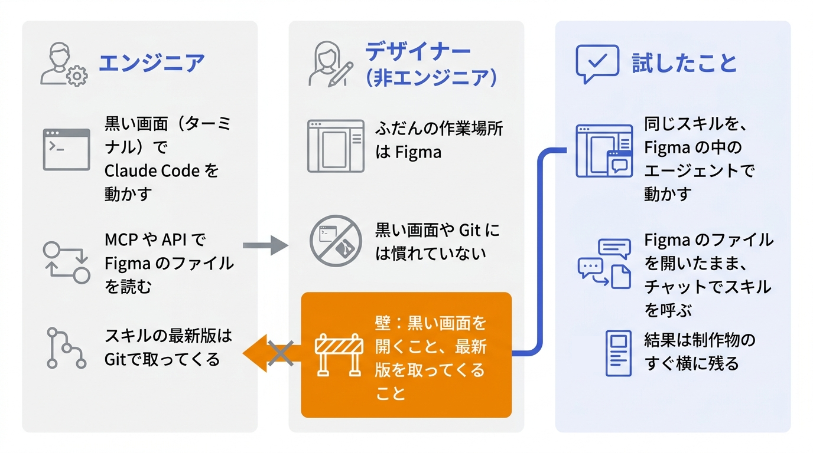

デザイナーさんとの定例をきっかけに、Figma エージェントで動かす案が出ました。
定例では、コーディングの決まりをスキルにして Figma エージェントに渡し、決まりから外れた所の指摘と直しまでさせる例を見せてもらいました。
結果から対象のフレームへ飛べるので、確かめて直すまでが Figma の中で済みます。

私のスキルは Claude Code と Git が前提で、入れるところから手間がかかっていました。
Mac では `.` で始まるフォルダを扱いにくい、という声もありました。

Figma の中で完結すれば、デザイナーさんはファイルを開いたまま、チャットからスキルを呼べます。
結果も制作物の横に残り、制作物とチェックの記録が Figma の上でつながります。
そのほうが扱いやすい、という声も定例で出ました。

私のスキルも Figma エージェントで動かせるか、試してみることにしました。

題材にしたのは、私が Claude Code で作って業務で使っている、制作物を指示と照らして確かめるスキルです。
手順書と決まりのファイルのほかに Python のスクリプトを持つ、大きめのスキルです。
判定の中身と業務での精度は、この記事では書きません。

これを Figma エージェントで動かすには、まず Figma エージェントで何ができるかを知る必要がありました。

## Figma エージェントとは

Figma エージェントは、Figma のファイルを開いた画面の中で話しかけるエージェントです。
チャットで頼むと、ファイルの中身を読み取ってキャンバスに描いたり、裏の実行環境でシェルや Python を動かしたりできます。

> In Figma Design, you can collaborate with an agent to generate and remix designs, automate busywork, and get design feedback.
>
> 訳: Figma Design では、エージェントと一緒にデザインを作ったり作り直したり、細かな作業を自動にしたり、デザインへの意見をもらったりできる。

https://help.figma.com/hc/en-us/articles/37998629035799-Work-with-the-Figma-agent-in-design-files

:::message
2026年10月23〜25日に、Figma（Web 版）のエージェントで確かめた内容です。「公式」と書いたもの以外は私の観察で、仕様ではありません。今後変わる可能性があります。
:::

Figma エージェントは、チャット・スキル・実行環境の 3 つに分けて考えると分かりやすいです。

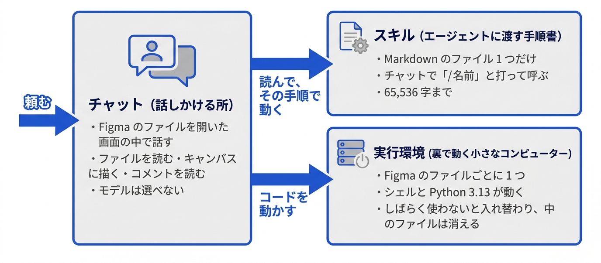

| 要素 | 確かめたこと |
| --- | --- |
| チャット | ファイルを開いた画面の中で話す。新しいチャットは既定で「共有チャット」（ファイルのほかの利用者にも見える）で、プライベートにも切り替えられる。モデルを選ぶ欄は無い |
| スキル | 登録できるのは Markdown 1 ファイルだけ（公式）。frontmatter の name と description がそのまま名前と説明になり、`/名前` で呼ぶ。エージェントに最初に届かない続きは、頼めば読んだ |
| 実行環境 | Figma のファイルごとに 1 つの Linux の microVM（軽い仮想マシン）。Python 3.13.5 が動き、試したライブラリのうち入っていたのは PIL だけで、pip は無かった。外へのネットは届いた。しばらく使わないと入れ替わり、中のファイルは消える。私の試しでは 5 分半では同じ VM、11 分では別の VM だった |
| 道具 | Figma の Plugin API（ファイルの中身を JavaScript で読み書きする API）を実行する道具、シェル、Web 検索、コメントを読む道具、別のエージェントに任せる道具 |

実行環境の中身は、チャットで小さな Python を書き出して実行させ、その出力で確かめました。
次の画面がそのときの返事です。

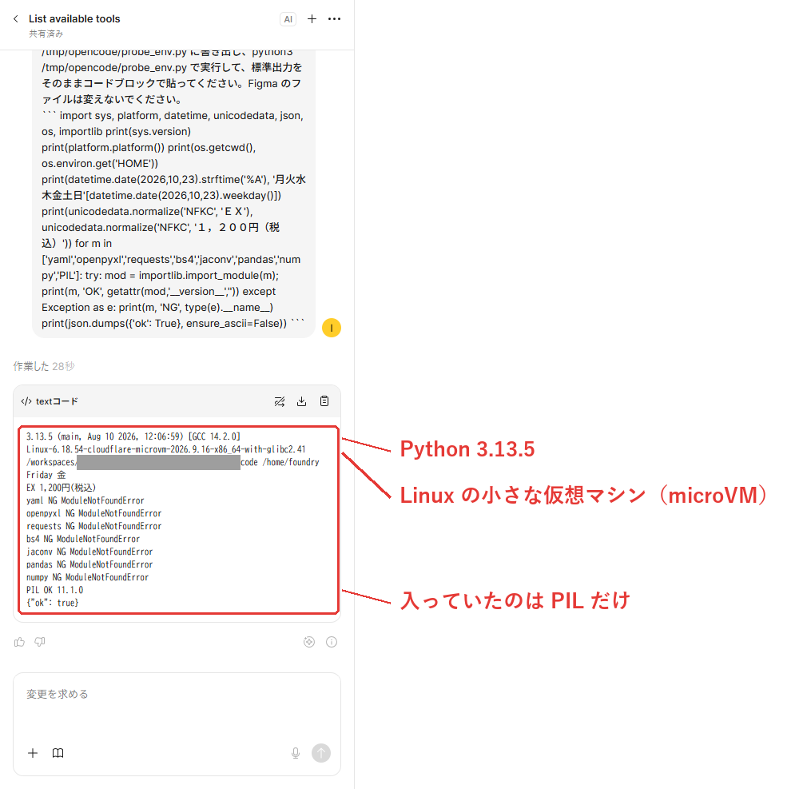

*2026年10月23日の確かめ。作業場所のフォルダの ID は灰色で伏せた*

使える道具は、エージェントの説明を鵜呑みにせず、実際に動かして確かめています。
題材のスキルは Python のスクリプトを持つので、まずスキルに埋めた Python が動くかを試しました。

スキルに Python を埋めて登録すると、エージェントはそのコードをファイルに書き出して実行しました。
書き出したファイルの SHA-256 は手元のものと一致し、出力も手元で動かしたものと同じでした。

**スキルに Python を埋めておけば、Figma の中で決まった処理を動かせる**、という手応えはここで得ています。
次に確かめたのは、Claude Code のスキルの手順と決まりを、全部 1 つのスキルに収められるかです。

## Claude Code のスキルを 1 つの Markdown に収める壁

### Markdown 1 ファイルという制約

Claude Code のスキルは、手順書（SKILL.md）と、必要に応じて読む決まりやスクリプトのファイルを、1 つのフォルダにまとめたものです。
題材のスキルも、手順書・決まり・Python のファイルに分かれています。

Figma のスキルは、この形のままでは登録できません。
Figma の公式ヘルプには、スキルは Markdown 1 ファイルで、部品のフォルダには対応しないと書かれています。

> The skill must be a single Markdown (`.md`) file that follows the Agent Skills specification. Custom skills *do not* support optional directories such as `scripts/`, `references/`, and `assets/`, which might sometimes be packaged with an agent skill.
>
> 訳: スキルは Agent Skills の仕様に沿った Markdown 1 ファイルでなければならず、`scripts/`・`references/`・`assets/` のような任意のフォルダには対応しない。

https://help.figma.com/hc/en-us/articles/40283639496599-Create-and-manage-custom-skills-in-Figma

手順も決まりも Python も、すべて 1 つの Markdown にまとめることになります。

### 字数とバイト数の 2 つの上限

1 つにまとめようとして、最初に行き詰まったのは機能ではなく字数でした。
スキルには、字数とバイト数の 2 つの壁があります。
単位が混ざるので、書き分けておきます。

| 項目 | 大きさ |
| --- | --- |
| 指示として登録できる上限 | 65,536 字 |
| エージェントに最初に届く量 | 約 51,000 バイト（続きは頼めば読む） |
| 題材のスキルの手順と決まり | 72,943 バイト（UTF-8） |
| 圧縮してスキルに入れた版 | 59,375 字（上限まで残り約 6,100 字） |
| 組み替えたあとの起動役のスキル | 約 6,500 字 |

Claude Code のスキルの手順と決まりだけで、エージェントに最初に届く量を超えています。
1 つのスキルにまとめた版も 64,369 字あり、登録できる上限の手前まで来ていました。

### 圧縮で収めた版の行き詰まり

最初は圧縮で乗り切ろうとしました。
手順の細部を削り、Python は要る関数だけに絞りました。
この版は Figma の中で最後まで動き、手元の Claude Code で回したときと同じ結果を出しました。

圧縮した版が通ったあと、私は「今の形は字数を圧縮しただけで、テストケースが増えると対応できない」と判断しました。
手順や決まりを足すたびに、何かを削ることになります。

必要なのは、中身をスキルの外に置く仕組みでした。
次に考えたのは、スキルの外のどこに置けば、Figma エージェントから読めるかです。

## スキルの中身を Figma のキャンバスに置く

### 置き場所に求めた条件

置き場所に求めた条件は、次の 3 つです。

- Figma エージェントから、続けて読めること
- 鍵やサーバーを、新しく用意しなくてよいこと
- デザイナーが、Figma の上でそのまま読んで直せること

検討した次の 3 つの案は、どれもこの条件に合いませんでした。

- **スキルのフォルダに部品を置く**: 実行環境の中のスキルの場所には、SKILL.md 以外のファイルも書き込めました。しかし新しいチャットを開くと、その場所が SKILL.md だけで作り直されます
- **コネクターで外のサーバーにつなぐ**: Figma エージェントのコネクターは、リモートの HTTPS の MCP サーバー（エージェントに外の道具をつなぐ仕組み）に対応しています。ただ、手順を置くためのサーバーを別に用意する必要があります
- **課題管理ツールの Wiki や外の Web に置く**: 読み込ませるには鍵が要り、鍵を付けなければ中身を公開することになります

### 置き場に選んだ Figma のテキスト

置き場所に選んだのは、**Figma のファイルそのもの**です。
エージェントがいつもの Figma の道具で読めて、利用者がもともと持っている Figma の権限で済むので、新しい鍵もサーバーも要りません。

ファイルの中でデータを持たせる場所にも、いくつか候補がありました。
pluginData と sharedPluginData は、Plugin API でノードにデータを持たせる置き場です。
試した結果は次のとおりです。

| 候補 | 結果 |
| --- | --- |
| pluginData | ページの JS からは書けない（プラグインの ID が要る） |
| sharedPluginData | 1 件あたり 100kB の上限がある（分ければ置けるが、人が Figma の上で読めない） |
| テキストのノード | 50 万字を書いて読み返しても、sha256 が一致した |

テキストのノード（キャンバスに置く文字の要素）がいちばん素直で、人が Figma の上でそのまま読めるのも決め手になりました。

### キャンバスに並べたライブラリ

スキルの中身を置いた Figma の下書きのファイルを、この記事ではライブラリと呼びます。
Figma の標準のライブラリの機能とは別のものです。

ライブラリでは、Claude Code のスキルのフォルダの中身を、ファイルごとにカードにしてキャンバスに並べました。
カードの名前がファイルの名前になり、カードの中の文字がファイルの中身になります。

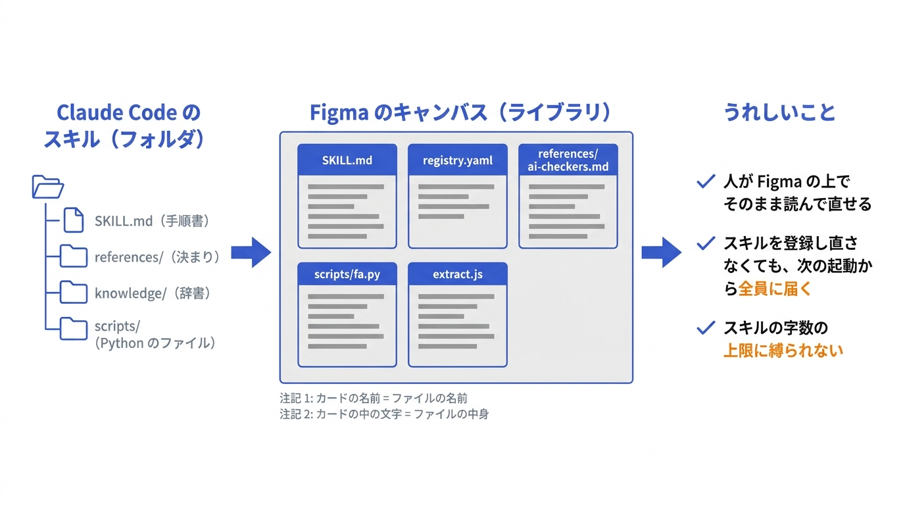

実際のライブラリを俯瞰すると、次のようになります。
左から「はじめに」「手順」「表」「決まり」「辞書」「スクリプト」「Figma の部品」の 7 つの枠が並び、Claude Code のスキルのフォルダの区切りをそのまま映しています。
上の名札は、記事のために書き足したものです。

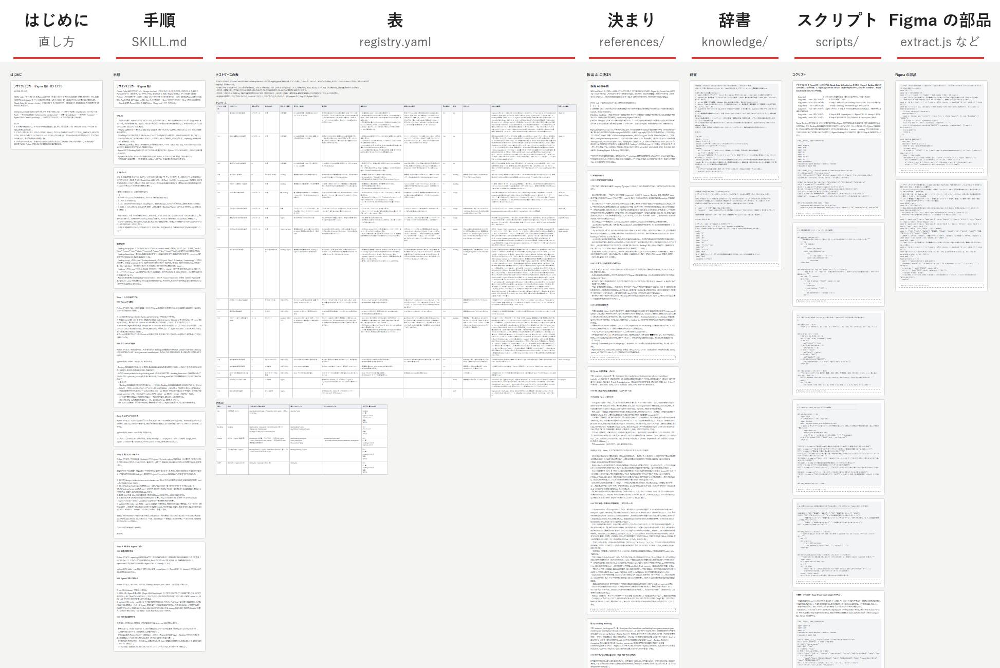

*2026年10月24日の版。文字が読めない大きさまで縮めた*

並べ直した最初の版では、7 つの枠にカード 43 枚と表 2 つがあり、テキストのノードは 388 個・27 万字でした。
スキルの上限の 4 倍を超える量ですが、キャンバスにはまだ余裕があります。

カードの作りは次のとおりです。

- カードは 1 つのフレームで、レイヤー名がそのままファイルのパスになっている（`scripts/fa.py` など）。1 つのファイルを何枚かのカードに分けるときは、`scripts/fa.py#2` のように `#` 以降に番号を付ける。この番号は人が見分けるためのもので、つなぐ順はノードの並び順で決まる
- カードの中のテキストはレイヤー名で役割を分ける。`見出し1`・`見出し2` は Markdown の見出し、`本文` と `コード` はそのままの文字、`説明` は Python の docstring になる
- 起動役はカードの中のテキストをノードの並び順につないで、レイヤー名のパスにファイルとして書き出す。カードやテキストの重なりの順を入れ替えると、書き出す順も変わる

カードを 1 枚、寄って見ると、次のような見た目です。
Python のファイルを置いたカードの上のほうで、上の文が `説明`（書き出すと docstring になる）、灰色の枠が `コード` のテキストです。

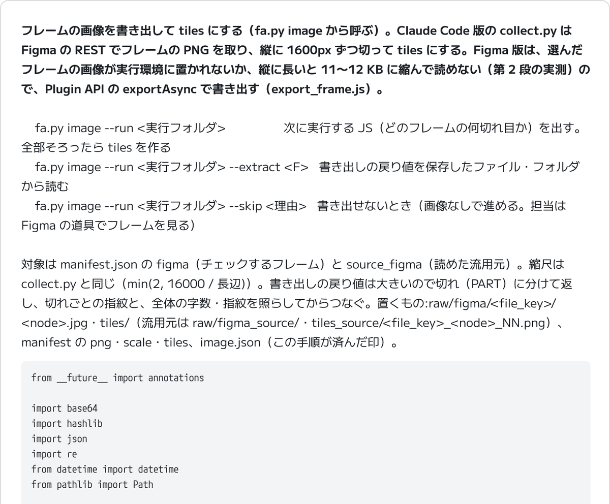

*フレームの画像を書き出す処理のカード。Figma の画面から、カードの上のほうだけを切り出した*

コードも含めて、人が Figma の上でそのまま読めます。
このライブラリを読み、実行環境にファイルとして戻すのが、起動役のスキルです。

## 小さなスキルから中身を動かす仕組み

### 起動役のスキルの全体の流れ

起動役は、ライブラリを読み、実行環境にファイルを戻して、Python を起動するだけの小さなスキルです。

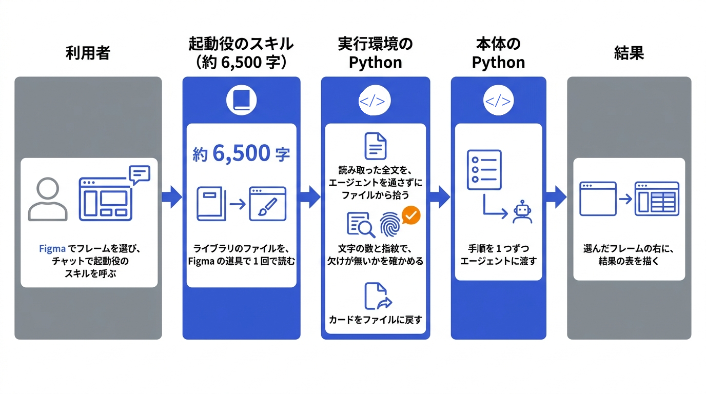

利用者はチェックしたいファイルを開いてフレームを選び、スキルを送ります。
結果の表は、チェックしたフレームの右隣に描かれます。
デザイナーから見ると、次のような画面になります。

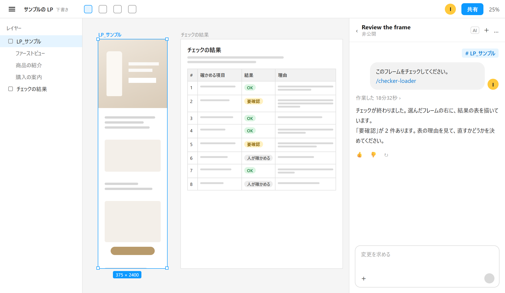

*記事のために作った再現の画面。配置は実際の Figma エージェントの画面に合わせ、制作物・結果の中身・スキルの名前はダミーにした*

ライブラリは別のファイルですが、エージェントの JS の道具は、実行先のファイルを file key（Figma のファイルごとの ID）で指定できます。
起動役のスキルにライブラリの file key を書いておけば、別のファイルの中身を読めます。

なお、利用者には、ライブラリのファイルを見る権限と、結果を描くファイルを編集できる権限（Full のシートと編集の権限）が要ります。

起動役のスキルがすることは、次の 2 つです。

1. Figma の JS の道具で、ライブラリの枠を 1 回で読む
2. 決まった Python を実行環境に書いて動かす。この Python が読み取りの結果を探して照らし、カードを元のファイルに戻してから、スキルの本体を起動する

### 戻り値を書き写させない理由

この作りで大事だったのは、**戻り値をエージェントに書き写させない**ことです。
道具の戻り値が 5〜8 万バイトを超えると、エージェントの画面では途中が省略されます。

ただし、全文は実行環境のファイルに残っていて、その場所もエージェントから見えています。
この量の戻り値を書き写させれば、どこかで欠けたり写し間違えたりします。
そこで JS は読んで返すだけにし、全文は Python が実行環境のファイルから直接拾う作りにしました。

### ライブラリを 1 回で読む JS

枠の中の名前と文字を木の形のまま JSON にし、テキストの数と指紋を添えて返します。
指紋には FNV-1a という軽いハッシュを使い、JS と Python の両方で同じ計算をして照らします。
前後を印の文字で挟むのは、あとで Python が戻り値を探し出せるようにするためです。

```js
// ライブラリの枠を読む（読むだけ）。枠の中の名前と文字を、木の形のまま返す
const ID = '<ライブラリの枠の node id>';
const g = (x, k) => { try { return x[k]; } catch (e) { return undefined; } };
let root = await figma.getNodeByIdAsync(ID);
if (!root) {
  for (const p of figma.root.children) {  // ID で見つからなければ、枠の名前で探す
    await p.loadAsync();
    root = p.findOne(n => n.type === 'FRAME' && n.name === 'checker-library');
    if (root) break;
  }
}
if (!root) return 'LIB-MISSING ' + ID;
let h = 2166136261, n = 0;
const walk = x => {
  const o = { id: x.id, type: x.type, name: x.name };
  if (x.type === 'TEXT') {
    o.characters = x.characters; n++;
    for (const ch of x.characters) { h ^= ch.codePointAt(0); h = Math.imul(h, 16777619) >>> 0; }
    h ^= 1; h = Math.imul(h, 16777619) >>> 0;  // テキストの区切りも指紋に入れる
  }
  const c = g(x, 'children');  // ノードの種類によっては、無いプロパティを読むと例外になる
  if (c) o.children = c.map(walk);
  return o;
};
const tree = walk(root);
return 'LIB-BEGIN' + JSON.stringify({ at: new Date().toISOString(), root: tree, check: { texts: n, fnv: h } }) + 'LIB-END';
```

この JS には file key が出てきません。
file key は JS を実行する道具に引数として渡します。
そのとき JS の中の `figma.root` は、渡したライブラリのファイルを指します。

### 戻り値を照らしてファイルに戻す Python

起動役のスキルには、次の Python を 1 文字も変えずに書き出して実行するよう書いてあります。
この Python がすることは、次の 3 つです。

- 今のチャットの作業場所に残った道具の戻り値を、新しい順に探す
- JS と同じ順にテキストをたどって、テキストの数と指紋を照らす
- カードの中のテキストをつないでレイヤー名のパスに書き出し、スキルの本体を起動する

実物から名前を短くし、作業場所の ID の取り方を省いた抜粋です。

:::details 戻り値を照らしてファイルに戻す Python（抜粋、約 65 行）
```python
import glob, json, os, re, subprocess, sys
R, W = '/tmp/lib/', '/workspaces/'
ws = '<今のチャットの作業場所の ID>'  # 実物は /workspaces/<ID>/... の形の PWD から取る

# 今のチャットの作業場所に残った道具の戻り値を、新しい順に見る
files = glob.glob(W + ws + '/sessions/**/tool-output/*', recursive=True) \
      + glob.glob('/tmp/sbox-streams/' + ws + '/**/*', recursive=True)
lib = None
for f in sorted((f for f in files if os.path.isfile(f)), key=os.path.getmtime, reverse=True):
    t = open(f, encoding='utf-8', errors='replace').read()
    i = t.rfind('LIB-BEGIN')  # 印の文字は、ライブラリの本文に書かない
    if i < 0:
        continue
    s = t[i + len('LIB-BEGIN'):t.find('LIB-END', i)]
    for _ in range(3):  # 戻り値が JSON の文字列としてもう一段包まれていることがある
        try:
            lib = json.loads(s)
            break
        except ValueError:
            try:
                s = json.loads('"' + s + '"')
            except ValueError:
                break
    if isinstance(lib, dict):
        break
if not isinstance(lib, dict):
    sys.exit('ライブラリがまだ読めていません。手順 1 の JS を実行してから、もう一度実行してください')

# JS と同じ順でテキストをたどって数と指紋を照らし、レイヤー名がパスの枠をカードとして集める
h, n, cards, todo = 2166136261, 0, [], [lib['root']]
while todo:
    x = todo.pop(0)
    if x.get('type') == 'TEXT':
        n += 1
        for ch in x.get('characters') or '':
            h = ((h ^ ord(ch)) * 16777619) & 0xFFFFFFFF
        h = ((h ^ 1) * 16777619) & 0xFFFFFFFF
    if x.get('type') == 'FRAME' and re.fullmatch(r'[\w.\-/]+\.(md|py|yaml|js)(#.*)?', x.get('name') or ''):
        cards.append(x)
    todo[:0] = x.get('children') or []
if [n, h] != [lib['check']['texts'], lib['check']['fnv']]:
    sys.exit('読み取りが欠けています。手順 1 の JS をもう一度実行してください')

# カードの中のテキストを上から順につなぎ、レイヤー名のパスに書き出す
out_files = {}
for c in cards:
    out, ts, todo = [], [], list(c.get('children') or [])
    while todo:
        x = todo.pop(0)
        ts += [x] if x.get('type') == 'TEXT' else []
        todo[:0] = x.get('children') or []
    for p in ts:
        role, s = p.get('name'), p.get('characters') or ''
        if role in ('見出し1', '見出し2'):
            out.append('#' * int(role[-1]) + ' ' + s)
        elif role == '説明':
            out.append('"""' + s.replace('\\', '\\\\').replace('"""', '\\"\\"\\"') + '\n"""')
        elif role in ('本文', 'コード'):
            out.append(s)
    if out:
        out_files.setdefault(c['name'].split('#', 1)[0], []).append('\n\n'.join(out))
for path, parts in out_files.items():
    os.makedirs(os.path.dirname(R + path), exist_ok=True)
    open(R + path, 'w', encoding='utf-8', newline='\n').write('\n\n'.join(parts).rstrip('\n') + '\n')
sys.exit(subprocess.call([sys.executable, R + 'scripts/fa.py', 'start']))
```
:::

テキストの数か指紋が合わなければ、処理を止めて、読み直すよう促します。
作業場所はチャットごとに分かれているので、前のチャットで読んだ古いライブラリは拾いません。
同じチャットで読み直したときは、新しいほうを使います。

ただし、同じチャットで今回の読み取りが失敗し、前の回の読み取りが残っていれば、そちらを拾う可能性はあります。
指紋が照らすのはテキストの中身だけで、どの回の読み取りかまでは見ていないためです。

なお、読み取りの結果が置かれる場所（`tool-output` や `/tmp/sbox-streams`）は、私が実行環境の中で見つけたもので、公式の仕様ではありません。
変わったときは、この探し方を直すことになります。

:::message alert
カードの名前をそのままパスに使っていて、名前の検査も緩い（`..` を含む名前も通る）ので、ライブラリを編集できる人は、利用者の実行環境で動くコードを書き換えられます。ライブラリは、編集できる人を保守の人に絞る前提です。
:::

### 手順を 1 つずつ出す Python

ファイルに戻ったあとは、スキルの本体の Python が、エージェントに手順を 1 つずつ渡していきます。
手順書を一度に全部渡していたころは、エージェントが手順を飛ばしたり、いくつかを勝手にまとめたりしがちだったためです。

`fa.py` は、ライブラリのカードから書き出されたスキルの本体の Python です。
`fa.py next` を実行するたびに、Python が次の手順を 1 つだけ出します。
エージェントはその手順だけをして、出力の最後の行に書かれたコマンドで、また `fa.py next` を実行します。

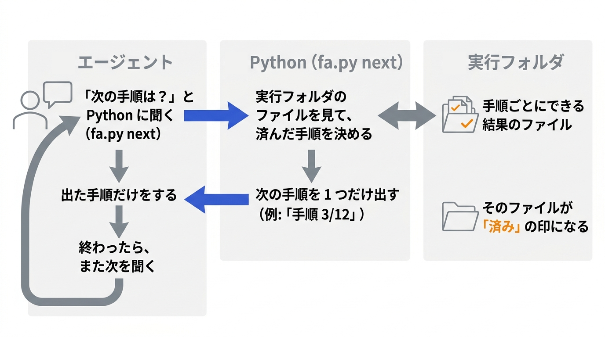

起動役のスキルには、くり返し方をこう書いています。

```markdown
「=== 手順 1/… ===」が出たら、その手順だけをする。手順が終わるたびに、出力の最後の行のコマンド（fa.py next）を実行して次の手順を出す。「利用者に報告する」の手順まで、これをくり返す。
```

どの手順まで済んだかは、エージェントの自己申告ではなく、実行フォルダにできたファイルをもとに Python が決めます。
済みの印のファイルの多くは、その手順の Python が自分の検査を通ったときに書き出すものです。
実物から、手順をいくつか省いた抜粋です。

```python
def plan(run):
    """手順の並びと、済んだかどうか。済みは実行フォルダのファイルで決める"""
    fd = run / "findings"
    return [("extract", "Figma から読む", extracted(run)),
            ("collect", "実行フォルダを作る", (run / "manifest.json").exists()),
            ("check", "スクリプトの所見", (fd / "script.json").exists()),
            ("delegate", "担当 AI に任せる", all((fd / f"{a['id']}.ok").exists() for a in agents())),
            ("table", "結果の表を作る", (run / "report.json").exists()),
            ("draw", "結果を Figma に描いて照らす", (run / "verify.ok").exists()),
            ("report", "利用者に報告する", False)]


def cmd_next(args):
    run = Path(args.run)
    s = plan(run)
    i = next((n for n, x in enumerate(s) if not x[2]), len(s) - 1)  # 最初の済んでいない手順
    sid, title, _ = s[i]
    print(f"=== 手順 {i + 1}/{len(s)}: {title} ===  （済み: {'・'.join(x[0] for x in s[:i]) or 'なし'}）")
    print(step_text(run, sid))  # ライブラリの手順書から、その手順の節だけを出す
    if sid != "report":
        print(f"--- この手順が終わったら: python3 {FA} next --run {run}")
```

`step_text` が出す各手順の節も、ライブラリのカードにあります。
次は「担当 AI に任せる」の手順の節です。

担当 AI は、確かめる項目ごとに判断を受け持つ別のエージェントです。
この節には、エージェントが打つコマンドと、してはいけないことが書いてあります。
この節を直したいときは、Figma の上でこのカードの文字を直します。

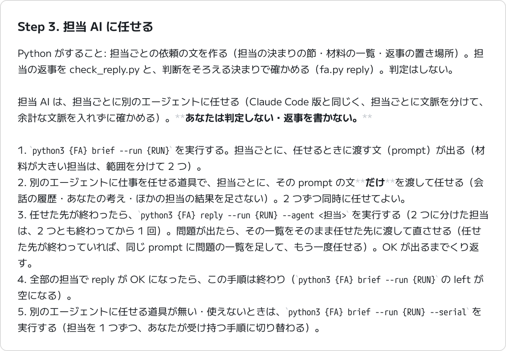

*手順書のカードの 1 枚（2026年10月24日の版）。見出しの番号は手順書の中の番号*

1 つずつ出す形にしてからは、エージェントが出た順に進みやすくなりました。

## スキルを登録し直さない直し方

中身をキャンバスに置いていちばん良かったのは、直すたびにスキルを登録し直さなくていいことです。
ライブラリを直せば、次の起動から全員が新しい中身で動きます。

次の画面は、ライブラリに足した確かめる項目が、スキルを登録し直さずに結果の表に出たところです。


*ライブラリに足した項目の行（2026年10月24日）。名前の一部を灰色で伏せた*

- 確かめる項目をライブラリに足すと、担当と結果の表の行が増えた
- 不具合の直しを 3 つと、ライブラリを読む回数を減らす改修を、どれもスキルを登録し直さずに届けた
- 担当 AI の決まりのカードを Figma の上で 1 か所直すと、次のチャットの結果にそのまま出た

AI だけで判断する項目なら、Python を書かずに足せます。
表に 1 行と、決まりの文の節を 1 つ足すだけです。
そのため、文面はデザイナーが書き、ライブラリへ入れる作業だけを保守の人が受け持つ、という分け方もできます。

直し方は、ライブラリの先頭の「はじめに」のカードに書いておきました。

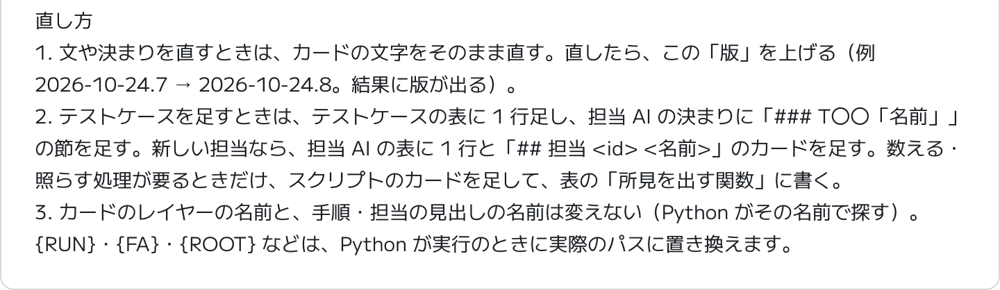

*「はじめに」のカードのうち、直し方の部分。人が Figma の上で読んで直すための説明*

中身の大元は Figma のライブラリで、手元の元ファイルは、組み直すためと履歴のために持っています。
Figma の上で直した文は、元ファイルに取り込んでから組み直します。

## Figma エージェントに実行させて分かったこと

Claude Code のスキルを Figma エージェントに実行させると、Claude Code では起きないつまずきがいくつもありました。
どれも、試しては直すくり返しの中で見つけたものです。

試しては直すくり返しは、ブラウザの中の Figma エージェントとの対話を Claude Code に任せて回しました。
その進め方は、別の記事に書いています。

https://zenn.dev/akaringo1109/articles/browser-profile-handoff-agent

| 起きたこと | 対処 |
| --- | --- |
| チャットに貼ったコードが崩れる | コードはチャットに貼らず、スキルかライブラリに置く |
| JS の道具に渡せるコードは 2 万字まで | 描く JS を 1 万 7 千字以下に分ける |
| 長い戻り値は画面で省略される | 全文は Python がファイルから拾う（上の「戻り値を書き写させない理由」） |
| 前のチャットの読み取りを拾ってしまう | 今のチャットの作業場所と、実行フォルダを作ったあとのファイルだけを見る |
| 返事を待つあいだに実行環境が入れ替わる | ライブラリを読むところからやり直し、決めたことはチャットから拾う |
| スキルのフォルダに置いたファイルが、新しいチャットで消える | 部品はスキルのフォルダではなくライブラリに置く（上の「置き場所に求めた条件」） |

### チャットに貼ったコードの崩れ

チャットの入力欄は、入力した文を Markdown として解釈します。
`_` `*` `[` `\` の前に `\` が足され、コードブロックで囲んでも同じでした。
そのため、コードはチャットに貼らず、スキルかライブラリに置いています。

### JS の道具に渡せる長さの上限

結果の表を描く JS が 3 万 3 千字になり、エージェントが道具に渡せずに止まりました。
エージェントの返事では、JS を実行する道具に渡せるコードは最大 2 万字です。
描く JS を 1 万 7 千字以下に分けると通りました。
途中の材料はページに隠した一時のフレームに置き、次の JS が読んでから消しています。

### 前のチャットに残った読み取り

同じファイルのチャットは、しばらく同じ VM を使い回します。
そのため、前のチャットで読んだ古い読み取りを、次のチャットで使ってしまったことがありました。
いまは、今のチャットの作業場所の読み取りだけを見ること、実行フォルダを作った時刻より前のファイルは使わないことを、Python の側で決めています。

### 返事を待つあいだの実行環境の入れ替わり

利用者に質問して返事を待つあいだに VM が入れ替わると、実行フォルダが消えます。
そこで起動役に、「手順のファイルが無いと出たら、ライブラリを読むところからやり直す。前に決めたことはチャットから拾い、聞き直さない」と書きました。

13 分 46 秒あけて続きを送った回では、「実行環境が入れ替わったので、ライブラリを読むところからやり直します」と出て、聞き直さずに最後まで通りました。

## まとめ: 中身を詰めずに外へ出すという解き方

Figma に慣れた人が、黒い画面を開かずに Claude Code 相当のスキルを使えるかを試しました。
Figma の中だけで、Claude Code のスキルと同じ手順を最後まで動かせました。
やったことと分かったことを、まとめます。

- **誰のためか**: 黒い画面や Git に慣れていないデザイナーが、Figma のファイルを開いたまま、チャットからスキルを呼べる
- **どう動かしたか**: スキルは起動役だけにし、中身は Figma のキャンバスのライブラリに置いた。起動役がライブラリを読んでファイルに戻し、Python が手順を 1 つずつ出す
- **何が良かったか**: スキルの字数の上限に縛られない。ライブラリを直せば、登録し直さずに全員に届く。文の直しはデザイナーとも分け合える
- **何に気をつけるか**: 戻り値はエージェントに書き写させない。コードはチャットに貼らない。実行環境は消える前提で、やり直せる作りにする

試しに使ってもらったデザイナーさんからは、「結果がフレームの横に出るので、確かめたらそのまま直せる」という声をもらいました。

字数の上限に当たったとき、最初は詰め方を工夫しました。
うまくいったのは、詰め込むのをやめて、中身を人が読んで直せる場所に出したときでした。
今回はそれが Figma のキャンバスで、使う人がふだん見ている場所でもありました。

スキルを Markdown 1 ファイルで受け取るほかのエージェントでも、外のファイルを読む道具とコードを動かす場所さえあれば、同じ形は使えるはずです。

### まだ残っている限界と次に決めること

- 実行環境の中のファイルの置き場所は、公式の仕様ではありません。変わったら、Python の探し方を直します
- モデルを選べません。性能の低いモデルに替わっても、利用者の側で防ぐ手段がありません
- 1 回に 11〜27 分かかります。使ってもらったデザイナーさんからも「急ぎのときは待てない」と言われました。圧縮して 1 つのスキルに入れた版は 6 分前後でした。読む材料と描く結果が増えたためとみていますが、処理ごとには測っていません
- Figma の上で人が直した文は、手元の元ファイルに取り込まないと、次にライブラリを書いたときに上書きされます

次に決めるのは、本番の置き場所です。
ライブラリをどのチームのファイルに置き、編集できる人を誰に絞るか。
どちらもまだ決めきれていません。

## Trellis のこと

Trellis は、福岡でホームページの制作と、AI による業務の自動化に取り組んでいます。
記事は Zenn と、Trellis のサイトのブログの両方に載せています。

https://trellis-grow.com
