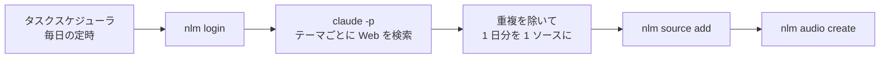

私は毎日、追いたいテーマのニュースを Gemini Notebook（旧 NotebookLM）の音声解説で聴いています。
PC で動かす自作の仕組みです。
コンサルティング会社で AI 導入をリードしながら、福岡の Trellis で AI による業務改善・自動化を担当している伊藤です。

2026 年 10 月下旬に、Gemini のチャットに「@Gemini Notebook」が入り、ノートブックを操作できるようになりました。
これとスケジュールで、PC 無しで回せるか試しました。
音声解説はチャットから作れず、予約からソースを足せたのも 2 回中 1 回でした。

**この記事で分かること**

- @Gemini Notebook で、Gemini のチャットから頼めることと、頼めないこと（実際の画面つき）
- Gemini のスケジュールで、毎日ソースを貯めようとした設定と、その結果
- 自作の仕組みを Gemini に寄せられるか（いまの結論）

料金プランの違いと、スマホのアプリでの操作は扱いません。

:::message
2026 年 10 月 27〜28 日に、Web 版の Gemini と Gemini Notebook を、Google Workspace のアカウントで試した結果です。
:::

## 自作のポッドキャストを置き換えたい理由

### Gemini Notebook とは

Gemini Notebook は渡した資料（ソース）をもとに要約や質疑をしてくれる Google の AI ノートです。
2026 年 7 月 16 日に NotebookLM から名前が変わりました（Google の発表では、同じ単体の製品のまま）。
公式サイトの見出しは「あらゆることの理解を支援する」です。

https://notebook.google/

https://blog.google/innovation-and-ai/products/gemini-notebook/notebooklm-gemini-notebook/


*Gemini Notebook の公式サイト（2026-10-27 に撮影）*

画面の右側にある「Studio」の欄で、ソースから音声解説・スライド・マインドマップなどを作れます。
音声解説（Audio Overview）は 2 人の対話の音声で、私の自作のポッドキャストはこれを使っています。

### Claude Code と nlm で組んだいまの仕組み

Windows のタスクスケジューラが毎日 Claude Code を非対話で起動し、テーマごとにニュースを集め、有志の CLI で NotebookLM を操作して音声にしています。

CLI は notebooklm-mcp-cli（コマンドは `nlm`）で、Google の公式の道具ではありません。

https://github.com/jacob-bd/gemini-notebook-mcp-cli



仕組みの全体と、ソースの絞り方で失敗した話は、前の記事にまとめました。

https://zenn.dev/akaringo1109/articles/notebooklm-auto-podcast-daily-news

### 手元の PC に頼っている 3 つの所

動いてはいますが、手元の PC に頼っている所が 3 つあります。

- **PC が起動していて、ログオンしている必要がある。** 私の環境では、タスクスケジューラを「ユーザーがログオンしているときのみ実行する」にしないと、認証が働きませんでした
- **Google のセッションが切れることがある。** 私の環境では長くブラウザを開かないと切れ、`nlm login` が失敗し始めたら手で認証し直しています
- **有志の CLI に頼っている。** Google の公式の道具ではないので、Google 側の仕組みが変わると動かなくなるおそれがあります

集めて貯めるところを Google の側に移せれば、PC で動かすのは音声を作るところだけになります。
音声まで移せれば、3 つとも無くなります。
そこで、新しく出た @Gemini Notebook で、この 2 つを Gemini から動かせるかを確かめました。

## @Gemini Notebook で、チャットから動かせるか

### @Gemini Notebook とは

Google は 2026 年 10 月 23 日（米国時間）に、Gemini Notebook を Gemini アプリの連携アプリ（Connected App）にしたと発表しました。

> You can type @Gemini Notebook in a Gemini chat to quickly create new notebooks, add sources to a notebook, save key notes, or retrieve information from their existing notebooks.
>
> （訳: Gemini のチャットで @Gemini Notebook と入力すると、ノートブックの作成、ソースの追加、要点のメモの保存、既存のノートブックからの情報の取り出しをすばやく行えます）

https://workspaceupdates.googleblog.com/2026/10/take-actions-on-your-notebooks-from-Gemini-Notebook-directly-in-the-Gemini-app.html

Gemini の入力欄で `@` と打つと、「コネクタ」の欄に Gemini Notebook が出ます。
私が試した Workspace のアカウントでは、何も設定せずに出ました。
告知では、管理者の設定は最初からオンで、Gemini と Gemini Notebook の両方がオンの組織部門やグループのユーザーが使えます。


*入力欄の @ で出るメニュー*

私が知ったのは、「@Gemini Notebook」コマンドとして紹介していた次の投稿でした。
音声解説やスライドなどの Studio の出力は対象外、という点も書かれています。

https://x.com/ai_jitan/status/2114837438560604502

### チャットから頼めたこと

記事用に「生成AIニュース（記事用デモ）」というノートブックを作り、3 つのことを頼みました。

- **ノートブックを作る。** 名前を指定して頼むと、その名前で作られました
- **Web で調べた記事をソースに足す。** 今週の生成 AI のニュースを調べて 3 件足すよう頼むと、題名と URL つきで追加の報告が返りました
- **ソースだけを根拠に答え、メモに残す。** 要点を 3 行で答えたうえで、その 3 行をノートブックにメモとして保存しました


*Web で調べた 3 件を、チャットからソースに足したところ（URL は伏せています）*

メモは Gemini Notebook の側ではソースの一覧に、メモのアイコンで並びます。
ソースが 3 件から 4 件に増えていました。


*チャットから保存したメモ（赤枠）*

### チャットからは作れない音声解説

同じチャットで「音声解説を日本語で作って」と頼むと、音声は作られませんでした。
代わりに、2 人の対話の台本がテキストで返ってきます。


*音声を頼むと、台本のテキストが返る*

公式のヘルプにも、Studio の出力は Gemini Notebook でしか作れないと書かれています。

> Studio パネルからのアイテム生成はできません。音声解説、動画解説、インフォグラフィック、スライド資料などのアーティファクトを作成する機能は、Gemini Notebook でのみ利用できます。

https://support.google.com/gemininotebook/answer/17003757?hl=ja

音声を Gemini から作れない以上、音声は自作の仕組みに残すしかありません。
それでも、毎日ソースを貯めるところまで Gemini に任せられれば、PC で動かすのは音声を作るところだけになります。

## 音声は無理でも、ソースを毎日貯められるか

### スケジュール（スケジュール設定済み）とは

Gemini のスケジュールはプロンプトを毎日・毎週・毎月の決まった時刻に、Gemini に実行させる機能です。
サイドバーの時計のアイコンから「スケジュール設定済み」の画面を開いて作ります。

公式のヘルプでは、次の条件と制約が挙がっています。

- 使えるのは個人の Google アカウントと、対象のエディションの Workspace のアカウント
- 同時に有効にできるのは 10 個まで
- 配信の時刻の 1 時間前から準備を始める
- 「アクティビティの保存」がオフだと使えない
- しばらく使わないと、スケジュールが自動でオフになることがある

https://support.google.com/gemini/answer/16316416?hl=ja

### ノートブックにソースを貯めるプラン

チャットで 3 件を足せた依頼を、そのまま毎日の予約にします。
作るときの画面は名前・プラン（プロンプト）・頻度の 3 つです。
プランにはノートブックの名前を書いて、ソースに足すところまでを頼みます。


*スケジュールの作成画面。注記（赤枠）には、実行の時刻はおおよそで、上限に達すると止まるとある*

プランに書いたのは次の文です。
同じ記事を何度も聴かないよう、追加済みの記事は選ばないことも書いています。

```text
生成AIの主なニュースをウェブで調べて、信頼できる記事を3件選び、
そのURLを「生成AIニュース（記事用デモ）」ノートブックにソースとして追加してください。
すでに追加済みの記事は選ばないでください。
最後に、追加した記事の題名と要点を5行でまとめてください。
```

作ると「有効」の欄に入り、次の実行を待ちます。


*作ったスケジュール*

### 予約からソースを足せたのは 2 回のうち 1 回

作成の画面で作った予約と、チャットで頼んで作った予約の 2 つで試しました。
プランの中身はほぼ同じです。

1. 20 時 35 分ごろに、作成の画面で 9:00 PM の回を作った。21 時を過ぎても「実行を待機中」のままだった。開き直すと、時刻は午前・午後の無い「9:00」と出ていた
2. 21 時 7 分に 11:00 PM へ変えた。夜のうちには実行されず、翌日の 10 時 27 分に実行された（表示は午前・午後の無い「11:00」）
3. 翌朝 5 時 50 分に、チャットで「毎朝 7 時に、…ノートブックに追加して。毎日のスケジュールとして設定して」と頼み、別の予約を作った。こちらは 6 時 59 分に実行された

先に動いた 6 時 59 分の回（チャットで作った予約）は、次のように答えて、ソースを足しませんでした。


*6 時 59 分の回の答え。チャットで頼んだときは同じ依頼で足せた*

10 時 27 分の回（作成の画面で作った予約）は、3 件を足したと答えました。
ノートブックのソースも 4 件から 7 件に増え、増えた 3 件は答えの 3 件と同じでした。


*10 時 27 分の回の答え（2026-10-28）。予約の名前と実行の時刻（上の赤枠）と、追加したという答え（下の赤枠）*

同じアカウント、同じノートブック、ほぼ同じプランで、結果が分かれました。
私が試した範囲では、予約から @Gemini Notebook を毎回使えるとは言えません。

公式のヘルプには、ほかのアプリを使う予約には、そのアプリの連携が要るとあります。
Gemini Notebook の連携が予約の実行で使えるかは、ヘルプでは確かめられませんでした。

## 全部を Gemini に寄せられるか

工程ごとに並べると、次のとおりです。

| 工程 | 自作の仕組み | Gemini と Gemini Notebook だけで（試した結果） |
| --- | --- | --- |
| 毎日の起動 | タスクスケジューラ（PC が要る） | スケジュールで動く |
| 記事を集めてソースに入れる | Web 検索の結果を 1 日分の Markdown にまとめて 1 件 | 予約から足せた回と、足せなかった回があった |
| 音声を作る | `nlm audio create` で自動 | 自動では作れない。Gemini Notebook で自分で作る |

ソースを貯めるところは、予約から動いた回もありました。
ただ、2 回のうち 1 回で、毎日任せられるとは言えません。
音声解説は、Gemini のチャットからは作れず、自動にする方法がありません。

いま Gemini Notebook だけで回すなら、手作業になります。
ノートブックを開き、「ウェブで新しいソースを検索」の Fast Research か Deep Research でその日のニュースを集め、Studio の音声解説も自分で作ります。


*ソースの欄の検索。Fast Research と Deep Research を選べる（赤枠）*

予約から毎回ソースを足せるようになっても、ソースの入れ方は変わります。
自作の仕組みでは 1 日分を 1 件にまとめていましたが、Gemini は記事の URL を 1 件ずつ足します。
1 日 3 件ずつ足すと、無料のプランの上限（1 ノートブック 50 件）を 17 日目に超えます。

https://support.google.com/gemininotebook/answer/16213268

毎日の音声を自動で作れない以上、自作の仕組みはやめられません。
予約から @Gemini Notebook を毎回使え、音声解説も自動で作れるようになるまでは、毎日のポッドキャストは自作の仕組みで回します。

## Trellis のこと

Trellis は、福岡でホームページの制作と、AI による業務の自動化をしている会社です。
記事は Zenn と、Trellis のサイトのブログの両方に載せています。

https://trellis-grow.com
