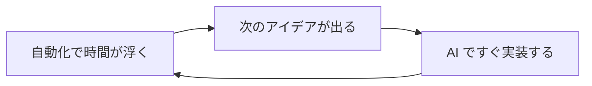

コードは書かないが、全体を動かす。
Web ディレクターから始めた私の仕事は、ずっとそういう形でした。
AI が来て、その前提が変わりました。

外資系コンサルで AI 導入をリードしながら、Trellis で AI による業務改善・自動化を担当している伊藤です。
このブログには AI のエージェントを実際の仕事で回して分かったことを書いています。

この記事で分かること
- エンジニアではない上流の PM が、AI で実装まで手を伸ばすと何が変わるか
- 私がどこから来て、いま何をしているか
- このブログで何を書いているか（書いた記事への入り口）

## Web ディレクターとしての始まり

IT 業界に入ったのは 26 歳で、完全な未経験からでした。
それまでは、やりたいことが定まらないまま仕事を転々としていて、フリーターのような時期もありました。

たどり着いたのが、**Web ディレクター**という仕事です。
クライアントから Web サイトや施策の要望を受け、デザイナーやエンジニアのチームを率いて、プロジェクト全体を進めます。
自分ではコードを書きませんが、開発・デザイン・ビジネスの要件を全部わかったうえで動く必要がありました。

この仕事を起点に、転職を重ねてきました。

- 規模の小さな制作会社
- Web 制作・システム開発を手がける会社
- いまの外資系コンサル

「コードは書かないが、全体を動かす」。
この Web ディレクター出身の考え方は、いまも仕事の根っこにあります。
技術に強い経歴があったわけではなく、必要に迫られるたびに現場で覚えるやり方が続いています。

## AI 以前から続けてきた自動化

IT 業界に入ってから気づいたのは、私は仕事を「楽にすること」が好きだ、ということです。

仕事として開発を受け持ったことはありませんが、自分の作業を楽にするためのコードは書いていました。

AI の時代よりずっと前から、Python でブラウザの操作や繰り返しの集計を自動化し、分析の道具を自分で作っていました。
プロジェクトを管理する仕事をしながら、「これ、自動化できるな」と思ったら、すぐに手を動かす癖がつきました。

マイルールは単純で、「**同じ作業が 2 回以上繰り返されたら、すぐに自動化を考える**」です。
自分の仕事を楽にして、人がやるべき判断と設計に使う時間を増やしたい。
根っこにあるのは、この考え方です。

ただ、エンジニアではない立場の自動化には、いつも同じ壁がありました。

- アイデアはあるが、実装できるかどうかを自分では判断できない
- 形にするまでに、時間がかかりすぎる

この 2 つが、動く速さをいつも決めていました。

## AI で消えた「実装できない」壁

そこに AI が来ました。
最初は自動化の延長だと思っていました。
使い始めてみると、変わったのは速さだけではありませんでした。

**実装にかかる時間が大きく減り、やりたいことをすぐに試せる**ようになったのです。
すると、自動化のループが回り始めます。

いまは、自作のツールやスキル（Claude Code に覚えさせておく手順のファイル）、ワークフローを数多く作り、仕事の大半をその上で動かしています。
AI のおかげで、自分の考えたことを自分で形にできる範囲が広がった、と感じています。

## 手を動かして変わった上流の判断

いまは、大手企業の AI の業務導入のプロジェクトで、先頭に立っています。
顧客の業務の課題を上流から整理し、AI をどう組み込むかを設計し、実際に動くものを作るところまでやります。

この立ち位置は **FDE（Forward Deployed Engineer）** と呼ばれる働き方に重なります。
顧客の現場に入り、業務の流れを見ながら課題の本質を見つけ、解決の設計を描いて実装まで担う働き方です。
「課題をまとめて開発側に渡す人」ではなく「現場の非効率を見つけ、解決の絵を自分で描く人」です。

私は FDE を、職種の名前としてより、**課題の発見から実装まで、最上流から通しで責任を持つ構え**として捉えています。

自分で手を動かすようになってから、上流の判断の精度が上がりました。
AI のエージェント（作業を任せられる AI）や RAG（資料を意味の近さで探して、答えの材料にする方式）を、ざっくりでも自分で動かしたことがある。
それだけで、次の 3 つが変わります。

- 要件定義の解像度
- エンジニアに伝える言葉
- 「この設計は実装のコストが高いので、別の方法にしよう」と決める速さ

たとえば、貯めたノートから「先月のあの件」を AI に引き出させたくて、RAG を入れれば解決すると思っていました。
自分で動かすと、要約が浅い、直近の変更に弱い、といった形で外れました。

そこで、エージェントにファイルを直接探して読ませる検索と、git の変更履歴を重ねる形に切り替えました。
この判断は動かしてみなければできませんでした。

@[card](https://zenn.dev/akaringo1109/articles/obsidian-context-continuity-2)

「上流か実装か」の二択ではありません。
**実装の肌感を持った上流の設計者が、いちばん動ける範囲が広い**と考えています。

## このブログで書いていること

テーマは、エンジニアではない人が、最上流で AI を使って課題を解決することです。
2 つの線で書いています。

**設計の考え方**: 実務から得た気づきを、案件の情報を出さずに言葉にしたもの。

- 課題の発見から要求の整理まで、最上流の考え方
- AI に何を任せ、何を人に残すかという役割の分け方
- FDE の働き方で、課題の解像度がどう変わるか
- エンジニアではない人が、AI 導入のプロジェクトを最上流から動かすとき

**手を動かした実践**: 実際に使っている道具と、その運用の記録。

- Claude Code を仕事でどう使っているか
- Obsidian での個人の知識管理の設計と運用
- AI 時代の情報整理と、自分の考えを育てる仕組み

たとえば、会議・チャット・案件の資材を Obsidian に集め、AI と文脈を途切らせない運用を書きました。

@[card](https://zenn.dev/akaringo1109/articles/obsidian-context-continuity)

追いたいテーマのニュースを Claude Code に集めさせ、Google の NotebookLM で音声の解説にして聴く仕組みも作りました。

@[card](https://zenn.dev/akaringo1109/articles/notebooklm-auto-podcast-daily-news)

書くと、曖昧だった考えが整理され、読んだ知識が自分のものになります。
難しい言葉は使わず、考え方の話には現場の具体を添えるようにしています。

## Trellis のこと

Trellis は福岡でホームページの制作と、AI による業務の自動化をしている会社です。
このブログの記事は Trellis のサイトの TRELLIS BLOG にも載せていきます。

@[card](https://trellis-grow.com)
