コーディングエージェントを何体も並べて開発すると、誰が作業中で、誰が承認を待ち、誰が終わったのかを追うのが大変になります。

そこで、普段のエージェントたちとの協業を、会社として見える画面にしてみました。
エージェントが社員として机で働き、承認を待つ人は手を挙げる、ピクセルアートのオフィス「Hakoniwa」です。
Herdr のデスクトップアプリのレイアウトで、ほぼ全部を AI に頼んで作りました。

福岡で AI による業務改善や自動化、Web 制作などに取り組んでいる Trellis です。
この記事で分かるのは次の 3 つです。Herdr App のインストールの手順と、レイアウトや mod の細かい仕様は書きません。

- Hakoniwa でこだわった所（承認待ち、リーダーと部下、部屋、休憩など）
- 先に絵を描かせ、それを AI に再現させた作り方
- Hakoniwa の入れ方と、自分なりの AI オフィスを作る最初の一歩

## Herdr App とは

Herdr は、コーディングエージェントを動かすためのデスクトップアプリです。
ターミナルとエージェントを、スペース（プロジェクトごとのまとまり）とタブに分けて並べます。
ターミナルで動く Herdr TUI と区別するため、この記事では Herdr App と呼びます。

公式サイトの最初の画面の説明は、次のとおりです。

> Herdr is an app for running coding agents that you shape by asking. Every window here is Herdr. Someone imagined it, their agent built it, and they shared it.
>
> 訳: Herdr は、コーディングエージェントを動かすアプリで、頼むことで形を変えられる。ここにある窓はどれも Herdr だ。誰かが思い描き、その人のエージェントが作り、共有した。

https://herdr.dev

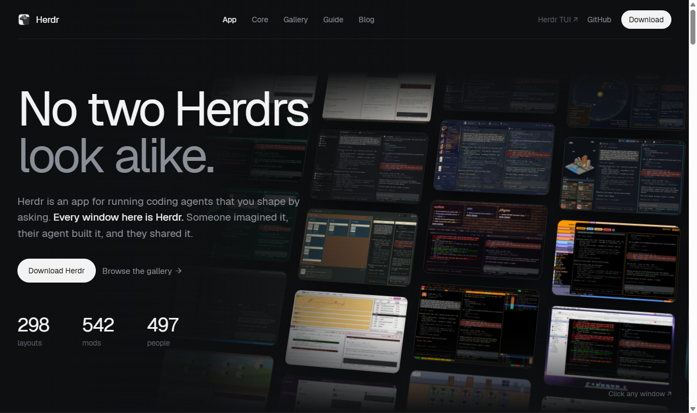

*出典: Herdr の公式サイト（herdr.dev）。2026年11月9日に撮影*

「頼むことで形を変えられる」は比喩ではありません。
Herdr App の設定の置き場には、エージェント向けの説明書（`AGENTS.md`）が入っていて、エージェントはそれを読んで画面を作り替えます。

https://herdr.dev/guide/

エージェントの実行と状態の管理は、Herdr App が裏で使う herdr-core（コマンドは `hc`）が受け持ちます。
herdr-core でエージェントに仕事を分ける考え方は、前の記事に書きました。

https://zenn.dev/trellis/articles/t3code-herdr-mobile-agents

:::message
Windows 11 の Herdr App 0.1.14 で試しました。2026年11月10日時点の内容です。Herdr App はまだ開発の初めの段階で、ファイルの仕様はこの先変わるかもしれません。正しい情報は、手元の `~/.config/herdr-app/AGENTS.md` にあります。
:::

## どのファイルを変えると何が変わるか

Herdr App の画面は、`~/.config/herdr-app` のファイルから描かれます。
公式の説明書の最初の一文が、この作りを言い表しています。

> This folder is the Herdr app's whole interface, as files.
>
> 訳: このフォルダが、Herdr App のインターフェースのすべてを、ファイルにしたものだ。

引用は、手元の 0.1.14 が書いた説明書から取りました。公開の写しは Herdr App のリポジトリにあります。

https://github.com/herdrdev/herdr-app/blob/master/defaults/AGENTS.md

- **レイアウト**（`layouts/<名前>.json`）: 窓のどこに何を置くか。ブロックの並び、テーマ、フォント、背景
- **mod**（`mods/<名前>/`）: パネルの中身。JavaScript で書き、スペースやエージェントのライブの状態を読んで描く
- **キーと設定**（`keys.json`・`settings.json` など）: キーの割り当て、通知の音、拡大率

説明書によると、ファイルを保存すると、窓は 1 秒以内に追いかけて描き直します。
スペースの一覧もエージェントの一覧も、自分で書くものと同じ部品でできているので、画面のどこでも作り替えられます。

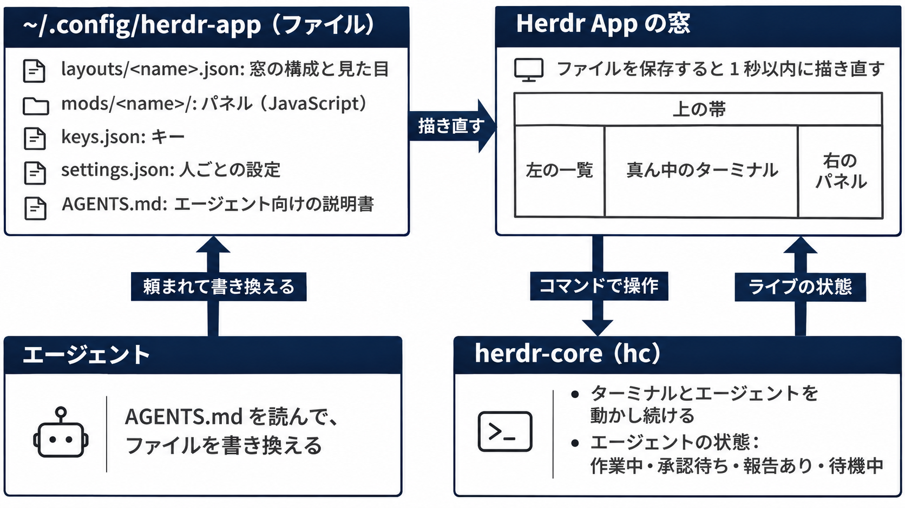

*エージェントがファイルを書き換え、窓が描き直す。ターミナルとエージェントは herdr-core が動かす*

## Hakoniwa: エージェントが社員として働くオフィス

標準のレイアウトでも、左の一覧でエージェントの状態は分かります。
ただ、エージェントが 10 体を超え、親が子に仕事を分けるようになると、一覧では「誰の部下が、どこで止まっているか」が追えなくなりました。

そこで、エージェントを社員、スペースを部屋に見立てて、普段の協業をそのまま会社として描くことにしました。
一目で状況が分かり、眺めていて楽しい画面を目指しています。

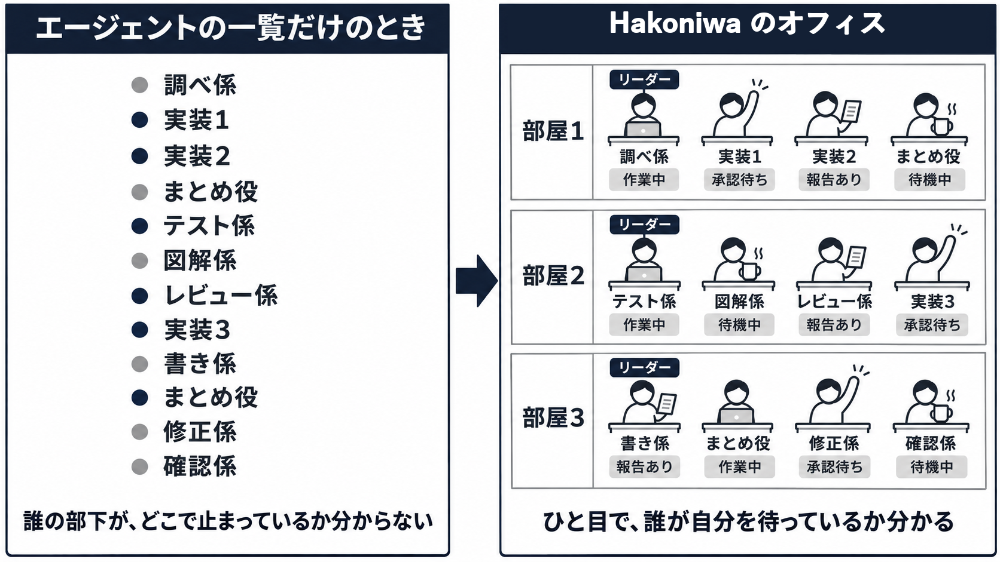

*一覧でも状態は分かる。オフィスにすると、チームのまとまりと待っている人が目に入る*

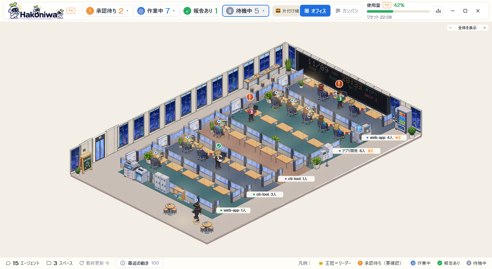

*Hakoniwa の全体（デモモード。名前と会話は見本のもの）*

寄りにして人を押すと、一人ひとりのしぐさと、右の欄にその人の顔・モデル・会話が出ます。

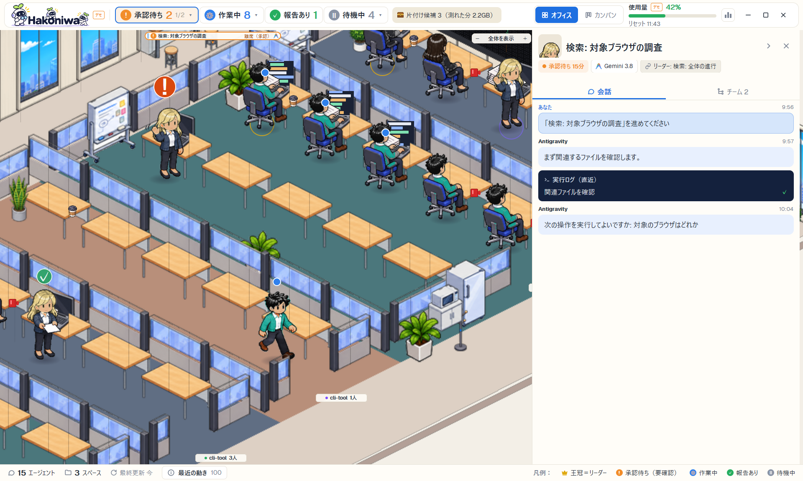

*寄りで見たオフィス。右の欄は、承認を待っているエージェントの会話（デモモード）*

Herdr の言葉は、Hakoniwa では次のように見えます。

| Herdr | Hakoniwa |
| --- | --- |
| スペース | 部屋（プロジェクト） |
| エージェント | 社員。自分の席で働く |
| 子のエージェント（`hc run` で立てた子） | チームの席に並んで座る部下 |
| 作業中（`working`） | 席でキーボードを打つ |
| 承認待ち（`blocked`。承認や返事を待っている） | 自席で立って手を挙げ、頭に「!」 |
| 報告あり（`done`。見ていない間に終わった。見ると `idle` になる） | 自席で書類を持って立ち、頭に「✓」 |
| 待機中（`idle`） | 席に座り、机に赤いマグ |

## Hakoniwa でこだわったこと

Hakoniwa は、眺めるだけでなく、ここから仕事を回せるように作りました。
こだわった所を 7 つ紹介します。

### 承認待ちがすぐ分かり、カンバンでも並べられる

エージェントを何体も回していると、一番もったいないのは、承認を待ったまま止まっている時間です。
Hakoniwa では、承認を待つ人が自席で立って手を挙げるだけでなく、上の帯の「承認待ち」の人数を押すと、対応が必要な人の一覧が開きます。

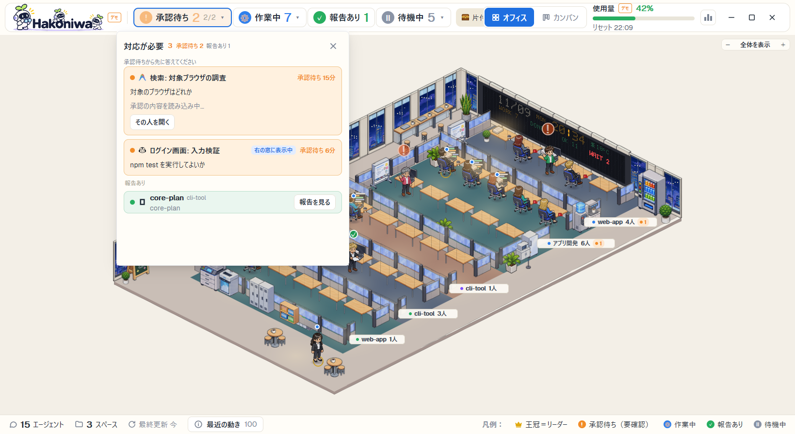

*上の帯から開く「対応が必要」の一覧。承認待ちが先に並ぶ*

人を押すと、右の欄にその人のターミナルと会話の記録が出ます。
承認待ちなら、ターミナルの画面から読んだ選択肢（承認・却下など）がボタンになり、その場で答えられます。

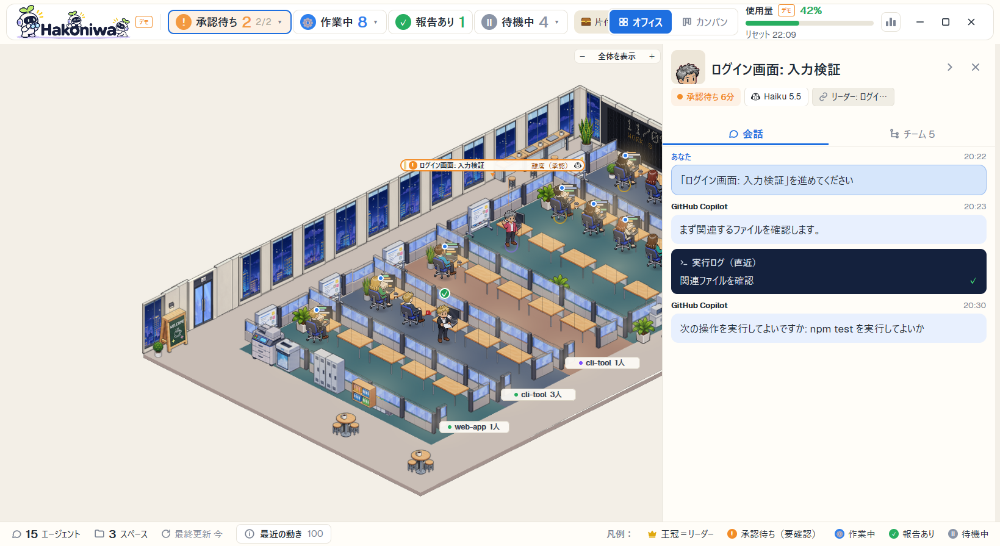

*右の欄。デモモードでは本物のターミナルが無いので、ターミナルのタブと承認のボタンは出ていない*

カンバンに切り替えると、同じエージェントが状態ごとの列に並びます。
チーム全体の様子はオフィスで見て、止まっている人を順に片づけるときはカンバンを使う、という使い分けができます。

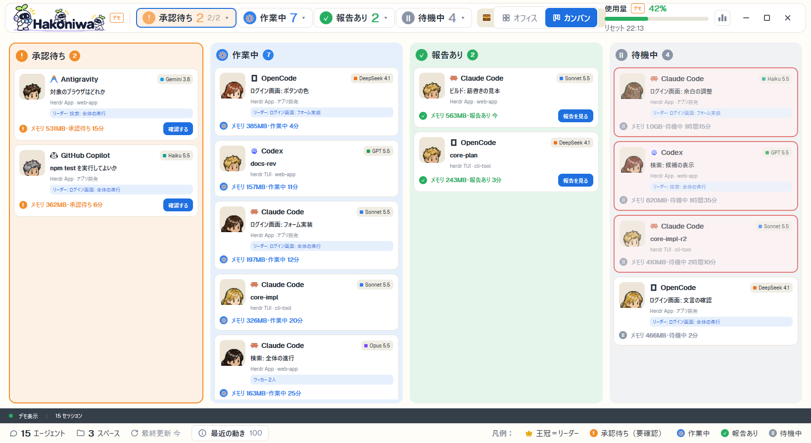

*カンバン。種類の違うエージェントが同じ列に並ぶ*

### 左のツリーから、エージェントを立てて部屋を作る

エージェントを立てるたびにターミナルでコマンドを打つのは、社員を雇うたびに書類を書くようなものです。
Hakoniwa では、オフィスの左に部屋（スペース）とエージェントのツリーを置き、マウスで会社を動かせるようにしました。

- 部屋ごとの「＋」か、一番下の「新しいエージェント」から、プロバイダ（Claude Code・Codex・OpenCode・Cursor・Antigravity）、モデル、推論の強さを選んで立てる
- 「スペースを作る」で、名前とフォルダを決めて部屋を足す
- エージェントをドラッグして、別の部屋へ移す
- 行を押すと、そのターミナルが右の欄に出て、そのまま打ち込める

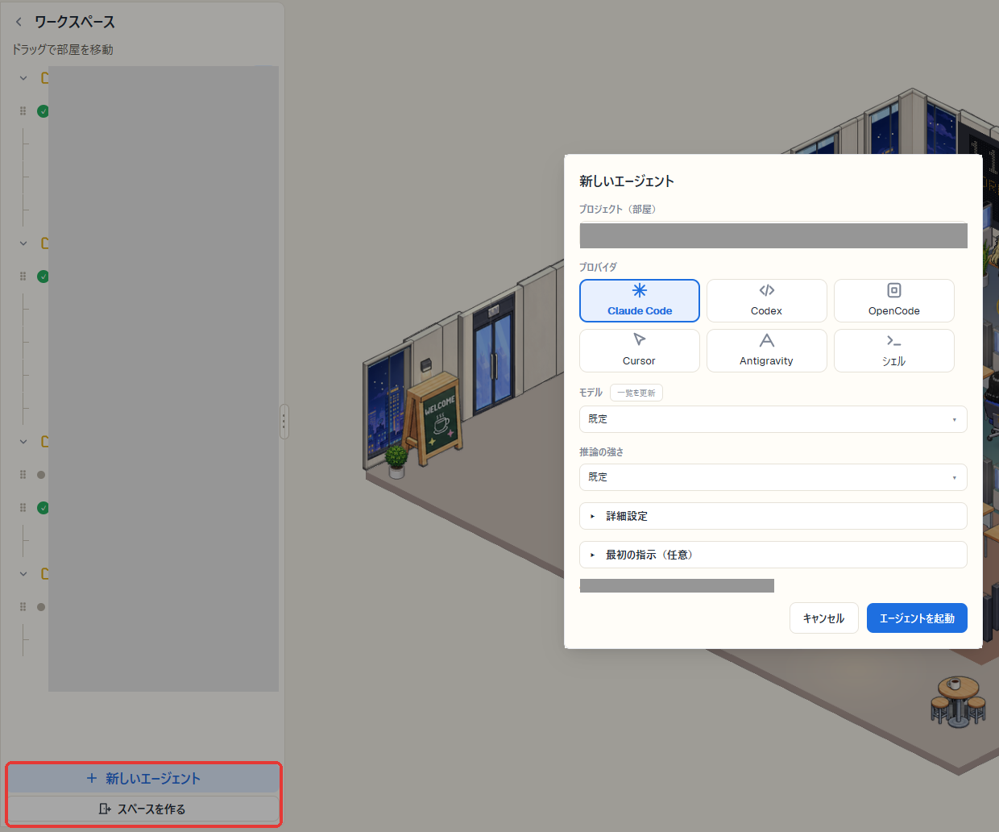

*左のツリーから開く「新しいエージェント」の窓。ツリーの名前は伏せた*

### リーダーと部下の関係が、席と金の輪で分かる

親のエージェントが子に仕事を分けるようになると、どの子がどの親の仕事をしているかが見えないと、報告を受けても話がつながりません。

立てる窓の「詳細設定」では、リーダー（単独で立てる）か、ワーカー（選んだリーダーの下）かを選べます。
ワーカーとして立てると、herdr-core の親子の関係（`hc run --parent`）でつながり、その関係のまま Hakoniwa に出ます。

- ワーカーはリーダーの部屋に集まり、チームの席に並んで座る
- チームの席の下には敷物が敷かれ、どこまでが 1 つのチームかが床の色で分かる
- リーダーの足元には金の輪が出る（左のツリーでは王冠）
- 右の欄のチームのタブで、親と子の木が見られる

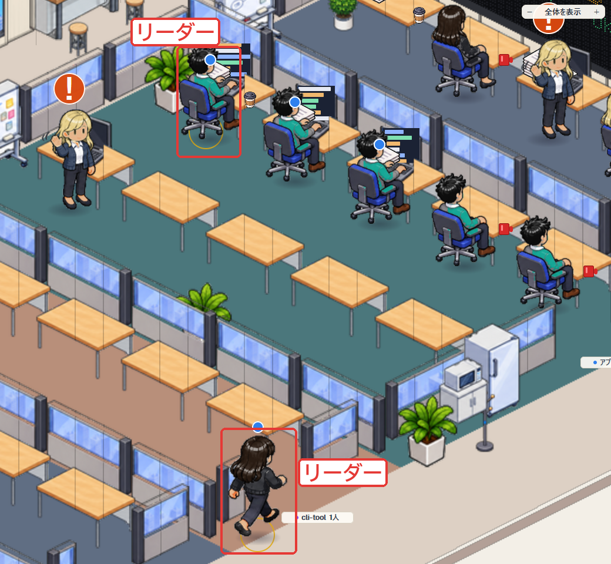

*足元の金の輪がリーダー。部下はチームの敷物の上に並んで座る（デモモード）*

リーダーには、たとえば次のように頼みます。
`hc --skill` が herdr-core の使い方をエージェントに教えるので、細かいコマンドは書かなくて済みます。

```text
hc --skill を読んでから進めてください。
この部屋の仕事を 3 つに分け、子のエージェントを 3 体立てて任せてください。
子は同じ部屋に立て、終わるのを hc wait --children any で待ってください。
全員が終わったら、結果をまとめて報告してください。
```

部下を別のプロバイダのエージェント（Codex や OpenCode など）にすると、種類の違う社員が同じ部屋で働く形になります。

### 部屋は、人がいる間だけ増えていく

プロジェクトを始めるたびにスペースを作っていくと、終わったスペースが残り、一覧が長くなっていきます。
Hakoniwa の床には、人のいるスペースだけが、ガラスの壁の部屋として描かれます（左のツリーには、空のスペースも出ます）。

- 部屋は 1 列に並び、新しい部屋は手前（左下）へ積まれていく。床の大きさは、部屋の数と人数に合わせて伸びる
- 部屋の机は人数に合わせて列が増え、空いた机も 1 つ用意される
- 新しいスペースの名前は、最初に入ったエージェントの名前から付く
- 最後の 1 人がいなくなり、ターミナルも残っていないスペースは、6 秒後に閉じて部屋も消える

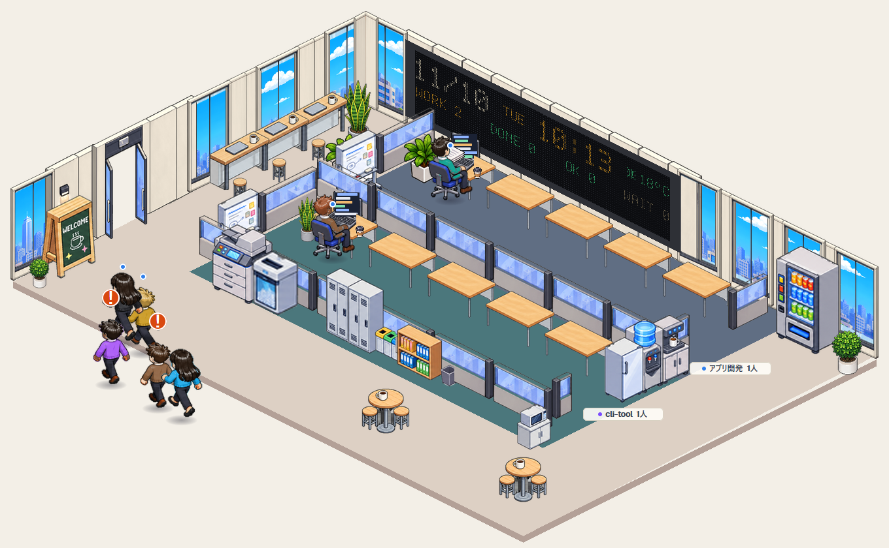

*エージェントが 2 人のとき。部屋は 2 つで、床も小さい（デモモード）*

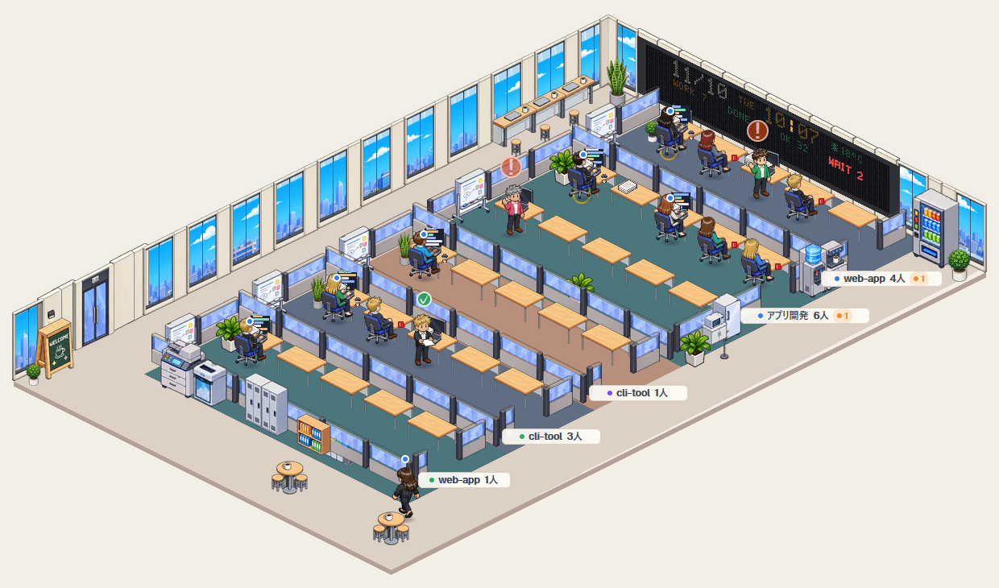

*15 人のとき。部屋が手前に積まれ、床がそのぶん伸びる*

仕事が増えれば部屋が増え、片づけば部屋が消えるので、オフィスがそのときの仕事の量に合わせて伸び縮みします。
人のスペースを勝手に閉じられると困るときは、設定の `office.auto_rooms` を `false` にすれば止まります。

### オフィス機器と植物、窓の外の鳥まで描く

ずっと開いておく画面なので、エージェントのいない所にも、オフィスらしい物を置きました。
動かない物は、画像生成 AI で描いた絵から切り出した部品です（作り方は後の「AI に頼んで作った」で書きます）。

- 入口の扉の横に、「WELCOME」の黒板のウェルカムボードと植物
- 部屋の仕切りに沿って、複合機、シュレッダー、ロッカー、書類棚、ホワイトボード、分別のゴミ箱
- 掲示板の右に、給湯と休憩のまとまり（自販機、コーヒーメーカー、ウォーターサーバー、電子レンジ、冷蔵庫）
- 植物は種類を変えて、部屋ごとに奥の角に置く。ロビーの空いた床には丸テーブル
- ときどき、窓の外を鳥の群れが横切る（雨・雪・雷の日は飛ばない）

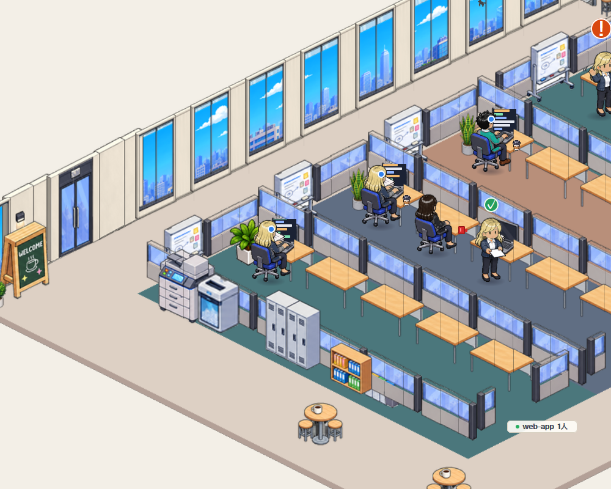

*入口のウェルカムボードと、仕切りに沿って並ぶ機器（デモモード、昼）*

### 天気と時刻が、窓の外と電光掲示板に出る

仕事の画面でも、ずっと開いておくなら、眺めて楽しい要素がほしくなります。
Hakoniwa では、オフィスの外の世界も描きました。

- 窓の外は、時刻に合わせて朝・昼・夕方・夜の景色に変わる
- 天気に合わせて、雲、雨、雪、霧、雷が出る（天気は Open-Meteo から 30 分ごとに取る）
- 夜には月と星が出る。月の満ち欠けは日付から計算している
- 壁の電光掲示板に、日付、時刻、場所、気温、状態ごとの人数が出る

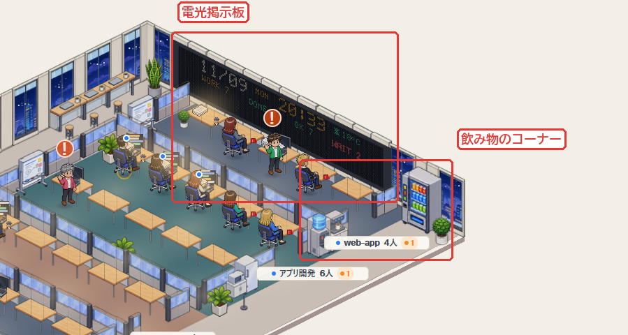

*奥の壁の電光掲示板と、右手前の飲み物のコーナー（デモモード、夜）*

### 休憩や会話で、席を立って歩く

一番人らしく見せたかったのが、席を立って歩く動きです。
最初は、承認待ちの人は承認デスクへ、報告ありの人は提出カウンターへ歩かせていました。
ところが、窓口が遠く、床も広く取るので、どちらも自席で立って待つ形に変えました。

いま、人が歩くのは次の 3 つのときだけです。

- **入ってくる・帰る**: 新しく立てたエージェントは、入口の扉から歩いて自分の席に着き、終わった人は歩いて出ていく
- **会話**: エージェントどうしがメッセージを送り合うと、席を立って近くで向き合い、「…」の吹き出しで話して席に戻る
- **休憩**: 手が空いた人（待機中）が、ときどき近くのウォーターサーバーやコーヒーの機械（たまに自販機）へ歩き、カップを持って席に戻る。休憩に行くのは同時に 1〜2 人まで

席にいる間も、作業が長く続くと机に缶やカップが増え、エージェントのメモリの使用量が増えるほど書類の山が高くなります。
席を立って歩く人がいると、状態の一覧を読むより先に目が行くので、オフィスの中で何かが起きていることに自然に気づけます。

## AI に頼んで作った

Hakoniwa は、Herdr App の中の AI のエージェントに頼んで作りました。
こちらでしたのは、どんな会社にしたいかを伝え、できた画面を見て直してほしい所を言うことで、コードはほとんど読んでいません。

### 先に絵を描かせ、それを再現させる

一番面白かったのは、作る順番です。
見た目をエージェントにコードから考えさせるのではなく、先に画像生成 AI でオフィスの絵と画面の案を描かせ、その絵をエージェントにコードで再現させました。

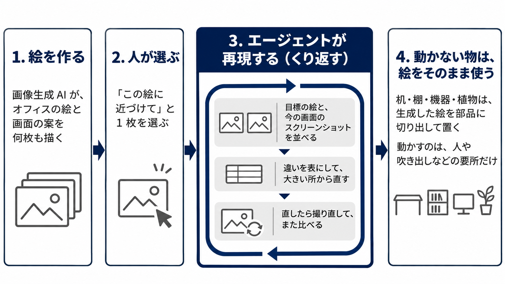

*絵を描かせてから、エージェントに再現させる*

最初に描かせたのは、目標にする机まわりの絵です。
木の床、ガラスの腰壁で区切った小部屋、モニター、植物のある絵を選び、この水準のピクセルアートに近づけるよう頼みました。
机や棚のような動かない物は、生成した絵から切り出した部品をそのまま置き、手で描き直していません。

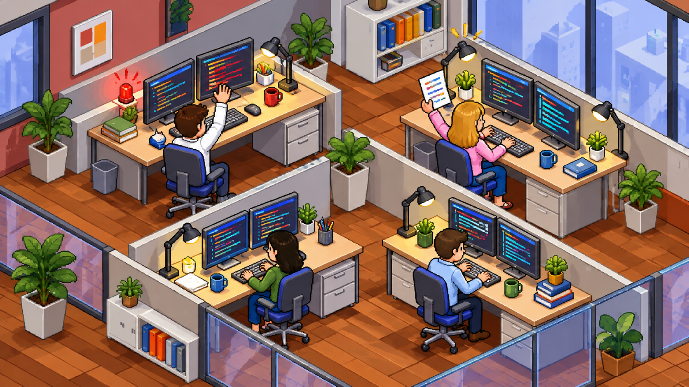

*最初に画像生成 AI で描いた、目標の絵（2026年11月2日）*

画面の部品も、同じ流れで作りました。
画像生成 AI に画面の案を何枚も描かせ、良いと思った案をそのまま目標にしました。
エージェントは、目標の絵と今の画面を並べて撮り、違いを表にして、大きい所から寄せていきます。
「新しいエージェント」の窓も、生成した案から 1 つを選んで作りました。

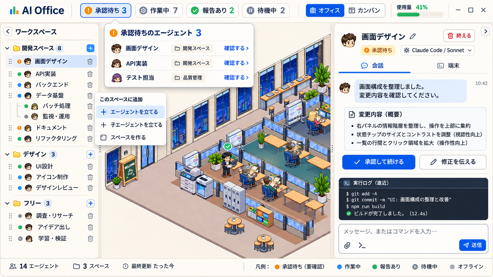

*画像生成 AI で描いた画面の案。上の帯、左のツリー、右の欄を、この案に寄せた*

### 任せきりにするために、エージェントにさせた 4 つのこと

コードを読まずに進められたのは、確かめるところまでエージェントに任せたからです。

- **最初に説明書と型を読ませる**: `AGENTS.md` と、mod から使える関数の型（`herdr.d.ts` など）は、手元の版に合わせて書き直される。Web の古い情報より、これを正にさせる
- **確かめるのもエージェントに任せる**: 直すたびに `herdr-app check` で読み込めるかを確かめ、`herdr-app shot` で窓を画像にして、エージェント自身に見せる。窓が隠れていても撮れるので、人の作業を邪魔しない
- **見本のデータ（デモモード）を作らせる**: 全部の状態と親子を一度に出せる見本があると、見た目の確かめと撮影が楽になる。実際の会話やフォルダ名も写らない
- **使いやすさの見直しを回させる**: 撮った画面を、押せる大きさ、状態が分かるか、次に何をすればよいか分かるか、といった観点で点検させ、重い順に直して撮り直す、を繰り返させた。同じ画面を別の AI にも見せて、指摘をもらった

### できあがった Hakoniwa の作り

できあがった Hakoniwa は、1 つのレイアウトと 1 つの mod でできています。
mod は画面を描くことに絞り、エージェントの状態や会話を集める処理と、床と家具の絵を描く処理は、Python に任せています。

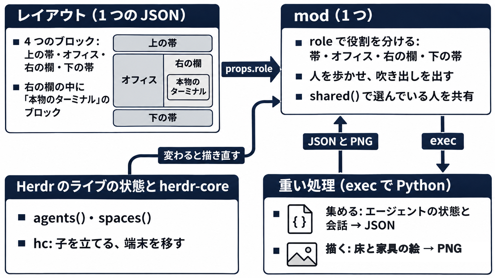

*Hakoniwa の作り。mod は軽く保ち、重い処理は Python に任せる*

## Herdr のレイアウト集に載せた

Herdr App のレイアウトは、利用者が作ったものを herdr.dev のレイアウト集で一覧できます。
載せるのに申請は要らず、GitHub の公開リポジトリに topic を付けるだけです。

> add the repo topic `herdr-layout` for a layout or `herdr-mod` for a mod. It shows up at herdr.dev/layouts or herdr.dev/mods within the hour.
>
> 訳: レイアウトならリポジトリに topic `herdr-layout` を、mod なら `herdr-mod` を付ける。1 時間以内に herdr.dev/layouts か herdr.dev/mods に出る。

リポジトリには、別のエージェントが空のフォルダから作り直せる指示書（`RECIPE.md`）と、スクリーンショットを置きます。

Hakoniwa も、このレイアウト集に載せました（MIT ライセンス）。

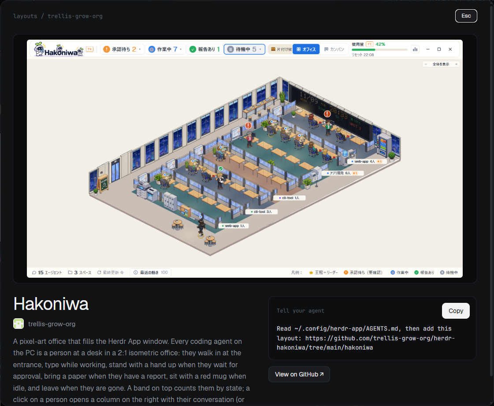

*出典: herdr.dev のレイアウト集で Hakoniwa を開いたところ。2026年11月10日に撮影*

https://github.com/trellis-grow-org/herdr-hakoniwa

入れるときは、Herdr App の中のエージェントにこう頼みます（レイアウト集の「Tell your agent」の 1 文と同じです）。

```text
Read ~/.config/herdr-app/AGENTS.md, then add this layout: https://github.com/trellis-grow-org/herdr-hakoniwa/tree/main/hakoniwa
```

説明書は、入れる側のエージェントに、mod がネットに出るか、プログラムを動かすか、自分のフォルダの外を読むかを、入れる前に人に伝えるよう求めています。

レイアウト集には Herdr 側の審査が無く、mod は制限の無いコードとして動くので、知らない人の mod は中身を読ませてから入れます。
Hakoniwa は、天気を取るために外へ通信し、Python と `hc` を動かし、各エージェントの会話の記録を読みます。README に全部書きました。

:::message
Hakoniwa は Windows で作り、Windows でだけ確かめました。
Herdr App のほかに、Python 3.10 以上と numpy・Pillow が要ります。
画面の言葉は日本語だけです。
入れて最初の 1〜2 分は、家具と人の部品を作るため「オフィスを準備中…」と出ます。
:::

入れたあとは、自分の環境に合わせて直してください。
MIT ライセンスなので、好きなように作り替えてかまいません。

- **エージェントの立て方**: 立てる窓に並ぶエージェントと起動の仕方は、こちらの環境に合わせてある。自分が使うエージェントと起動の引数（設定の `office.launch.kinds`）を、Herdr App の中のエージェントに設定させる
- **使用量**: 上の帯の使用量は、よく使う Claude Code の 5 時間の枠だけを出している。週の枠や Codex・OpenCode の使用量は、隣のボタンから開く一覧で見る
- **そのほか**: 天気の場所、部屋の並べ方、人の服の色なども設定で変えられる。設定に無いことも、エージェントに頼めば作り替えられる

## まとめ: エージェントとの協業を、自分なりの会社にしてみる

- 普段のエージェントたちとの協業を、社員・部屋・リーダーと部下のいる会社として描いた
- 承認待ち、報告、休憩が人のしぐさと動きで見えるので、眺めるだけで状況が分かり、見ていて楽しい
- 作る作業は、ほぼ全部 AI に頼んだ。先に絵を描かせて、それを再現させ、確かめるところまで任せると、中身をほとんど見ずに作れた
- できたレイアウトは、topic を付けるだけでレイアウト集に載り、ほかの人は 1 文で入れられる

試すなら、最初の一歩は 2 つあります。

- Hakoniwa を入れる: Herdr App の中のエージェントに、上の 1 文を頼む
- 自分の AI オフィスを頼む: 「エージェントを部署ごとの部屋に分けて」「承認待ちが出たら音を鳴らして」のように、ほしい会社の姿をエージェントに伝えてみる。先に画像生成 AI で絵を描かせると、見た目を伝えやすい

自分なりの AI オフィスや AI 会社を作ってみると、開発やエージェントとの協業がより楽しくなります。

## Trellis のこと

Trellis は、福岡でホームページの制作と、AI による業務の自動化に取り組んでいます。
記事は Zenn と、Trellis のサイトのブログの両方に載せています。

https://trellis-grow.com/?utm_source=zenn&utm_medium=referral&utm_campaign=herdr-app-layout-ai-office&utm_content=card
