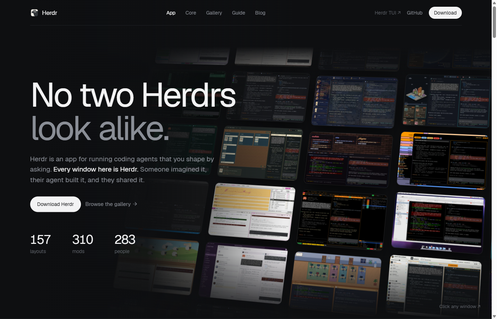
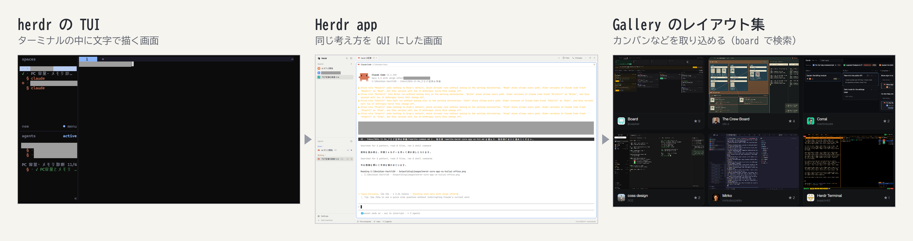
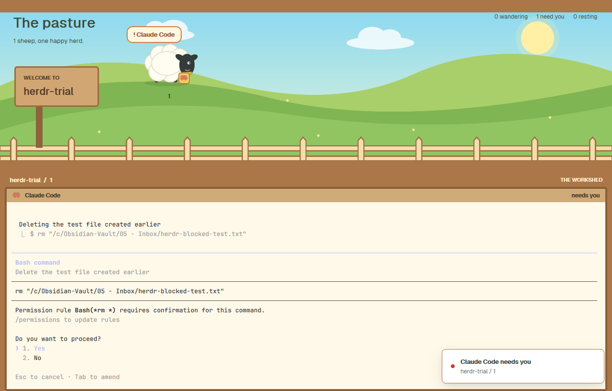
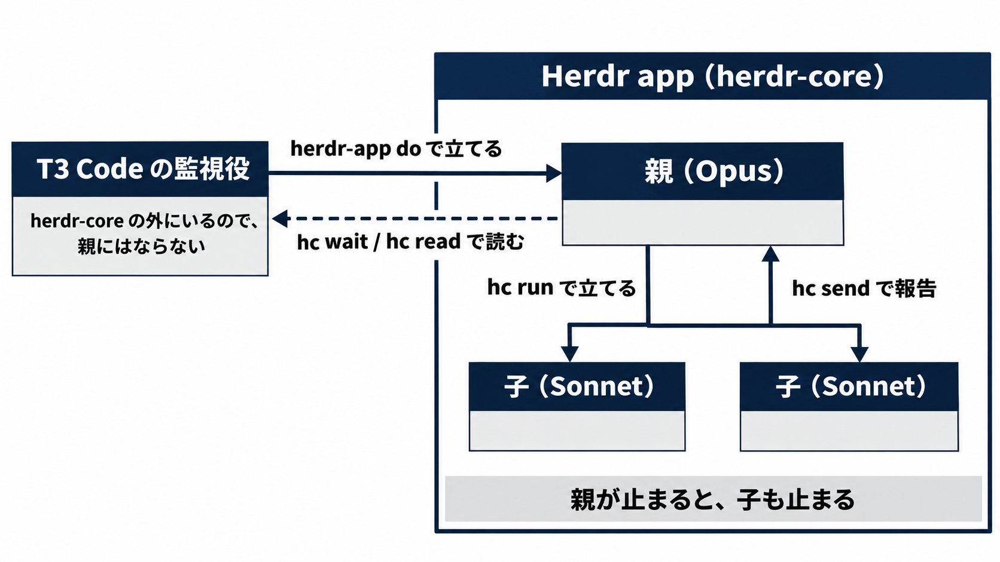
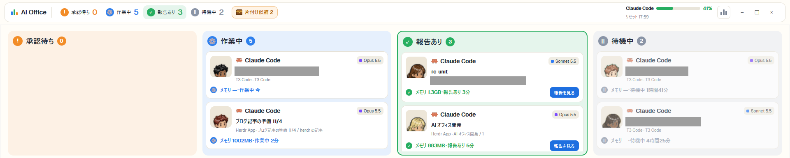
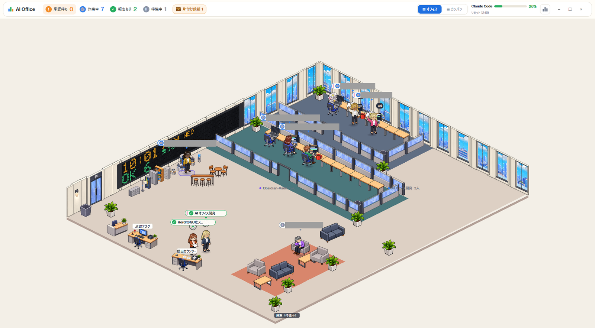

2026年10月29日、herdr から、新しい実行環境の **herdr-core** と、その上で動くデスクトップアプリの **Herdr app** が出ました。

herdr は、Claude Code などのコーディングエージェントを並べて動かすマルチエージェントの仕組みです。
エージェントがほかのエージェントに仕事を渡し、その報告を受け取ることもできます。

私は前からある herdr の TUI でエージェントを束ねていて、11月2日から Herdr app を TUI と並べて使いました。

:::message
この記事で分かること

- herdr の TUI・herdr-core・Herdr app の役割の違い
- TUI と Herdr app の違いを、項目ごとに並べた表
- Herdr app の仕様（状態の知らせ方、親子のワーカー、レイアウトと mods）

どちらが良いかの判定と、導入の手順は書きません。
:::

## herdr の TUI・herdr-core・Herdr app とは

10月29日の発表で、herdr は 3 つになりました。

- **herdr TUI**: 前からある herdr。端末の中に画面を描くアプリで、自分のサーバーを持つ
- **herdr-core**: 端末とエージェントを動かし続ける小さなサーバー。コマンドは `hc`。画面は描かない
- **Herdr app**: herdr-core の上で動くデスクトップアプリ。アプリを閉じても更新しても、エージェントは herdr-core の中で動き続ける

公式サイトのトップは Herdr app の紹介になっています。

> No two Herdrs look alike.
>
> Herdr is an app for running coding agents that you shape by asking.
>
> 訳: 同じ見た目の Herdr は 2 つとない。Herdr は、コーディングエージェントを動かすアプリで、頼んで形を変えていける。

同じページには、エージェントが別のエージェントを動かす使い方も書かれています。

> Your agents run agents. And hear back.
>
> 訳: エージェントがエージェントを動かし、報告を受け取る。

https://herdr.dev



*出典: herdr 公式サイト（2026年11月4日の午後に撮影）*

「頼んで形を変えていける」は、画面や設定をエージェントに頼んで変えられることを指しています（あとの「画面を作り替えるレイアウトと mods」）。
エージェントどうしの仕事の受け渡しは、あとの「herdr-core の親子のワーカー」です。

TUI と herdr-core は別のサーバーで、エージェントを共有しません。
TUI のペインで動くエージェントは Herdr app には出ず、その逆も出ません。
TUI はこれまでどおり使えると、公式サイトの FAQ に書かれています。

私の TUI の使い方は前の記事に書きました。
スマホからは Claude Code などを動かせるアプリの T3 Code を入り口にして、TUI のエージェントに指示しています。

https://zenn.dev/trellis/articles/t3code-herdr-mobile-agents


:::message
Windows 11 で試しました。herdr TUI は 0.9.5、Herdr app は 0.1.11 で入れて 0.1.12 に更新（画面の表記は BETA）、`hc` は 0.1.16、Claude Code は 2.1.316 です。2026年11月2日〜4日の内容で、どれも若い道具なので、挙動はこの先変わる可能性があります。
:::

## TUI で足りなかったこと

TUI の運用のしやすさには満足していました。
エージェントへの指示も、herdr の中で親のエージェントを立てて子に仕事を回すのも、無理なくできていました。

一方で、TUI の画面はかなり見づらく、GUI でもう少し見やすくなるといいなと思っていました。
Herdr app には公式のレイアウト集があり、看板ボードのような「こういう UI があるといいな」と思っていた画面を使えそうでした。

TUI（ターミナル ユーザー インターフェース）はターミナルの中に文字と記号で描く画面です。
Herdr app は同じ考え方の画面を GUI にしたもので、公式のレイアウト集の Gallery から、カンバンなどの画面を取り込めます。



*作業の名前などは伏せています*

もう 1 つは、スマホとの関係です。
Herdr app に移れば、スマホから T3 Code を通さずに済むかも知れないと考えました。

## 比べた結果のまとめ

Herdr app を入れた理由は次の 2 つでした。

- エージェントの状態（作業中・承認待ち・完了）を、UI の上でしっかり見張りたい
- レイアウトや mods（レイアウトに入れる JavaScript の拡張）で画面を作り替えられるカスタマイズ性が面白そう

入れて分かった事実も 2 つあります。

- 状態は、エージェントが自分で知らせる。Herdr app は画面を読まないので、知らせないエージェントの状態は分からない
- 親子のワーカーという考え方と作りがある。エージェントが立てた手伝いは子になり、終わったら親に報告する

項目ごとの違いは次のとおりです。

| 項目 | herdr TUI | herdr-core と Herdr app |
| --- | --- | --- |
| 画面 | ターミナルの中に文字で描く画面 | デスクトップアプリ。レイアウトと mods で作り替えられる |
| エージェントの居場所 | TUI のサーバー | herdr-core。アプリを閉じても更新しても動き続ける |
| 状態の知り方 | herdr がエージェントを見分け、herdr が配るプラグインやフックで拾う | 各プログラムが OSC 7501 で自分から知らせる。画面は読まない |
| ほかのエージェントへの指示 | `herdr agent prompt`・`read`・`wait` | `hc send`・`read`・`wait` |
| 親子のワーカー | 親が子の名前を指し、自分で待つ | `hc run` で立てた端末が子になり、子の報告が親に届く |
| スマホから | 公式は SSH だけ（私は T3 Code 経由） | 公式のスマホ版・Web 版は無い。遠隔は、この PC から SSH 先を操作する向き |

前の節のスマホの件は、11月2日に調べた時点では表の最後の行のとおりで、Herdr app でも変わりませんでした。

## OSC 7501 による状態の知らせ方

ワーカーを見張るには、どのエージェントが作業中で、どれが終わり、どれが人を待っているかを、プログラムから読める必要があります。
herdr-core では、この状態を各プログラムが OSC 7501 で自分から知らせます。
OSC 7501 は、プログラムが端末に流す、画面には出ない制御用の文字列の一種です。

> A terminal's status (working, done, needs you) is what its program reports through OSC 7501 ... No screen scraping, no list of known agents.
>
> 訳: 端末の状態（作業中・完了・人を待っている）は、そのプログラムが OSC 7501 で知らせたものです。画面の読み取りも、知っているエージェントの一覧もありません。

*出典: [herdr-core の公式ページ](https://herdr.dev/core/)（2026年11月4日に確認）*

エージェントでなくても、この文字列を端末に書けば状態を持てます。
公式のページには自分のスクリプトから承認待ちを知らせる例があります。

```bash
printf '\e]7501;state=blocked:app=my-agent\e\\'
```

私も PowerShell から同じ形の文字列を書き、作業中から承認待ちに変わって、一言の説明も届くことを確かめました。

Claude Code はこの信号に対応していて、Herdr app の中で起動すると `claude-code` として認識されました。
公式のレイアウトの 1 つの Pasture（羊の牧場）では、承認待ちになると羊の上に「! Claude Code」が出て、右下に通知が出ます。



`hc get` で状態を読むと、何をしているかの一言も付いてきます。
Herdr app に立てたワーカーは作業中に次のような状態を返しました。

```json
"status": {"app": "claude-code", "state": "working", "msg": "Writing <作業フォルダー>\\herdr-app-material.md"}
```

### 状態を知らせないエージェント

11月2日に、herdr-core の端末でエージェントを 1 つずつ起動して「PONG と返して」と頼み、`hc get` の状態が変わるかを見ました。

| エージェント | Herdr app に状態が届くか |
| --- | --- |
| Claude Code | 届く |
| Codex | 届く |
| Antigravity | 届く（承認待ちの文言つき） |
| OpenCode | 届かない |
| Cursor | 届かない |
| GitHub Copilot | 届かない |

承認待ちまで確かめたのは Claude Code と Antigravity です。
どのエージェントも版が変われば結果が変わる可能性があります。

届かないエージェントも端末の中では普通に動きます。
OpenCode の場合、`hc get` は起動の直後も作業のあとも `reported: false` のままで、作業中・完了・承認待ちのどれも出ませんでした。
公式の FAQ にも同じことが書かれています。

> An agent that doesn't speak it still runs, just without a status.
>
> 訳: OSC 7501 を話さないエージェントも動きますが、状態は持ちません。

*出典: [herdr 公式サイトの FAQ](https://herdr.dev/)（2026年11月4日に確認）*

FAQ によると、サイドバーのエージェントの一覧に出るのも、OSC 7501 で状態を知らせるエージェントだけです。

状態が届かないワーカーは、`hc wait` が終わりを待てず、プロセスが終わるまで戻りません。
その場合は、ワーカー自身に `hc send <親> "終わりました"` で知らせてもらえば、親は完了を受け取れます。

状態を出すエージェントでも、あいだに別の端末の仕組みを挟むと届かないことがあります。
公式の FAQ は Herdr の中で tmux を使った場合を挙げています。

## herdr-core の親子のワーカー

エージェントに手伝いを立てさせて仕事を分けるなら、親は子の終わりを知る必要があります。
herdr-core にはこの親子の関係が最初から入っています。

公式の説明では、エージェントが立てた手伝いは立てた側の下に置かれ、終わったら報告し、立てた側が止まると一緒に止まります（[herdr-core の公式ページ](https://herdr.dev/core/)）。

Herdr app の中の親（Claude の Opus）に、子（Claude の Sonnet）を立てさせると、次の流れで回りました。

```bash
# 親の端末で動かす（$HC_TERMINAL_ID は親の番地に展開される）
# 子を立てる。--bg で子の画面を親に流さない
# --no-notify で、子が承認待ちになった・終わったといった自動の知らせを親に送らない（下の 3 つの 1 つ目）
hc run --bg --no-notify --name office-c claude --model claude-sonnet-5-5

# 子が入力を受け付けるまで待ってから、最初の指示を送る
hc wait office-c --timeout 90
hc send office-c "<指示書>.md を読んで従って。終わったら hc send $HC_TERMINAL_ID で報告"

# 子が全員止まるか、子の報告が届くまで待つ
hc wait --children all --timeout 560
```

実際には、思考の深さも指定した `.cmd` を `claude` の代わりに起動しました。

`hc wait <子>` は、子が作業を止めるか終わると戻ります。
`--children all` は、子が全員止まるか、自分あての報告が届くと戻ります。
`--timeout` で戻ったときは失敗ではないので、状態を見て待ち直します。

子の報告は親の入力に `<hc from="t1r office-c">…</hc>` の形で届きます。
Herdr app のサイドバーでも、子は親の下に入れ子で並びます。

使ってみて、次の 3 つが要りました。

- **`--no-notify`**: hc が自動で出す知らせ（子が承認待ちになった、終わった、など）を親に送らない。付けないと、子が承認待ちになるたびに親が起こされた。子が自分で `hc send` する報告は届く
- **最初の指示は、子が入力を受け付けてから送る**: 起動中に送ると、取りこぼすことがあった
- **長い指示はファイルに書く**: `hc send` には「`<ファイル>` を読んで従って」とだけ送る。引用符や改行が崩れない

子を親が止まったあとも残したいときは、`--outlive-parent` を付けます。

### herdr-core の外からの操作

herdr-core の端末ではないエージェント（前の記事の T3 Code のエージェントなど）は、Herdr app のワーカーの親にはなれません。
それでも���Herdr app の画面を外から操作する `herdr-app do` でスペース（サイドバーでタブをまとめる単位）とワーカーを作り、`hc` で状態を読めます。

```bash
# スペースと、最初のタブのワーカー（Claude Code）を 1 回で作る
# Git Bash から流すので、パスの書き換えを止める MSYS_NO_PATHCONV=1 を付けた
MSYS_NO_PATHCONV=1 herdr-app do space.new '{"name":"ブログ記事の準備","folder":"<Vault>","tab":"記事の候補","argv":["claude"],"task":"<指示書>.md を読んで、その指示どおりに進めてください。"}'

# 状態を見て、止まったら画面を読む
hc get t6b --json
hc wait t6b --timeout 300
hc read --lines 0 t6b
```

外から立てたワーカーに子を立てさせれば、上の親子の形になります。



## 画面を作り替えるレイアウトと mods

Herdr app を入れた理由の 1 つがこのカスタマイズ性でした。
結局やりたかったのは、カンバンやオフィスのレイアウトのように、エージェントがかわいらしく動くゲーミフィケーションの要素を画面に入れることです。

Herdr app の設定・レイアウト・キー・テーマは `~/.config/herdr-app` のファイルで、使い方の手引き（`AGENTS.md`）も同じ場所にあります。
エージェントに「手引きを読んで、このレイアウトを入れて」と頼むだけで、画面が変わります。

レイアウトは公式の Gallery で探せます。
11月4日に開いた時点で、公式の例が 7 つ（Board・Call・Chat・Code・Mission・Pasture・Threads）と、有志の投稿が 157 件ありました。

https://herdr.dev/gallery/

公式の例の Board は承認待ち・作業中・完了・待機の列にエージェントのカードが並ぶカンバンで、カードを押すとその端末が下に出ます。

:::message alert
レイアウトに入っている mods は、サンドボックスの無い JavaScript で、コマンドの実行やネットへの接続ができます（Herdr app の手引き `herdr-app --skill`）。
入れる前に中身を読みます。Pasture は、通信・外部のプログラムの実行・フォルダーの外の読み取りが無いことを確かめてから入れました。
:::

### 自作のカンバンと AI オフィス

公式の Board を元に、自作のカンバンを作りました。
列の名前を日本語にし、カードにモデルとメモリ、上の帯に状態ごとの数と Claude Code の使用量を足しています。



*作業の名前の一部は伏せています*

次に、エージェントを 1 つのオフィスで働く社員として描く画面を作りました。
Herdr app の外で動くエージェントも含めて、小さなスクリプトが状態を数秒ごとに読んで 1 つのファイルにまとめ、mod がそれを描きます。

作るのも Herdr app の中で、前の節の親子のワーカーに任せました。
作っている画面そのものを使いながら作れば、改善点が見えると考えたからです。



*作業中の吹き出しに出る作業名は伏せています*

作業中の人はキーボードを打ち、承認待ちの人は承認デスクに来て、終わった人は提出カウンターに書類を出します。
長く待機している人は控室のソファで休みます。
上の帯には状態ごとの人数と、Claude Code の使用量を出しています。

これはお遊びの要素が大きい画面です。
そのお遊びの要素を作り込み、ワーカーの状態が見える範囲を広げるつもりで作りました。

## まとめ: エージェントが状態を知らせて画面も作り替える Herdr app

- Herdr app は herdr-core の上で動く画面で、エージェントは herdr-core の中で動く。アプリを閉じても更新しても、エージェントは止まらない
- 状態は、エージェントが OSC 7501 で自分から知らせる。知らせないエージェントも動くが、状態は持たない。私が試した範囲では、Claude Code・Codex・Antigravity は届き、OpenCode・Cursor・GitHub Copilot は届かなかった
- 親子のワーカーが herdr-core に入っている。`hc run` で立てた子は親の下に置かれ、`hc send` で親に報告し、親が止まると一緒に止まる
- 画面は設定のファイル・レイアウト・mods をエージェントに書き換えさせて作り替えられる。mods は信頼したコードとして動くので、中身を読んでから入れる

スマホの T3 Code から、`hc attach --observe` で Herdr app の端末を見られるかは、まだ試していません。
OpenCode に OSC 7501 を出させるプラグインを足す案もありますが、まだ作っていません。

試すなら、上の `printf` の 1 行で、自分のスクリプトに状態を持たせるところから始められます。

## Trellis のこと

Trellis は、福岡でホームページの制作と、AI による業務の自動化に取り組んでいます。
記事は Zenn と、Trellis のサイトのブログの両方に載せています。

https://trellis-grow.com/?utm_source=zenn&utm_medium=referral&utm_campaign=herdr-core-app-vs-tui&utm_content=card
