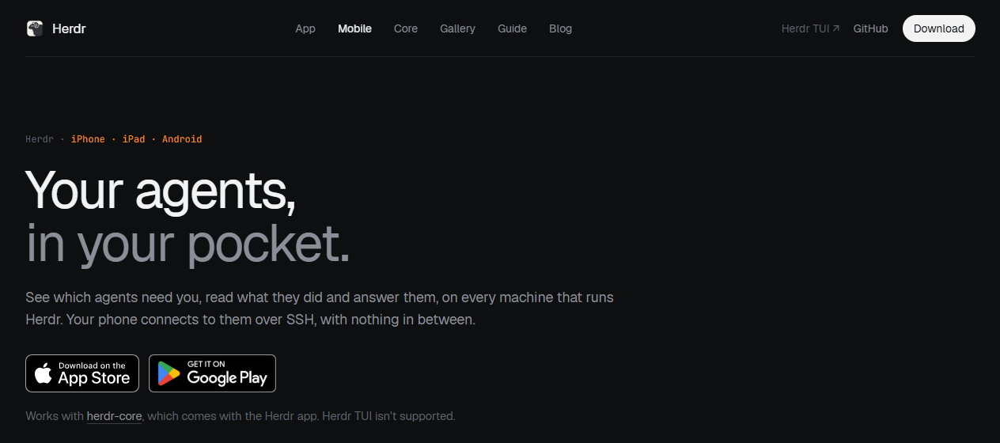
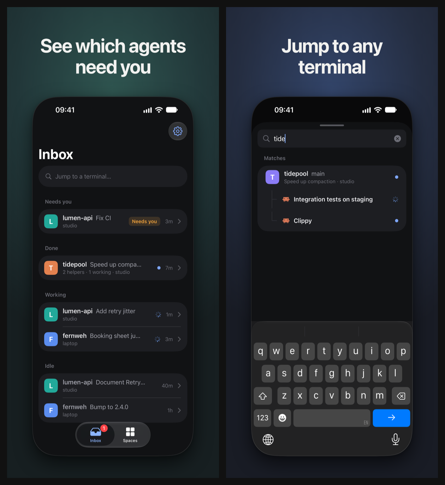
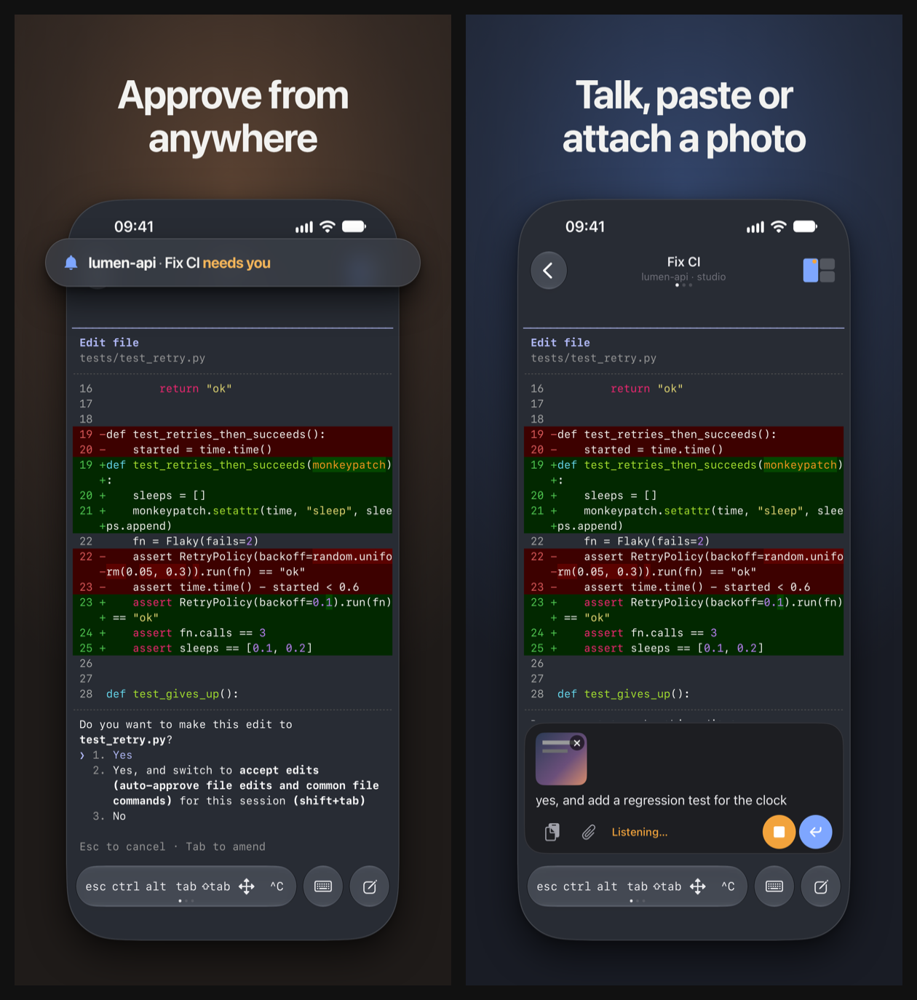
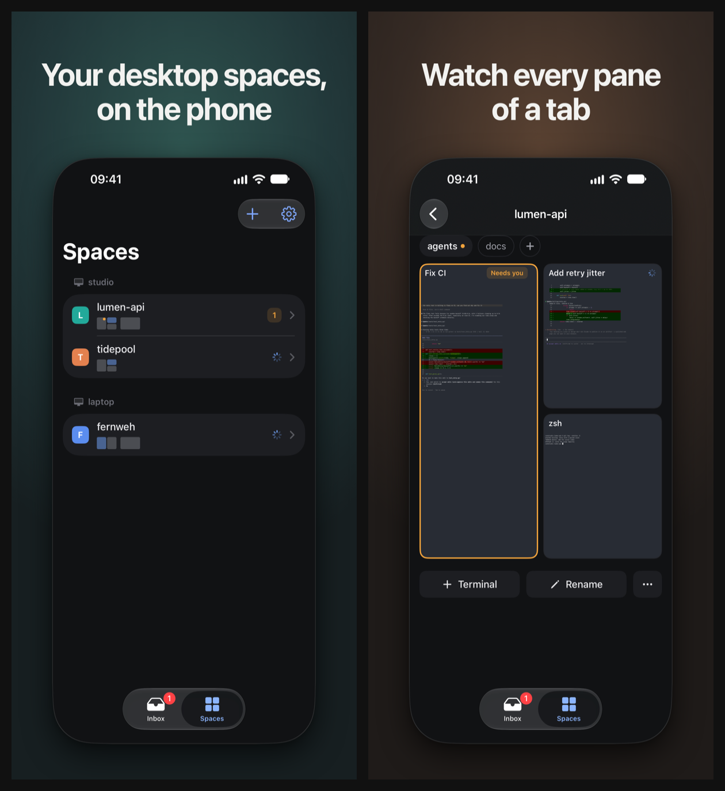
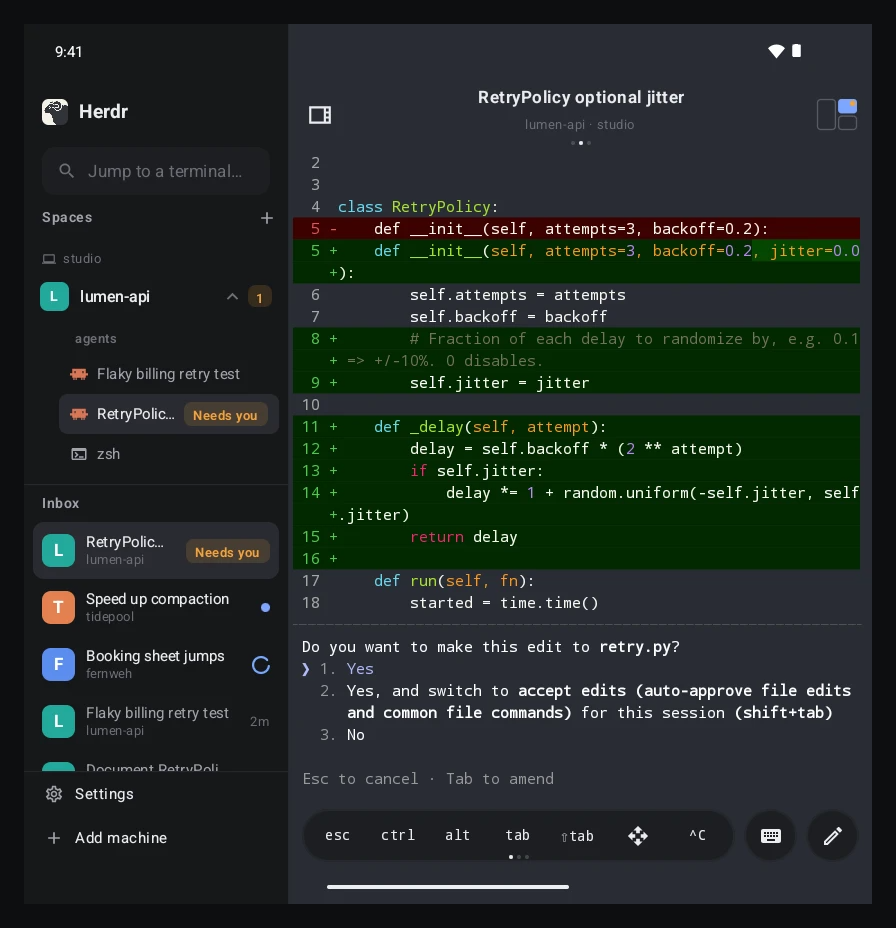
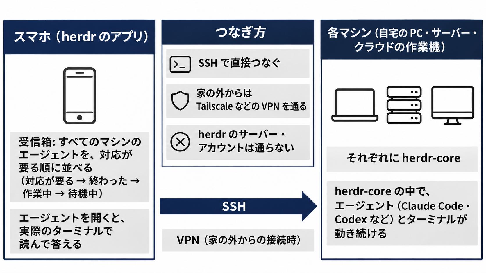

herdr に、公式のスマホアプリ（iPhone・iPad・Android）が出ました。
PC やサーバーで動いているコーディングエージェントを、スマホから見て、答えるためのアプリです。

福岡で AI による業務改善や自動化、Web 制作などに取り組んでいる Trellis です。
英語で書かれた公式サイトと App Store の説明・画面から、このアプリでできることを日本語でまとめました。
私はまだ実機では使っていないので、載せた画面は公式のものです（つなぎ方の図だけは、公式の説明をもとに作りました）。

この記事で分かること:

- herdr のスマホアプリの画面と、できること
- PC とのつなぎ方（SSH で各マシンに直接つなぐ）と、使う前に確かめたいこと

インストールの細かい手順は書きません。

## herdr のスマホアプリとは

公式の名前は「Herdr」で、作っているのは Herdr, Inc. です。
公式サイトのスマホアプリのページの見出しは「Your agents, in your pocket.」（あなたのエージェントを、ポケットに）です。

https://herdr.dev/mobile/

*出典: herdr 公式サイトのスマホアプリのページ（2026年11月12日に撮影）*

アプリは無料です。
App Store では iOS 26 以降が要り、2026年11月12日時点の版は 1.0.6 でした。
Android 版は Google Play から入れられます。

https://apps.apple.com/app/id6828898364

アプリがつなぐ先は、各 PC で動く herdr-core です。
herdr-core は、PC の中でエージェントとターミナルを動かし続ける部分で、新しく出た herdr-core と Herdr app のことは前の記事にまとめました。

https://zenn.dev/trellis/articles/herdr-core-app-vs-tui

## スマホアプリでできること

公式の説明を、画面ごとにまとめます。
画面の見た目は公式の画像で分かりますが、動きの説明は公式の文によるもので、私は確かめていません。

| 画面・機能 | できること |
| --- | --- |
| 受信箱（Inbox） | すべてのマシンのエージェントを、自分の対応が要る順に並べる |
| 検索 | どのマシンのどのターミナルにも飛ぶ |
| ターミナル | エージェントの実際のターミナルを開き、承認や質問に答える |
| まとめて送る | 長い文・画面のキャプチャー・写真・音声入力を、1 回で送る |
| スペース | PC の Herdr app で作った画面の配置を、スマホで見る |
| タブレット・折りたたみ | 一覧とターミナルを横に並べる |

### 対応が要るエージェントから見る受信箱

アプリを開くと、受信箱が出ます。
つないだすべてのマシンのエージェントが、自分の対応が要る順に並びます。

> The Inbox lists every agent on every machine, sorted by what it needs from you: needs you, done, working, idle.
>
> 訳: 受信箱には、すべてのマシンのすべてのエージェントが、あなたに求めていることの順に並びます。対応が要る、終わった、作業中、待機中、の順です。

まだ読んでいないものには青い点が付きます。
行を右にスワイプするとピン留めか既読に、左にスワイプするとそのエージェントに Esc を送れます。
下に引くか検索を押すと、どのマシンのどのターミナルにも飛べます。

*出典: App Store の Herdr の公式スクリーンショット（2026年11月12日に取得し、2 枚を横に並べた）*

### 実際のターミナルでの返事と、長い指示の送り方

受信箱でエージェントを開くと、そのエージェントが動いている実際のターミナルに入ります。
チャット風に作り直した画面ではなく、PC で動いているターミナルそのものです。

下の左の画面は、エージェントがファイルの変更の許可を求めているところです。
ターミナルに出た選択肢を、画面の下のキーで選んで答えます。
キーのバーには Esc・Ctrl・Tab・矢印が並び、並べるキーは変えられます。

長い指示は、別の入力画面で書いてから送ります（右の画面）。
文や画面のキャプチャーを貼る、写真を付ける、音声で入力する、のどれもできます。
書いたものはエージェントに 1 回の貼り付けとして入り、そのあと Enter が押されます。

*出典: App Store の Herdr の公式スクリーンショット（2026年11月12日に取得し、2 枚を横に並べた）*

付けた写真は PC に送られ、エージェントにはそのファイルの場所が打ち込まれます。
音声入力は、最初に 1 回だけダウンロードする音声認識のモデルで、スマホの中で文字にします。
スマホの OS の音声入力を使うこともできます。
App Store の 1.0.6 の更新内容によると、日本語などもターミナルに打てるようになりました。

### PC の画面の配置を、スマホで見るスペース

スペースは、PC の Herdr app で作る作業場の単位です。
1 つのスペースの中にタブがあり、タブの中にペイン（ターミナルの区画）が並びます。

PC の Herdr app で作ったスペースは、スマホにも出ます。
スペースの一覧では、マシンごとにスペースが分かれ、タブごとのペインの並びが縮小図で描かれます（下の左）。
タブを開くと、そのタブのペインがすべて、動いている状態のまま並びます（下の右）。

*出典: App Store の Herdr の公式スクリーンショット（2026年11月12日に取得し、2 枚を横に並べた）*

公式の説明では、スマホで見ていても、PC 側の大きさは何も変わりません。

> Watching from the phone never resizes anything on your computer.
>
> 訳: スマホで見ていても、PC の画面の大きさは何も変わりません。

前に T3 Code と herdr の記事で、これまでの herdr の画面をスマホからつなぐと、PC 側のペインまで縮む、と書きました。
公式のアプリは別の作りですが、この点をはっきり書いています。

https://zenn.dev/trellis/articles/t3code-herdr-mobile-agents

ターミナルとエージェントは、Herdr app を開いていなくても出ます。
スペースが出るのは、その PC で Herdr app も動いているときです。

### 大きな画面では、一覧とターミナルを横に並べる

iPad や、折りたたみのスマホを開いた状態では、一覧とターミナルが横に並びます。
左にスペースと受信箱、右に選んだエージェントのターミナルが出るので、次のエージェントを選びながら答えられます。

*出典: herdr 公式サイトのスマホアプリのページの画像（2026年11月12日に取得）*

## PC とのつなぎ方

### SSH で、各マシンの herdr-core に直接つなぐ

このアプリの特徴の 1 つが、つなぎ方です。
スマホは、各マシンの herdr-core に SSH で直接つなぎます。
herdr のアカウントも、herdr の会社のサーバーも、あいだに入りません。

> Your phone talks to herdr-core on each machine over SSH.
>
> There's no Herdr account and no server of ours in between.
>
> 訳: スマホは、各マシンの herdr-core と SSH で話します。herdr のアカウントも、私たちのサーバーも、あいだにはありません。

*公式の説明をもとに作った図（公式の画面ではない）*

公式の説明から読み取れるつなぎ方は、次のとおりです。

1. つなぐ PC やサーバーに herdr-core を入れる（Herdr app に付いてくるほか、単体でも入れられる）。そのマシンには、スマホから SSH でログインできるようにしておく
2. アプリで、マシンの名前かアドレスを入れてつなぐ
3. アプリが作った鍵をマシンに 1 回登録する（Tailscale SSH なら、鍵の設定は要らない）
4. 1 台つなぐと、つないだマシンの SSH の設定にあるホストと、Tailscale の機器から、ほかのマシンも候補に出る

家の外からつなぐときは、Tailscale などの VPN を使うよう案内されています。

### 使う前に確かめたいこと

- **SSH が前提**: スマホから各マシンに SSH でつなげることが前提です。SSH を使わずにつなぐ Herdr Cloud は、公式ブログ（2026年9月）で「次に足す部品」とされていて、スマホアプリのページには出てきません。
- **TUI は対象外**: これまでの herdr の TUI には対応していません。herdr-core が要ります。
- **受信箱に並ぶエージェント**: 受信箱に並ぶのは、OSC 7501 という仕組みで状態を herdr に知らせるエージェントです。App Store の説明では、Claude Code・Codex・Amp・OpenCode・Pi を見分け、ほかのプログラムはただのターミナルとして出るとしています。
- **閉じているときの通知は書かれていない**: 公式の説明にあるのは、アプリを開いているときに出る知らせです。アプリを閉じているときの通知があるかは、書かれていませんでした。
- **PC は動かしたまま**: マシンが再起動したり herdr-core が止まったりすると、その中のプログラムも止まります。

https://herdr.dev/blog/connecting-the-machines/

## SSH の受け口を開けたくないときは

私の PC には、外から SSH でつなぐ受け口を作っていません。
外から PC に入れる経路を増やすことに、セキュリティの面で不安があるためです。

この不安がはっきりしたのが、2026年10月に見つかった Tailscale の SSH の機能（Tailscale SSH）の問題でした。
Tailscale は調査の報告で、こう書いています。

> Most of the Tailscale SSH issues we've identified concern privilege escalation.
>
> 訳: 私たちが見つけた Tailscale SSH の問題の多くは、権限の昇格に関するものです。

https://tailscale.com/ssh-investigation-update

公報の TS-2026-014 が対象にしているのは、Tailscale SSH を使い、アクセスの決まりで転送（ポートフォワード）を許していた構成です。
その構成では、root しか触れないはずの口（Docker のソケットや、Tailscale 自身を操作する口）に届いてしまうとされています。

悪用には、つなぐことを許された機器が要り、問題は Tailscale 1.104.4 で直っています。

https://tailscale.com/security-bulletins

これは Tailscale SSH の 1 つの不具合で、SSH が全般に危ないという話ではありません。
それでも、外から入る経路を足せば、その経路の不具合の影響を受ける場所が増えます。

そこで私は、T3 Code のスマホアプリを使い、PC から外向きにトンネルを張って運用しています。
T3 Code の中継も外から PC に届く経路であることは変わりませんが、PC で SSH のサーバーを立てたり、受信のポートを開けたりせずに済みます。
画面での使い方は、次の記事にまとめました。

https://zenn.dev/akaringo1109/articles/t3code-mobile-multi-agent

## 試すときの最初の一歩

アプリには「Try the demo」があり、マシンをつながなくても、架空の 2 台のマシンで画面を触れます。
まずデモで、受信箱とターミナルの動きが自分の使い方に合うかを確かめられます。
合いそうなら、PC に herdr-core を入れ、スマホから SSH でつなげるようにするところから始めます。

## Trellis のこと

Trellis は、福岡でホームページの制作と、AI による業務の自動化に取り組んでいます。
記事は Zenn と、Trellis のサイトのブログの両方に載せています。

https://trellis-grow.com/?utm_source=zenn&utm_medium=referral&utm_campaign=herdr-mobile-app&utm_content=card
