Mermaid の文をブラウザ無しで SVG にできる別エンジン「Pele」を、本家の Mermaid.js と描き比べました。
コンサルティング会社で AI 導入をリードしながら、福岡の Trellis で AI による業務改善・自動化を担当している伊藤です。

私は Zenn の記事や設計書で Mermaid をよく使います。
記事を自社のブログに取り込む処理では、ブラウザを立ち上げて Mermaid.js で図を画像にしています。

**この記事で分かること**

- Pele が何をする道具か
- Mermaid.js と比べて、何が同じで何が違うか
- どちらをどこで使うか

細かい数字と測り方は、各節の折りたたみに入れました。

## Pele とは

Pele は、Mermaid の文を SVG に変換するレンダラーです。
Obsidian を開発する obsidianmd が、MIT ライセンスで公開しています。

> Renders Mermaid diagrams faster than you'd run from a volcano! 🌋

リポジトリの説明にあるキャッチコピーです。
火山から逃げるより速く Mermaid の図を描く、という意味で、速さを売りにしています。

https://github.com/obsidianmd/pele


*リポジトリの先頭。説明にキャッチコピーと「pele.run」へのリンクがある（2026-10-27 に撮影）*

README では、小さく、同期で、実行時の依存がなく、色とフォントに CSS 変数を使うと説明されています。
Mermaid 12.1.0 に組み込まれた図種をすべて扱い、レイアウトと見た目は独自に持つ、とも書かれています。

使い方は、npm のパッケージを入れて、Mermaid の文を渡すだけです。

```bash
npm install pele
```

```js
import fs from "node:fs";
import { render } from "pele";

const { svg } = render(`flowchart LR
  A[開始] --> B[終了]`);
fs.writeFileSync("diagram.svg", svg);
```

ブラウザでページの要素に描くときは `mount()` を使います。
CSS のフォントを読み、親要素の幅に合わせて描いてくれます（今回は試していません）。

## 描き比べた結果のサマリー

同じ Mermaid の文を Pele と Mermaid.js に渡して、8 種類の図で比べました。
フローチャート、シーケンス図、クラス図、状態遷移図、ER 図、ガントチャート、円グラフ、マインドマップです。

一言でいうと、**Pele は Mermaid の書き方をそのまま受け付けて、ブラウザ無しで、ずっと速く SVG を返します。**
ただし、見た目は別物です。

| 観点 | Mermaid.js | Pele |
| --- | --- | --- |
| 書き方 | 本家 | Mermaid の書き方をそのまま受け付ける。手元で試した図はどれもエラー無く描けた |
| 動く場所 | ブラウザが要る（画面の部品を置いて文字を測る） | Node でもブラウザでも動く。ブラウザの部品を使わない |
| 速さ | 画面に 1 枚描くには十分速い | 8 種類のどの図でも 30 倍以上速い |
| 大きさ | ライブラリも SVG も大きい | ライブラリは約 1/7。SVG も 1.8〜9 倍小さい |
| 見た目とテーマ | 角丸と淡い紫。テーマを指定できる | フラットで詰まった配置。色は CSS 変数で変える |
| ラベルの HTML | 描画する | 文字として扱う |

図の中身（ノードと線のつながり）は同じです。
変わるのは配色と余白、配置の詰め方で、同じ文でも別の図のように見えます。


*同じ Mermaid の文を、上が Mermaid.js、下が Pele で描いた*

速さの差は、いちばん小さいガントチャートで約 33 倍、いちばん大きい ER 図で約 100 倍でした。
Mermaid.js は図によって描く時間に開きがありましたが、Pele はどの図もほぼ同じ速さでした。

:::details 8 種類の図の時間と SVG の大きさ
| 図 | Mermaid.js | Pele | Mermaid.js の SVG | Pele の SVG |
| --- | ---: | ---: | ---: | ---: |
| フローチャート | 45.1 ms | 0.6 ms | 17.3 KB | 3.8 KB |
| シーケンス図 | 11.2 ms | 0.2 ms | 24.7 KB | 3.8 KB |
| クラス図 | 43.0 ms | 0.3 ms | 21.5 KB | 3.0 KB |
| 状態遷移図 | 41.0 ms | 0.5 ms | 28.4 KB | 3.3 KB |
| ER 図 | 40.0 ms | 0.4 ms | 47.5 KB | 6.1 KB |
| ガントチャート | 6.6 ms | 0.2 ms | 10.9 KB | 3.1 KB |
| 円グラフ | 5.1 ms | 0.1 ms | 4.6 KB | 2.5 KB |
| マインドマップ | 43.9 ms | 0.1 ms | 34.6 KB | 3.7 KB |

時間は Edge のページ内で 10 回描いた中央値です。
Pele の値は 1 ms 未満と小さく、実行ごとの幅も大きいので、目安として読んでください。


*シーケンス図。左が Mermaid.js、右が Pele。Pele は参加者の箱とメッセージの間隔が詰まる*


*ER 図。左が Mermaid.js、右が Pele。Pele は属性の行が詰まり、PK の位置も右端に寄る*
:::

:::details 比べた 8 種類の Mermaid の文
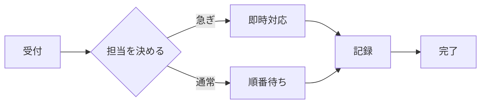

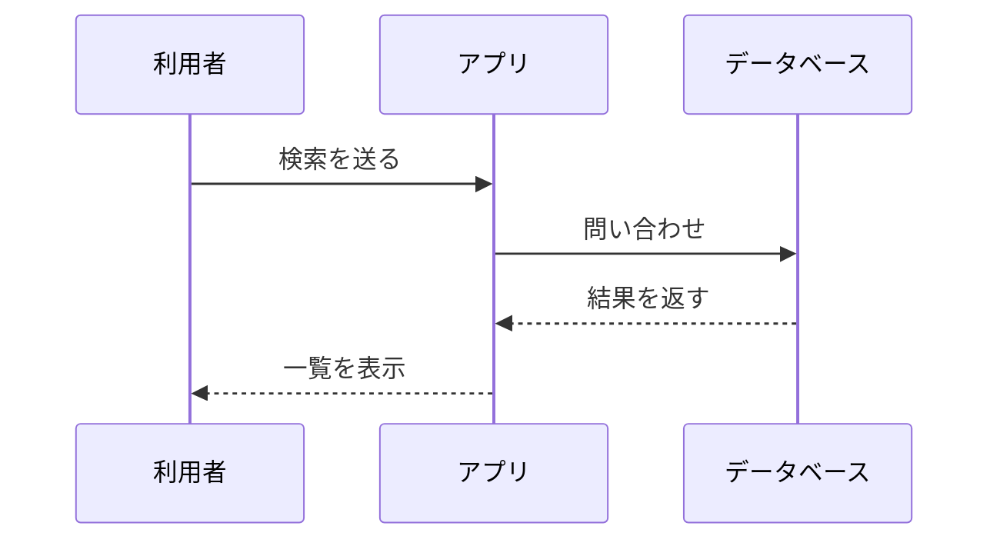

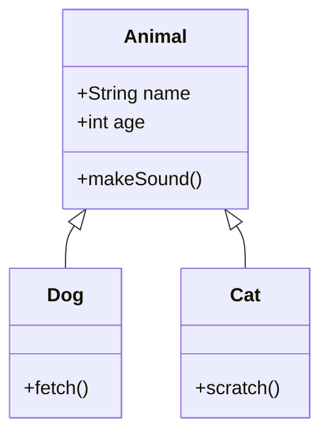

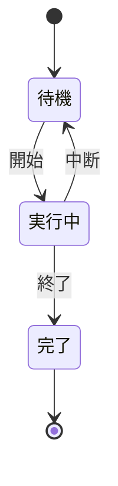

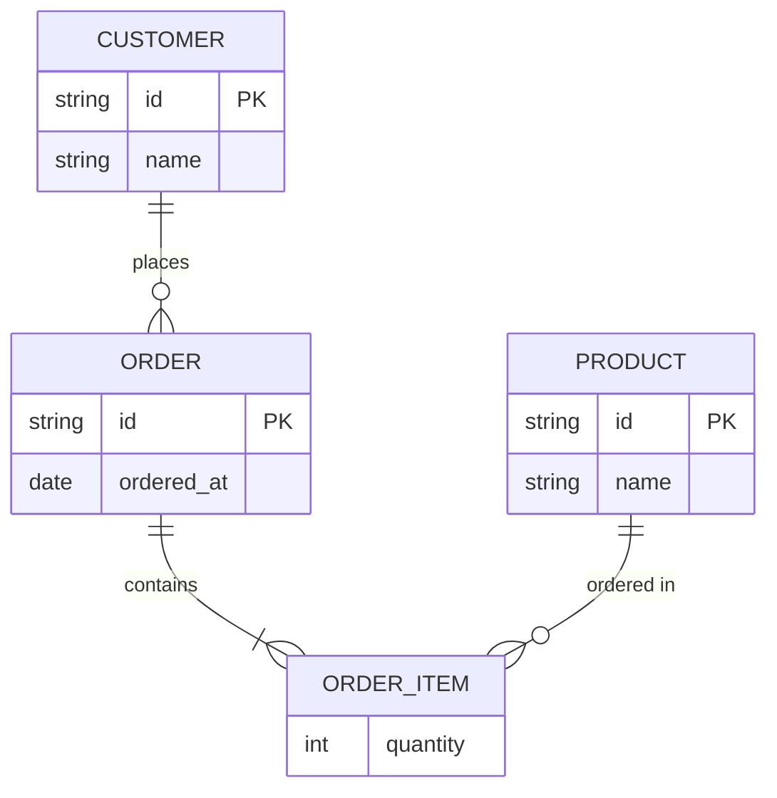

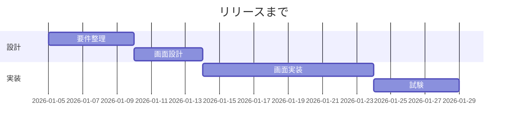

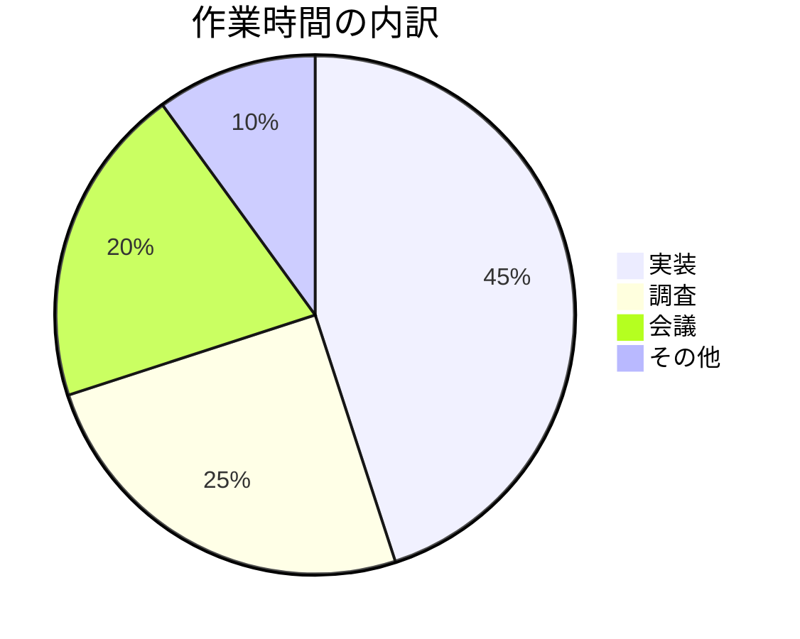

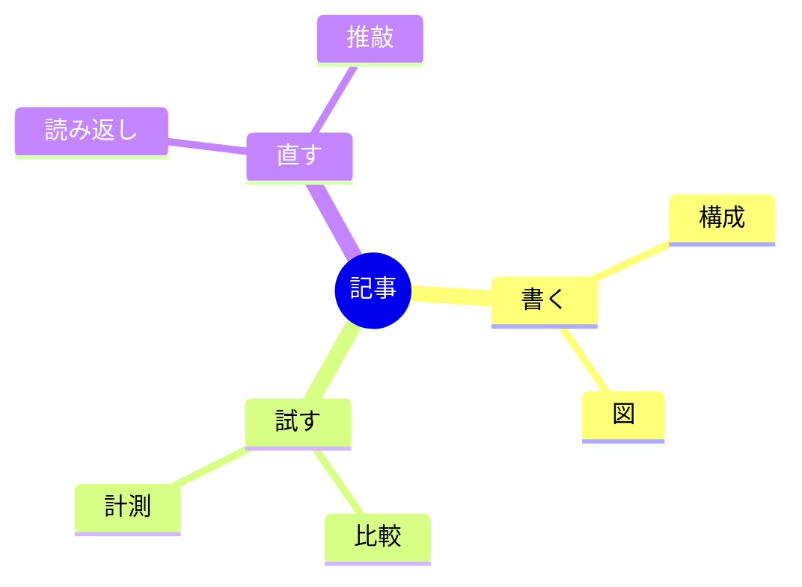
:::

:::details 試した環境と測り方
| 項目 | 値 |
| --- | --- |
| OS | Windows |
| CPU | Intel Core Ultra 7 265H（16 スレッド） |
| Node / npm | 24.22.1 / 11.19.1 |
| pele | 1.12.0 |
| mermaid | 12.2.0 |
| ブラウザ | Microsoft Edge 156.0.4314.42（headless、playwright-core から起動） |
| 日付 | 2026-10-27 |

Mermaid.js は `mermaid.min.js` を読み込んだ HTML を Edge で開き、ページ内で `mermaid.render()` を呼びました。
Pele も同じ条件で比べるため、Edge のページ内で `pele.render()` を呼んで測っています。

どれも空回しのあとに 10 回呼び、`performance.now()` で測った中央値を採りました。
Mermaid.js の時間には、内部の非同期処理と一時的な画面の部品の作成も含まれます。

Pele が対象にしているのは Mermaid 12.1.0 で、手元の Mermaid.js は 12.2.0 です。

```js
// Edge のページ内での計測（抜粋。Mermaid.js は window.mermaid.render を await する）
const times = await page.evaluate((text) => {
  window.pele.render(text);
  const out = [];
  for (let i = 0; i < 10; i++) {
    const t0 = performance.now();
    window.pele.render(text);
    out.push(performance.now() - t0);
  }
  return out;
}, text);
```
:::

## ブラウザを使わないから、速くて軽い

### 描き方の違い

速さの差は、主に描き方の違いから来ます。
Mermaid.js はブラウザの中で、画面に部品を置いて文字の幅を測り、配置を決めます。
Pele はブラウザの部品を使わずに、文字の幅を自分で測って SVG を直接組み立て、すぐに返します。

ブラウザが要らないので、Node だけで図を作れます。
私の取り込みの処理がブラウザを立ち上げているのは、Mermaid.js で描くためです。

### ライブラリと SVG の大きさ

ライブラリの大きさも違います。
配布ファイルはどちらも minify 済みです。

| ファイル | そのまま | gzip |
| --- | ---: | ---: |
| Pele 全体（pele.js） | 709 KB | 268 KB |
| Pele のフローチャートだけ | 141 KB | 56 KB |
| Mermaid.js（mermaid.min.js） | 5.2 MB | 1.5 MB |

Pele 全体でも Mermaid.js の約 1/7、gzip で約 1/6 です。
使う図種を絞って `pele/core` と `pele/diagrams/flowchart` だけを esbuild でまとめると、gzip で約 56 KB まで減りました（このまとめたもので描くところまでは試していません）。

SVG が小さいのは、主にスタイルの持ち方の違いです。
Mermaid.js は図ごとにテーマの CSS を `<style>` として埋め込みます。

手元の ER 図では 3.1 KB、マインドマップでは 17.5 KB がスタイルでした。
Pele の SVG には `<style>` が無く、色は CSS 変数で持つので、テーマの CSS を図ごとに繰り返しません。

### 何枚もまとめて作るときに効く

1 枚なら、Mermaid.js でも待つほどの時間はかかりません。
差が効くのは、ビルドや CI でまとめて作るときです。

ノード 101 個を一直線につないだ大きなフローチャートでは、Pele が 2.6 ms、Mermaid.js が 207 ms で、約 80 倍の差でした。
同じくらいの図を 100 枚作るなら、描く時間だけで Mermaid.js は 20 秒あまり、Pele は 1 秒もかかりません（読み込みと保存は含みません）。

## Mermaid の書き方はどこまで通るか

### エラー無く描けた書き方

Pele は Mermaid 12.1.0 の構文を対象にしています。
パーサーは、Mermaid のテストと差分ファジング（2 つの実装に同じ入力を与えて違いを調べるテスト）で確かめている、と README にあります。

手元では、次の書き方がエラー無く描けました。
確かめたのは、構文を受け付けて SVG が返ることと、出力を目で見た範囲です。

- 基本の 8 種類に加えて、timeline、block、architecture、C4、sankey、xychart
- `subgraph` の入れ子、シーケンス図の `loop`・`alt`・`par`・`box`・`activate`
- ガントチャートの `excludes weekends` と `todayMarker off`
- ノードの形の指定 `A@{ shape: cyl }`、`click` のリンク
- ラベルの `<br>`・`<b>`・Markdown の `**太字**`
- `classDef` と `style` によるノードの色

### Mermaid.js と同じにならない所

- **テーマの指定は無視される。** `%%{init: {"theme": "forest"}}%%` や frontmatter の `theme`・`themeVariables` は効かず、既定の色のままです。色は CSS 変数で指定します（次の節）。
- **HTML ラベルのスタイルは落ちる。** `<span style="color:red">` は、色が落ちて文字だけ残ります。`<br>` と `<b>`、Markdown はテキストの属性に変換されます。
- **ELK の配置にはならない。** `flowchart-elk` はエラーにはなりませんが、ELK（グラフを自動で配置する仕組み）の配置にはならず、手元の簡単な文では通常の flowchart と同じ SVG でした。

エンジンによる差の例もあります。
sankey 図の日本語ラベルは、Pele 1.12.0 では引用符で囲めば描けましたが、Mermaid.js 12.2.0 では引用符付きでも構文エラーになりました。

:::details 試した書き方の例（テーマ・色・ELK・日本語ラベル）
次の 3 つは、1 つ目が Pele では既定色のまま、2 つ目は Pele でも指定した色が付き、3 つ目は通常の flowchart と同じ出力でした。

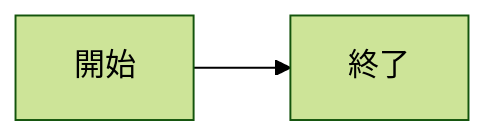

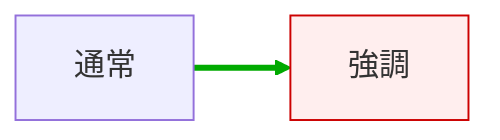


sankey の日本語ラベルは、引用符付きで Pele は描け、Mermaid.js は `Parse error on line 2: ... Expecting 'DQUOTE', got 'ESCAPED_TEXT'` でした。

```text
sankey-beta
"問い合わせ","一次対応",60
"問い合わせ","直接回答",40
```

xychart の日本語は、引用符で囲めばどちらも描け、外すとどちらも `Lexical error on line 3: Unrecognized text.` でした。

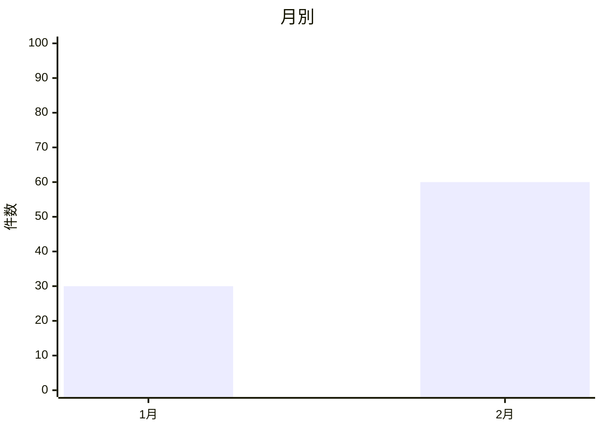
:::

## 見た目とテーマは引き継がれない

Pele の色は、SVG の CSS 変数で決まります。
SVG を HTML に直接埋め込むなら、図か親要素に変数を置くと、その色になります。

```css
.pele {
  --pele-bg: #fffcf0;
  --pele-fg: #100f0f;
  --pele-surface: #f2f0e5;
  --pele-border: #cecdc3;
  --pele-accent: #205ea6;
  --pele-radius: 2px;
}
```


*上が既定、下が CSS 変数で背景・面・線・角丸を変えたもの*

README では、色は描き直さずにテーマの変更に追従すると説明されています。
SVG を作り直さずに、ダークテーマへ切り替えられます。

気をつける所は 2 つです。

- **保存した SVG を `` で出すと、ページの CSS 変数は届かない。** SVG の中の既定の色になります。色を変えた SVG を配るなら、SVG のルートに `--pele-*` を書くか、インラインで埋め込みます。
- **Mermaid.js のテーマは移らない。** `classDef` と `style` の色は反映されますが、図全体の配色をそろえたいなら、Mermaid.js のテーマを CSS 変数に写す作業が要ります。既存の図の配色を全部そろえるなら、ここが一番の手間になりそうです。

## 信頼できない図も扱える

人が書いた図をサーバーで描くなら、図の文に悪意のある HTML やリンクが混ざることを考えます。
Pele は図のテキストをエスケープし、リンクとスタイルを絞り、入力と出力の大きさに上限を置く、と README にあります。

ラベルに HTML やスクリプトを混ぜて、Mermaid.js と比べました。

| 入れたもの | Pele | Mermaid.js（`securityLevel: "strict"`） |
| --- | --- | --- |
| `<script>alert(2)</script>` | 文字として表示 | 実行されない |
| `` | タグごと文字として表示 | `onerror` は落ちるが、`` タグは残る |
| `click` に `javascript:` の URL | リンクを出力しない | 試していない |
| `click` に `https://` の URL | 残り、`target="_blank"` と `rel="noopener"` が付く | 試していない |

SVG をページに入れ、ダイアログが出ないことを Playwright で見張って、どちらもスクリプトが動かないことを確かめました。
ただし HTML の扱いは同じではなく、Pele は HTML を描画せず文字として扱うので、ラベルの見た目は Mermaid.js と変わります。

信頼できない図を扱うときは、SECURITY.md に従って、リンクと画像も切れます。

```js
const { svg } = render(text, { links: false, images: false });
```

SECURITY.md にはほかに、エラーは `textContent` で表示する、アイコンは信頼できるものだけ渡す、`options` と `options.config` を図の作者に渡さない、時間制限が要るなら worker で描く、といった注意があります。
ブラウザの `mount()` には `sanitize` の関数も渡せます。

https://github.com/obsidianmd/pele/blob/main/SECURITY.md

## どこで Mermaid.js を使い、どこで Pele を使うか

分け方は、図を描くのが誰かです。

- **表示する側が描く場所（Zenn、GitHub、Obsidian）は、その場所のエンジンに任せる。** Pele に置き換えると見た目が変わり、テーマもそのままでは移りません。
- **自分が SVG を作って保存・配信するなら Pele。** ビルド、CI、サーバー、バッチの処理です。ブラウザが要らず、速く、SVG も小さくなります。
- **アプリの中で図を出すなら、`mount()` と CSS 変数でページのテーマに色を合わせられる。** 今回は `mount()` は試していません。
- **Mermaid.js の見た目やテーマ、HTML のラベル、ELK の配置をそのまま使いたいなら、Mermaid.js のまま。**

私の使い方では、Zenn の記事は表示する側が描くので、そのまま任せます。
記事中の Mermaid を画像にして取り込む処理は、ブラウザを立ち上げずに済む Pele に寄せられそうです。
ただし取り込みでは PNG にしているので、SVG を画像にする道具が別に要ります（ここは試していません）。

今回の比較は、見た目を比べたのが 8 種類で、時間は 1 台の PC の値です。
見た目を比べた Pele の SVG は Node の `render()` で作り、ブラウザの `mount()` は通していません。

試すなら、手元の図を 1 枚 Pele の `render()` に通し、Mermaid.js の出力と並べてみるのが早いです。
見た目が許せるなら、SVG を作る処理だけを Pele に替えられます。

## Trellis のこと

Trellis は、福岡でホームページの制作と、AI による業務の自動化をしている会社です。
記事は Zenn と、Trellis のサイトのブログの両方に載せています。

https://trellis-grow.com
