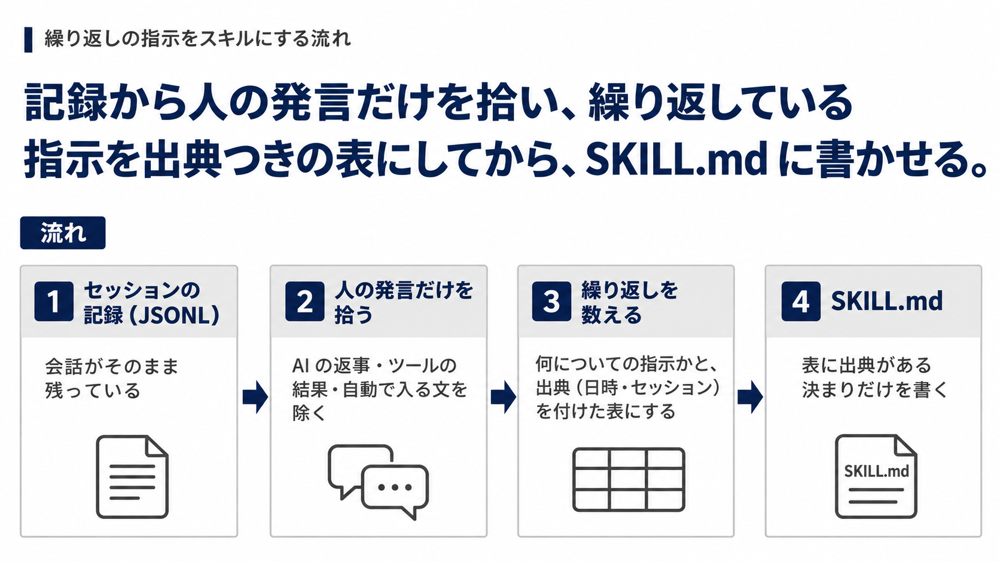
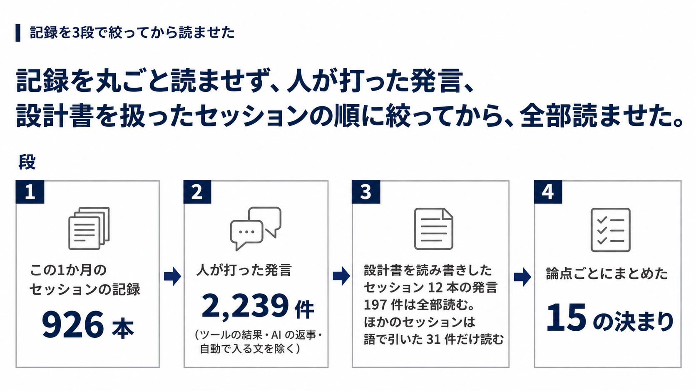

AI に設計書を書かせるたびに、私は同じ指摘を打ち直していました。
その指摘は Claude Code のセッションの記録（JSONL）に日時つきで残っています。

そこで記録から私の発言だけを拾わせ、繰り返している指示を出典つきの表にしてから、SKILL.md に書かせました。
頼んでから SKILL.md ができるまでは約 35 分で、次からは同じ指摘を打つ代わりにスキルを呼びます。

この記事で分かるのは、次のことです。

- 自分の指示が Claude Code のどこにどんな形で残っているか
- 記録から人の発言だけを拾い、繰り返している指示を見つける方法
- 見つけた指示を、出典つきで SKILL.md にまとめる方法

設計書の書き方と、できたスキルの全文は書きません。

## 設計書を書かせるたびに繰り返していた指摘

私は、作ったスキルや仕組みを外の人に説明する設計書を AI に書かせています。
AI が書く最初の版は長く、私は直させるたびに似た指摘を返していました。

- 「文字文字してて見にくすぎ。…可視化とスマホでレビューできるぐらいの情報量が肝要です」
- 「なるべく引き算。これ以上情報があっても人間が見れないから、本当に必要な情報、設計思想として書くべき内容を」
- 「アコーディオンにしまい込んで、タンスの奥底にしまい込んだみたい」（長い説明を、折りたたみに入れただけの版に）

次の設計書を書かせると、また同じことを言うことになります。

スキルにするよう頼んだときの私の言葉は「そのたびに毎回プロンプティングして指示するのは非常に非効率なので、これまで指示した内容をスキル化しておきたいです」でした。

## セッションの記録の置き場所と中身

Claude Code はセッションごとの会話を JSONL のファイルに残しています。
置き場所は `~/.claude/projects/<プロジェクト>/` で、Windows では `%USERPROFILE%\.claude\projects\` の下です。
公式のドキュメントは中身を次のように説明しています。

> `projects/<project>/<session>.jsonl` | Conversation transcript: messages, tool calls, and tool results, plus the system prompt, tool definitions, and parameters of the requests Claude Code sent the model
>
> 訳: 会話の記録。メッセージ、ツールの呼び出しと結果に加え、Claude Code がモデルに送ったリクエストのシステムプロンプト、ツールの定義、パラメーター。

https://code.claude.com/docs/en/claude-directory

私が打った指示も、ここに入っています。
ただし記録の大半は AI の返事とツールの結果で、人が打った発言はごく一部です。
そのまま読ませると、指示が埋もれます。

記録は `settings.json` の `cleanupPeriodDays`（既定 30 日）より古くなると消されます（細かい条件は上のドキュメントにあります）。
集めたい指示があるなら、早めに集めるか、この値を延ばしておきます。

記録には、ツールが読んだファイルの中身やコマンドの出力もそのまま入っています。
業務の記録を AI に読ませるなら、読ませる前に、渡してよい範囲かを確かめます。

## 記録から繰り返しの指示を見つける方法

全体の流れはこの図のとおりです。



*人の発言だけを拾い、出典つきの表にしてから SKILL.md にする*

### 人が打った発言の見分け方

記録の 1 行は発言・AI の返事・ツールの結果などの出来事 1 つです。
人が打った発言は、次の決まりで拾わせました。

- `type` が `user` で、本文が文字列か、`type: text` の要素を持つ行を拾う
- `tool_result` の要素を持つ行は除く（`type` が `user` でも、中身はツールの結果）
- `isMeta` の行、会話の要約（`isCompactSummary`）の行と、`<system-reminder>` や `<command-name>` のように自動で入る文で始まる発言は除く

記録のファイルは大きいので、全体を読み込まず、1 行ずつ JSON として読ませます。
この決まりで書いたスクリプトを載せます。

:::details 人が打った発言の候補を抜き出すスクリプト（Python 3.7 以降）
```python
"""Claude Code のセッションの記録（JSONL）から、人が打った発言の候補を抜き出す。

使い方:
  python extract_my_messages.py <記録.jsonl> [<記録.jsonl> ...] [--grep 語]
"""
import json
import os
import sys
from datetime import datetime, timedelta, timezone

LOCAL = timezone(timedelta(hours=9))  # 日本時間で出す
# 人が打っていない、自動で入る文の書き出し
SKIP = ("<system-reminder>", "<command-", "<local-command",
        "<task-notification>", "[Request interrupted")


def text_of(content):
    if content is None:
        return ""
    if isinstance(content, str):
        return content
    return "\n".join(c.get("text", "") for c in content
                     if isinstance(c, dict) and c.get("type") == "text")


def main():
    sys.stdout.reconfigure(encoding="utf-8")
    sys.stderr.reconfigure(encoding="utf-8")
    args = sys.argv[1:]
    word = None
    if "--grep" in args:
        i = args.index("--grep")
        if i + 1 >= len(args):
            sys.exit("--grep のあとに語を書いてください")
        word = args[i + 1]
        del args[i:i + 2]
    for path in args:
        path = os.path.expanduser(path)
        session = os.path.basename(path)[:8]
        with open(path, encoding="utf-8") as f:
            for lineno, line in enumerate(f, 1):  # 1 行ずつ読む（全体を載せない）
                try:
                    d = json.loads(line)
                except json.JSONDecodeError:
                    continue
                if d.get("type") != "user" or d.get("isMeta") or d.get("isCompactSummary"):
                    continue
                content = (d.get("message") or {}).get("content")
                if isinstance(content, list) and any(
                        isinstance(c, dict) and c.get("type") == "tool_result" for c in content):
                    continue  # ツールの結果を含む行は丸ごと除く
                text = text_of(content).strip()
                if not text or text.startswith(SKIP):
                    continue
                if word and word not in text:
                    continue
                ts = datetime.fromisoformat(d["timestamp"].replace("Z", "+00:00"))
                print(f"## {ts.astimezone(LOCAL):%Y-%m-%d %H:%M}  {session}:{lineno}")
                print(text)
                print()


if __name__ == "__main__":
    main()
```

Git Bash などで `python extract_my_messages.py ~/.claude/projects/<プロジェクト>/*.jsonl --grep 設計書` のように使います。
発言ごとに、日時（日本時間）と、セッション ID の先頭 8 桁・行番号を出します。
自動で入る文は書き出しでしか除いていないので、出てくるのは候補です。
読んで見分けてください。
見分け方は私の手元の記録（2026 年 10〜11 月のもの）で確かめました。
:::

### 指示を取りこぼさない絞り込み方

拾った発言を語で引くだけだと、その語を含まない指示を落とします。
たとえば「もっとシンプルに言えないか」という見出しへの指摘には、設計書という語がありません。

そこで最初に集めたときは、設計書を読み書きしたセッションに絞り、その中の発言は全部読ませました。
セッションは、設計書のフォルダ名とファイル名を手がかりに選ばせています。
ほかのセッションは語で引いた発言だけを読ませました。



*人の発言、設計書を扱ったセッションの順に絞ってから、全部読ませる*

論点ごとにまとめると、1 つの論点に日付の違う私の発言がいくつも集まりました。
それが、毎回繰り返していた指示です。

2 回目からは、前にまとめたメモを渡し、そのメモに無い発言だけを足させると、全体を読み直さずに済みます。
スキルにしたときも、そうしました。

## 拾った指示を SKILL.md にする方法

拾った発言はそのまま SKILL.md にせず、いったん出典つきの表にさせます。
出典があれば、決まりの 1 つずつがどの発言から来たかをたどれます。
列は日時・私の言葉（原文の一部）・何についての指示か・出典（セッション ID の先頭 8 桁と行番号）です。

:::details 記録から指示を集めさせる頼み方（実際の指示をもとに、パスと名前を置き換え、初めて集めるとき向けに直したもの）
```text
私（このPCの持ち主）が <文書の種類> について出した指示・直させたこと・その理由を、
Claude Code のセッションの記録から出典つきで集めてください。
あとで「<文書の種類> を書くスキル」の根拠にします。
読むだけで、書くファイルは <出力先> の 1 つだけです。

## 読む範囲
~/.claude/projects/<プロジェクト>/*.jsonl

## 私の発言の見分け方
- jsonl の 1 行 = 1 イベント。type が user で、message.content が文字列、
  または type: text の要素を持つもの。tool_result の要素を持つものはツールの結果なので除く。
- isMeta・<command-name>・<system-reminder>・<local-command-stdout> だけのものは除く。

## やり方
- ファイルは大きい。python で 1 行ずつ json.loads し、user の text だけを取り出す
  （全体をメモリに載せない）。
- <文書の種類> を読み書きしたセッションの発言は全部読む。
  ほかのセッションはキーワードで引き、前後の発言も読んで文脈を確かめる。
- timestamp（UTC）は日本時間に直して書く。

## 出力
1. 要点（繰り返し出てくる決まり・考え方。1 つ 1〜2 文）
2. 表: | # | 日時 | 私の言葉（原文の一部、80 字以内） | 何についての指示か（一般の決まりに言い直して） | 出典（セッション ID の先頭 8 桁:行番号） |
```

実際の指示には前のメモとの重複の扱いなども入っていました。
この形のままでは流していません。
:::

SKILL.md はこの表と、直させた設計書を渡して書かせました。
書かせるときの注文は次の 4 つです。

- ファイルは SKILL.md の 1 つだけにする
- 決まりは材料から取ったものだけにする
- 人の名前と顧客の情報は書かず、一般の決まりに直して書く
- 短く保つ（目安は 300 行以内）

私の言葉と、それが SKILL.md でどの文になったかの例です。

| 私の言葉（日付と出典） | SKILL.md の文 |
| --- | --- |
| 「なるべく引き算。…設計思想として書くべき内容を」（10/6、`5fa5c868`） | 段落・表・箇条の 1 つずつについて「これが無いと、なぜそう設計したかが伝わらないか」を問い、無くても伝わるものは消す。 |
| 「アコーディオンにしまい込んで、タンスの奥底にしまい込んだみたい」（9/29、`5e3ab641`） | 削ったうえで残したい補足・理由・詳細表だけを、`<details>` に畳む。畳むだけで削ったことにはしない。 |

出典をたどると、私が言っていない決まりも見分けられました。
折りたたみの外の本文を 6,000 字までにする目安は、私ではなく AI が置いた数字でした。
AI の報告も、この数字が私の言葉ではないと断ったうえで、このまま進めてよいかを私に確かめていました。

## できたスキルと作り直した結果

できたのは `.claude/skills/design-doc/SKILL.md` の 1 ファイルで、作った時点で 212 行でした。
`/design-doc <対象のフォルダ>` で呼び出します。

このスキルで設計書を 1 本作り直させると、折りたたみの外の本文は 6,002 字から 3,011 字になりました（約 27 分）。
作り直したのはまだ 1 本で、読み手にとって読みやすくなったかは測っていません。

## まとめ: 繰り返しの指示は記録から拾えばスキルになる

- 毎回の指示は Claude Code のセッションの記録（`~/.claude/projects/` の JSONL）に日時つきで残っている。既定では 30 日で消える
- 人の発言だけを拾い、対象を扱ったセッションの発言は全部読ませると、繰り返している指示が論点ごとに見える
- 出典つきの表にしてから SKILL.md を書かせると、私が言っていない決まりを見分けられる

設計書に限らず、繰り返している指示には同じ手順が使えます。
たとえば、コードのレビューで毎回付けているコメントや、文章を書かせるたびに直している言い回しです。

始めるなら、次の 3 つからです。

1. 自分の記録の置き場所と、`cleanupPeriodDays` の値を確かめる
2. AI に何度も同じ指示をしてきた作業を 1 つ選ぶ
3. 上のスクリプトか頼み方で、その作業のセッションから人の発言を抜き出させ、出典つきの表にさせる

私の場合は、言い方を変えて何度も返していた指摘が、「これが無いと、なぜそう設計したかが伝わらないか」という 1 つの問いにまとまりました。

## Trellis のこと

Trellis は、福岡でホームページの制作と、AI による業務の自動化をしている会社です。
記事は Zenn と、Trellis のサイトのブログの両方に載せています。

https://trellis-grow.com/?utm_source=zenn&utm_medium=referral&utm_campaign=skill-from-claude-code-sessions&utm_content=card
