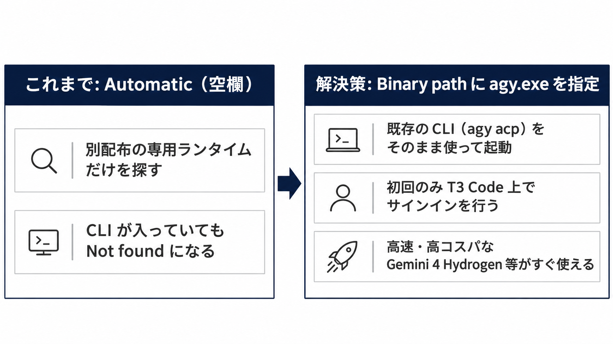
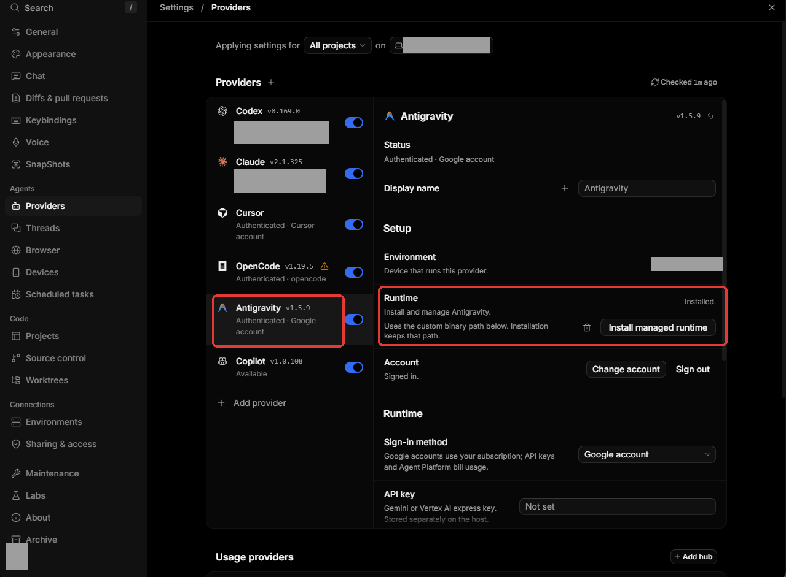
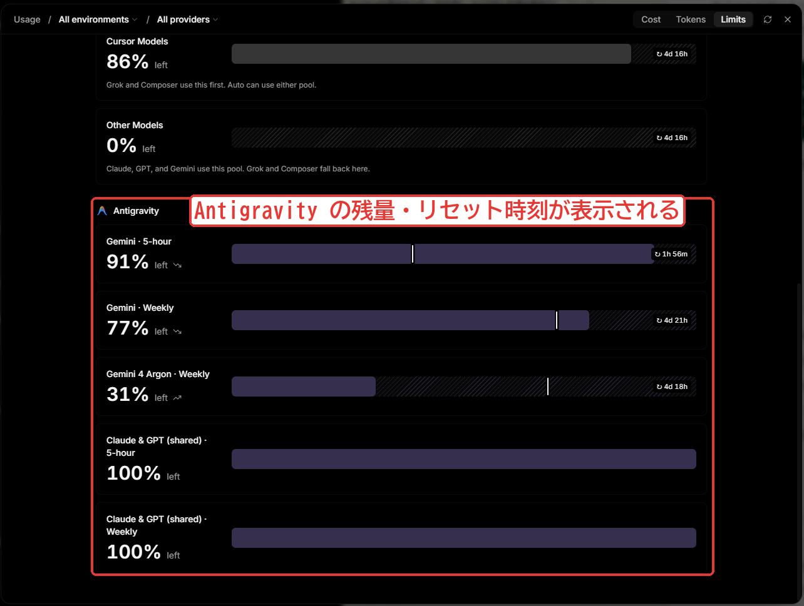

最近、Antigravity や Gemini 4 系モデルが話題です。
Argon に続いて Hydrogen や Carbon も登場し、特に高速・高コスパな Hydrogen の登場で、GPT 系から Antigravity / Gemini 系へ軸足を移す人が増えています。

私もいま T3 Code 上で Gemini 4 Hydrogen を使って作業しています。
ただ、最初に T3 Code へ Antigravity をつなごうとしたとき、`Not found` のまま動かず少しハマったので、解決方法と利用状況（グラフ）を出すコツをメモしておきます。

福岡で AI による業務改善や自動化、Web 制作などに取り組んでいる Trellis です。

:::message
**この記事で分かること**

- T3 Code で Antigravity が「Not found」になり、`Install Antigravity` でも進まない原因
- すでにインストール済みの `agy`（Antigravity CLI）を `Binary path` に指定して動かす設定
- T3 Code のグラフアイコンから Antigravity の利用状況（残量）を見えるようにする方法
- この記事をそのまま AI エージェントに渡して、自分の環境を直してもらうためのプロンプト例
:::

## 現象と原因: `Automatic` では `agy.exe` を見に行かない

T3 Code は、Claude Code や Codex、Antigravity などのエージェントを 1 つのチャット画面で束ねて動かせるアプリです（スマホ連携を含めた構成は以前の記事に書きました）。

https://zenn.dev/trellis/articles/t3code-herdr-mobile-agents

T3 Code の設定画面（Providers）で Antigravity を選んでも、「Not found · Antigravity ACP runtime is not...」と表示されたまま、「Install Antigravity」を押しても進まないことがあります。



原因は、**`Binary path` が空（`Automatic`）のときの探索先**にあります。

- `Automatic` の状態では、T3 Code は別配布の専用ランタイム（Windows なら `agy_acp_server.exe`）だけを探す
- すでに PC に入っている Antigravity CLI（`agy.exe`）は自動では拾われない

一方、Antigravity CLI 1.5.0 以降は **`agy acp`** サブコマンドで ACP サーバーとして起動する機能を持っています。
そのため、ランタイムを追加で入れなくても、**`Binary path` に手元の `agy` 実行ファイルを明示的に指定するだけ**で動くようになります。

## 解決方法: `Binary path` に `agy` を指定してサインインする

### 1\. `Binary path` を設定する

T3 Code の設定画面（Providers → Antigravity）を開くと、`Runtime` 欄に `Uses the custom binary path below.` という案内があり、その下の `Binary path` 欄に手元の `agy` のフルパスを指定できます。



*画面下部の `API key` のさらに下（スクロール先）に `Binary path` 欄があります*

Windows の標準的な配置例は次のとおりです（環境に合わせて置き換えてください）。

```text
%LOCALAPPDATA%\agy\bin\agy.exe
```

設定ファイル（`~/.t3/userdata/settings.json`）を直接書く場合は、`providerInstances.antigravity.config.binaryPath` に指定します。

```json
{
  "providerInstances": {
    "antigravity": {
      "config": {
        "binaryPath": "C:\\Users\\<ユーザー名>\\AppData\\Local\\agy\\bin\\agy.exe"
      }
    }
  }
}
```

### 2\. T3 Code 上でサインインする

パスが通ったら、T3 Code の Providers 画面から **Sign in** を実行します。

T3 Code は CLI 側のログイン情報（`~/.gemini` など）をそのまま共有せず、T3 専用のプロファイルディレクトリ（`~/.t3/userdata/providers/antigravity/...`）で認証情報を持ちます。

別の端末やターミナルでログイン済みでも、初回だけ T3 Code 上でサインインし直す必要があります。
サインインが通れば、モデル一覧に Gemini 4 Hydrogen や Argon、Carbon などが表示され、そのままスレッドで使えるようになります。

## おまけ: T3 Code のグラフから Antigravity の利用状況を見えるようにする

`Binary path` に `agy.exe` を指定するとエージェント自体はすぐ動きますが、最初は T3 Code 画面上部のグラフアイコン（使用状況・残量表示）に Antigravity の利用状況が表示されないことがあります。

### なぜ `agy.exe` だけだと残量が出ないのか

T3 Code が Antigravity の残量を取得する処理は、プロバイダー専用の保存先に置かれる **`acp_token.json`** を読んで Google の API を呼ぶ仕組みになっています。

- **ACP ランタイム（`agy_acp_server.exe`）**: サインイン時にこの `acp_token.json` を書き出す
- **CLI（`agy.exe`）**: 認証情報を OS の資格情報（keyring）に保存するため、`acp_token.json` が作られない

その結果、CLI だけで動かしていると「トークンファイルが見つからない」扱いになり、残量が表示されません。

### ランタイムで 1 回サインインしてから CLI に戻す

これを解決するには、**サインインの 1 回だけ ACP ランタイムを使い、トークンファイルを作ったあとに `agy.exe` へ戻す**のが確実です。

1. 一時的に `Binary path` に ACP ランタイム（`agy_acp_server.exe`）を指定する
2. T3 Code 上で **Sign in** を完了させ、`acp_token.json` を生成させる
3. `Binary path` を元の `agy.exe` に戻す

T3 Code の残量取得はランタイムを起動せず `acp_token.json` を直接読むため、`agy.exe` に戻したあともセッションは CLI で軽快に動きつつ、グラフアイコン（Usage → Limits）から Antigravity の残量やリセット時刻を確認できるようになります。



## エージェントにそのまま丸投げして直してもらう

実のところ、この原因の切り分けや設定の修正、残量表示の対応も、私自身が T3 Code の設定画面で詰まったあとに**動いている別のエージェントへ「T3 Code で Antigravity が使えるように設定しておいて」と頼んで解決してもらった**ものです。

手でパスを調べたり JSON を書き換えたりするのが面倒なら、今お使いのエージェント（Claude Code や Codex など）に、次のようなプロンプトと一緒にこの記事を渡してみてください。

```text
T3 Code で Antigravity（agy）が Not found になって動きません。
この記事の内容を参考に、手元の環境で agy の実行ファイルのパスを調べて、
T3 Code の設定（~/.t3/userdata/settings.json の binaryPath）を反映してください。
また、グラフアイコンから利用状況（acp_token.json）が見えるようにするための確認もお願いします。
反映前に既存の settings.json のバックアップを取り、設定後に確認すべき手順があれば教えてください。
```

環境ごとの `agy` の配置場所探しから設定ファイルのバックアップ・追記まで、エージェントが勝手に片付けてくれます。

## まとめ

- T3 Code で Antigravity が `Not found` になるのは、`Automatic` が別配布のランタイムだけを探すため
- Antigravity CLI 1.5.0 以降が入っていれば、`Binary path` に `agy.exe` を指定するだけで `agy acp` 経由で動く
- グラフアイコンに利用状況を出したい場合は、ACP ランタイムで 1 回サインインして `acp_token.json` を作ってから `agy.exe` に戻す

設定で詰まっている方は、この記事のやり方をそのままエージェントに渡してサクッと解決してみてください。

## Trellis のこと

Trellis は、福岡でホームページの制作と、AI による業務の自動化に取り組んでいます。
記事は Zenn と、Trellis のサイトのブログの両方に載せています。

https://trellis-grow.com/?utm_source=zenn&utm_medium=referral&utm_campaign=t3code-antigravity-cli-setup&utm_content=card
