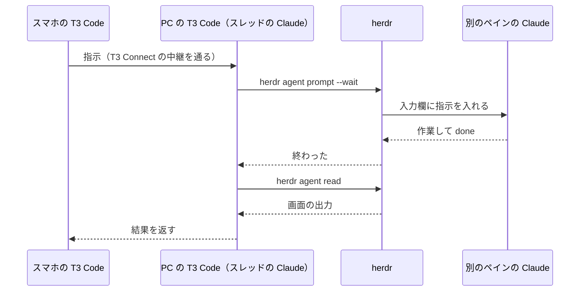

VS Code の拡張機能で Claude Code を動かしていましたが、VS Code が重く、使っていて体験も良くありませんでした。
ほかに契約しているエージェントとも協働させたくなり、VS Code をやめて、T3 Code と herdr でエージェントを束ねる形に移りました。

いまは寝る前にスマホから方針を伝え、朝に報告を読む形で回しています。

コンサルティング会社で AI 導入をリードしながら、福岡の Trellis で AI による業務改善・自動化を担当している伊藤です。
自分の仕事と生活の作業も、複数のエージェントに任せています。

インストールの手順は公式サイトに任せ、この記事では次の 3 つを書きます。

- 窓口の T3 Code と、実行と状態管理の herdr の役割の分け方
- スマホから PC のエージェントに指示を出す構成
- 夜通し回すときの決まりと、うまくいかなかったこと

## T3 Code と herdr とは

### T3 Code は話す窓口

T3 Code は Claude Code や Codex などのコーディングエージェントを、1 つのチャットの画面から操作するアプリです。
公式サイトは自らをこう呼んでいます。

> The open-source control plane for coding agents.
>
> 訳: コーディングエージェントのための、オープンソースの操作盤。

@[card](https://t3.codes)


*出典: T3 Code 公式サイトの紹介画像（og:image）。2026年10月26日に取得*

### herdr はエージェントの実行と状態の管理

herdr はコーディングエージェントをターミナルの中で動かし続け、それぞれの状態を持つ実行環境です。
公式サイトの見出しは短い一言です。

> the agent runtime
>
> 訳: エージェントの実行環境。

@[card](https://herdr.dev)


*出典: herdr 公式サイトの紹介画像（og:image）。2026年10月26日に取得*

:::message
Windows 11 で Claude Code を使っています。Bash のコマンドは Git for Windows の Git Bash で動かしています。herdr は 0.9.3（この記事の画面の撮影時は 0.9.5）、T3 Code はデスクトップ版（調べた時点で Alpha の 0.0.44）と Android のアプリです。2026年10月時点の内容で、どちらも若いツールなので、挙動はこの先変わる可能性があります。
:::

## 環境を移して実現したかったこと

エージェントどうしを協働させるために、実現したかったのは次の 3 つです。

- 複数のエージェントを並べて動かし、どれが終わってどれが止まっているかを、別のエージェントが見張る
- 使用量の上限で止まっても、朝までに誰かが拾って続きを動かす
- PC の前にいなくても、スマホから指示を出し、結果を読む

AI のコーディングエージェントを並べて動かすデスクトップアプリの Orca を経て、2026年10月1日に T3 Code と herdr に移りました。
翌日の 10月2日には、スマホの T3 Code から、PC の herdr のペインで動く Claude に質問を送り、答えを受け取れました。

## herdr のマルチエージェントと状態管理の仕組み

別のエージェントに見張らせるには、どのエージェントが終わり、どれが止まっているかを、プログラムから読める必要があります。
herdr はこれを CLI で返します。

herdr はターミナルをワークスペース・タブ・ペインの 3 段に束ね、ペインの中で動くエージェントを見分けます。
エージェントごとに、`idle`・`working`・`blocked`・`done` の状態を持ちます。

### CLI でのエージェントへの依頼と待ち合わせ

別のエージェントを立てて指示を送り、終わるまで待って、出力を読むところまでが、コマンドだけでできます。
応答は JSON で返り、ワークスペースやペインの ID もその中から読みます。
10月2日にスマホからの往復を試したときは、この順に打ちました。

```bash
# ワークスペースを作る。応答の JSON にペインの ID が入っている
herdr workspace create --label t3-remote-test --no-focus
# w5:p1 は、このときの応答にあったペインの ID。自分の応答の値に置き換える
herdr agent start t3-remote-test --kind claude --pane w5:p1

# 指示を送り、終わるまで待つ
herdr agent prompt t3-remote-test "<指示の文>" --wait

# 画面の出力を読む
herdr agent read t3-remote-test --source visible
```

同じ流れを、記事用に立てた別のセッションで撮ったのが次の画面です。
左のペインから、右の 2 つの Claude に CLI で頼んでいます。
右下の worker-b は答え終わり、右上の worker-a はまだ作業中です。
左下の一覧には、状態が記号で出ます（✓ が `done`、◐ が `working`）。


*2026年10月26日に、記事用のセッション（herdr 0.9.5、モデルは Haiku）で撮影。`--wait` で待った worker-b の応答は `"agent_status":"done"` で返っている*

`--wait` は、相手が承認や質問の画面で止まると `agent_blocked` を返します。
止まった理由を見て、人に聞くか自分で答えるかを、呼び出した側が決められます。

### 対応が要るエージェントを知らせる設定

設定は `%APPDATA%\herdr\config.toml` に書きます。
対応が要るエージェントを一覧の上に出し、裏のタブのエージェントが終わったら Windows の通知を出すようにしています。

```toml
[ui]
agent_panel_sort = "priority"   # blocked・done のエージェントを上に並べる
status_indicators = "symbols"   # 状態を色だけでなく形でも区別する

[ui.toast]
delivery = "system"             # 裏のタブのエージェントが done・blocked になったら Windows の通知
```

herdr はいま開いているタブのエージェントについては通知を出しません。
通知がほしいエージェントは、別のタブに置いておきます。

## スマホから herdr を動かす構成

### なぜ SSH を使わないのか

herdr の公式の遠隔接続は SSH です。
公式サイトは、別のマシンを SSH で足すと、そのワークスペースとエージェントが手元のものと並ぶと説明しています。

> Add them over SSH and their workspaces and agents sit alongside your local ones.
>
> 訳: SSH で追加すると、そのマシンのワークスペースとエージェントが、手元のものと並びます。

スマホから使うなら、スマホの SSH クライアントで PC に入り、`herdr` を開くことになります。
SSH を設定せずにつなぐ Herdr Cloud は、2026年10月26日時点では「coming soon」でした。

ただ、私は PC に SSH の受け口（Tailscale などで外からつなぐ仕組み）を作るのは避けたかったのです。
そこで、T3 Code のスレッドを入り口にして、herdr のマルチエージェントを遠隔で動かす仕組みにしました。

### T3 Code を入り口に選んだ理由

T3 Code にはデスクトップ版とモバイルアプリがあります。
エージェントのプロセス・ターミナル・git は、PC 側の T3 Code のサーバーが持ちます。
スマホからは PC で動いているスレッドをそのまま操作できます。

窓口に T3 Code を選んだのは、次の点からです。

| 観点 | T3 Code |
|---|---|
| スマホの画面 | チャットの画面なので、指で読み書きしやすい |
| PC との行き来 | PC で動いているスレッドを、スマホからそのまま続けられる |
| ファイルと差分 | ファイルを開けて、右のパネルに差分やプレビューを出せる |
| 受け口 | PC から外向きのトンネルを張るので、SSH のサーバーを立てなくてよい |

話す窓口は T3 Code、エージェントの実行と状態の管理は herdr、と分けました。
T3 Code にはスレッドを横に並べる画面が無く、herdr をスマホから使うには SSH の受け口が要ります。
片方で全部をまかなおうとすると、どこかで足りなくなっていました。

### スマホから herdr を動かす流れ

T3 Code のスレッドの Claude は、herdr の CLI も打てます。
スマホから T3 Code に頼むと、PC のスレッドの Claude が herdr の CLI で別のペインのエージェントに指示を渡し、結果を読んで返してきます。

スマホから「herdr の demo に、1+1 と今日の日付を聞いて」と送ると、「1+1 は 2 で、今日の日付は 2026-10-26 です。」と返ってきました。
答えたのは、PC の herdr の別のペインで動いていた Claude です。




*2026年10月26日にスマホ（Android）の T3 Code で撮影。答えたのは、PC の herdr の別のペインで動いている Claude（Haiku）。PC の名前は伏せた*

注意したいのは、herdr に組み込まれたエージェント向けの手引き（`herdr --skill`）が、herdr のペインの中で付く環境変数 `HERDR_ENV` が無ければ操作しないよう書いている点です。
T3 Code のスレッドは herdr のペインの外で動くので、この変数がありません。

ただ、CLI 自体は herdr のサーバーとソケットでつながって動きます。
そこでプロジェクトの決まりに「`HERDR_ENV` が無くても、herdr の実行ファイルを直接指定して操作してよい」と書き足しました。

### T3 Connect の中継の仕組み

スマホと PC は、T3 Code の中継の仕組みである T3 Connect でつながります。
T3 Code が cloudflared（Cloudflare Tunnel のクライアント）を置いて常駐させ、PC から外向きにトンネルを張ります。

T3 Code のサーバー自体は `127.0.0.1` でしか待ち受けず、外からの接続はこのトンネルを通って入ります。

有効にする手順は短く済みます。

1. PC の T3 Code の設定画面で、左の下の「Sign in to T3 Connect」からサインインする
2. T3 Connect のスイッチを入れる
3. スマホのアプリで同じアカウントにサインインし、PC の環境を選ぶ

最初の有効化は失敗しました。
T3 Code の [Issue #14070](https://github.com/pingdotgg/t3code/issues/14070) と同じ症状で、開発者は中継の側の失敗で、手元のアプリを更新しても変わらないと説明していました。
同じ日の 16:22 に試し直すと通りました。
この Issue は 10月4日に修正済みとして閉じられましたが、そのあとも同じ症状の報告が続いています。

この初回の失敗とは別に、使っている途中でつながらなくなったときは、cloudflared の準備の状態を見ています。
cloudflared は手元に状態を確かめるための口を開きます。

私の環境では `http://127.0.0.1:20241/ready` が、通っているときは `readyConnections` 4、切れているときは 0 を返しました（ポートは私の環境の値です）。

:::message alert
受信のポートを開けずに済むとはいえ、外から PC に入る経路ができることに変わりはありません。使う PC の決まりを確かめてから有効にしてください。
:::

### スマホでは herdr の画面を開かない理由

T3 Code にはターミナルもあるので、そこで `herdr` を起動すれば、スマホから herdr の画面も触れます。
ただ、これは常用しないことにしました。

herdr のペインの大きさは最後につないだ画面に合わせられます（herdr の [Issue #1401](https://github.com/herdrdev/herdr/issues/1401)）。
狭いスマホでつなぐと PC 側のペインまで縮み、Claude の画面が狭い幅で描き直されます。
抜けても、描き直された履歴は戻りません（[#2404](https://github.com/herdrdev/herdr/issues/2404)）。

どちらの Issue も機能の要望として「Not planned」で閉じられていました。
スマホでは herdr の画面を開かず、T3 Code の Claude に「ワーカーの様子を見て」と頼んでいます。
これなら画面の大きさの取り合いは起きません。

## 3 層に分けたマルチエージェントの回し方

子どもが 2 人いて、PC の前に座れる時間は短いので、エージェントには私がいない時間も動いていてほしいと思っています。
夜通し回すときは、3 層に分けます。
朝まで動かせたのは、この形の副産物です。

### 頭・コーディネーター・ワーカーの役割

| 層 | 置き場所 | 役割 |
|---|---|---|
| 頭 | T3 Code のスレッド | 私と話す窓口。方針を決めてコーディネーターに渡し、進み具合を見張る |
| コーディネーター | herdr のペイン | 作業を分けて指示書を書き、ワーカーに配る。夜間のログを書き、判断が要ることを朝にまとめる |
| ワーカー | herdr のペイン（複数） | 指示書どおりに作業し、報告を書いて終わりの合図を出す |


*この構成でスマホから話すのは頭だけ。ワーカーの細かい出力はコーディネーターが受け止める*

頭を T3 Code に置くのは、この構成でスマホから話せるのがそこだからです。
ワーカーの細かい出力を頭が全部読むと、頭の文脈がすぐに埋まります。
間にコーディネーターを挟むと、頭は「何が終わり、何を決めればいいか」だけを受け取れます。

晩によっては、T3 Code のスレッドがコーディネーターを兼ね、herdr のワーカーに直接配ります。
複数のワーカーが同じファイルを触らないよう、指示書で受け持ちの範囲を分けています。
ワーカーの変更を合わせるのは、別のワーカーか私の仕事です。
commit は朝に私がします。

### 夜間の決まりをファイルに書く

夜の間、私は答えられません。
そのため、エージェントへの決まりは会話ではなくファイルに書いて渡しています。
プロジェクトの CLAUDE.md はセッションの始めに読み込まれ、作業ごとの指示書はワーカーへの最初の指示で読ませます。

この回し方はふだんの使い方の延長です。
私は Obsidian の Vault を作業の場所にして、AI と共有したい決まりを共通のファイルに書き、セッションをまたいで読ませています。
その考え方と中身は前の記事に書きました。

@[card](https://zenn.dev/akaringo1109/articles/obsidian-context-continuity)

ある晩のコーディネーターに渡した決まりは、要旨をまとめるとこうでした。
この晩は別の作業のセッションと使用量の枠を分け合っていました。

```markdown
- commit・push・reset・checkout・削除はしない（消してよいものは朝に一覧で出す）
- 使用率が 92% に届いたら全員を止める（並列のセッションの分も見込み、95% を超えないため）
- テストケースを足す・外す・まとめる、判定の意味を変える、私が決めたことを覆す、はしない
  （判断が要るものは、朝に私へ回すファイルに書く）
```

herdr の扱い方はプロジェクトの CLAUDE.md に書いています。

- herdr のペインを操作する前に、毎回 `herdr --skill` を読む
- ワークスペースやペインの ID は推測せず、応答の JSON から読む
- 自分が作っていないワークスペースやペインを閉じない
- 指示を送る相手はペインの ID か一意な名前で決める。どのペインか分からない端末に「続けて」と送らない

最後の決まりは、私が手で操作している最中のセッションに、エージェントの指示が割り込まないためのものです。

### 終わりの合図をファイルに残す

コーディネーターは `herdr agent wait` で終わりを待ちますが、それだけだと拾い漏れることがあります。
そこでワーカーは作業の最後に合図のスクリプトを叩き、JSON のファイルを置きます。
ワーカーへの決まりはこう書いています。

```markdown
作業が終わったら、最後のターンで次を実行する。
  bash .claude/bin/worker-done.sh --summary "<実施した作業と結果の要約>"
続けられないとき・エラーで止まったときも、--status failed を付けて実行する。
Claude Code のサブエージェントは送らない（途中で「完了」が届いてしまう）。
```

最後の行のサブエージェントは、Claude Code が作業の一部を任せるために内部で立てる子のエージェントです。
ワーカーの中で動くので、これが合図を送ると、ワーカーの作業が終わる前に「完了」が届いてしまいます。

スクリプトは Git Bash で動き、実行ごとに分けたフォルダに `<タスクの ID>.done.json` と `latest.done.json` を書きます。

:::details worker-done.sh の要点（実物から抜き出したもの。このままでは動きません）

```bash
SIGNAL_DIR="${SIGNAL_BASE}/${RUN_SCOPE}"   # 実行ごとに分けたフォルダ。分からなければ unscoped
mkdir -p "$SIGNAL_DIR"
JSON_PAYLOAD="$("$PY" -c "
import json, sys
print(json.dumps({'taskId': sys.argv[1], 'status': sys.argv[2],
                  'summary': sys.argv[3], 'timestamp': sys.argv[4]},
                 ensure_ascii=False, indent=2))
" "$TASK_ID" "$STATUS" "$SUMMARY" "$NOW_ISO")"
printf '%s\n' "$JSON_PAYLOAD" > "${SIGNAL_DIR}/${TASK_ID}.done.json"
cp -f "${SIGNAL_DIR}/${TASK_ID}.done.json" "${SIGNAL_DIR}/latest.done.json"
```

:::

コーディネーターは見回りのたびにこのフォルダと herdr の状態の両方を見ます。
以前は全員が同じフォルダに書いていて、別の作業のワーカーが終わっただけで、関係の無い待ち手まで起きていました。
実行ごとにフォルダを分けたのは、そのためです。

ワーカーが最後のターンまでたどり着けずに止まったときは、合図が出ません。
そのときは herdr の状態でしか分かりません。

### 使用量の上限で止まったときの再開

夜間に回すと、Claude の使用量の上限（プランごとの利用の枠）に当たります。

私は `/usage` を打つだけの Claude Code のペインを 1 つ用意し、そこを PowerShell のスクリプトが herdr 越しに読んで、使用率を CSV に記録していました。
使用率がしきい値を超えたら、コーディネーターに知らせる分岐も入れています。

上の決まりを渡したのと同じ晩、並べて動かしていたもう一方の作業では、4 つのワーカーが動いていました。
この作業では、T3 Code のスレッドがコーディネーターを兼ねていました。

上限に当たると、コーディネーター自身も応答できなくなります。
そこで、Claude Code の、決まった時刻にプロンプトを流す予定をセッションの中に入れる機能を使いました。
枠が戻ったあとに来た予定のプロンプトで、コーディネーターがまた動き出します。

その晩の流れは次のとおりです。

- 0 時 20 分: 使用量は 83%。0 時 45 分ごろに 100% に届く見込みだった
- コーディネーターは自分のセッションに、毎時 13 分と 43 分の見回りと、朝 7 時 37 分の報告づくりの予定を入れた（見回りでは、使用量とワーカーの状態を見て、枠が戻っていれば再開を指示する）
- 0 時 45 分〜3 時 20 分: 使用量は 94〜100%。ワーカーは新しい作業を始めずに待った
- 3 時 20 分: 枠が戻り、コーディネーターがそれぞれに続きを送った
- 7 時 40 分: 朝の報告ができた
- 9 時 16 分: 止まっていた作業も含めて、すべて終わった

この予定はセッションの中に置かれます。
別の晩に、T3 Code のスレッドに入れた再開の予定が来なかったことがあり、T3 Code を起動し直したときに消えたとみています（確かめてはいません）。

この形で、スキルの移行や評価のような、一晩では終わらない作業も回しました。
私がしたのは、方針を決めることと、判断が要るところに答えることでした。

## うまくいかなかったこと

### herdr のセッションは T3 Code のスレッドに映らない

T3 Code はエージェントのプロセスを自分のサーバーで起動して持つ作りです。
herdr のペインで動いている Claude を、あとから T3 Code のスレッドとして表示することはできません。
T3 Code から見えるのは、スレッドの Claude が herdr の CLI で読んできた結果だけです。

### PC と T3 Code を起動したままにする必要がある

Windows では T3 Code をバックグラウンドのサービスとして動かせません。
公式のドキュメントにも「Windows background services are not supported.」とあります（[background-service.md](https://github.com/pingdotgg/t3code/blob/main/docs/user/background-service.md)）。

デスクトップアプリを開いたままにし、電源につないでスリープしない設定にしています。
バッテリーで動いていると、私の PC の設定では 45 分でスリープし、外から届かなくなります。

### 答えが速いときに返る agent_prompt_stalled

スマホからの往復を試したとき、`herdr agent prompt --wait` は `agent_prompt_stalled` を返しました。
指示は届いていて、答えも出ていました。
私の見立てでは、相手の答えが速すぎて、herdr が作業中の状態を拾う前に終わっていたためです。

stalled が返っても再送せず、まず `herdr agent read` で画面を確かめるようにしています。

## 試すときの最初の一歩

まず herdr を入れて、`herdr agent prompt --wait` で別のペインのエージェントに 1 つ頼んでみてください。
状態を持つターミナルで「頼んで、待って、読む」が通れば、スマホの入り口はあとから足せます。

## Trellis のこと

Trellis は、福岡でホームページの制作と、AI による業務の自動化をしている会社です。
記事は Zenn と、Trellis のサイトのブログの両方に載せています。

@[card](https://trellis-grow.com)
