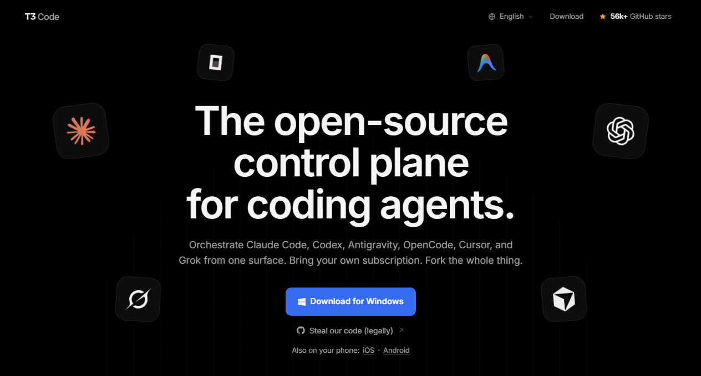
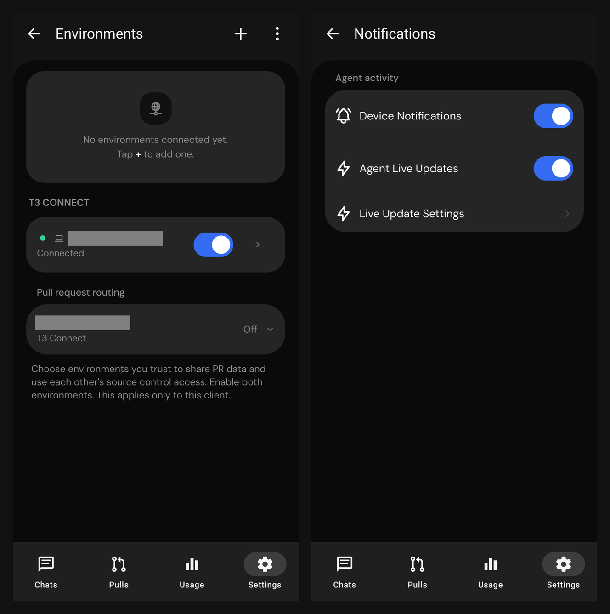
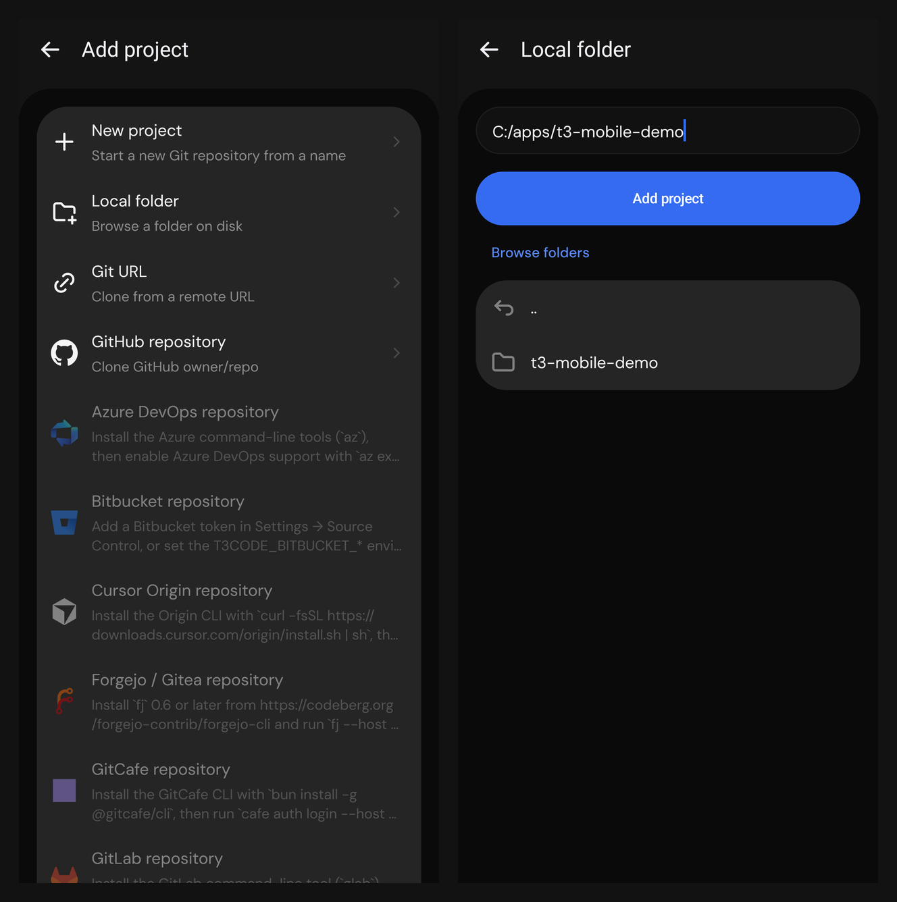
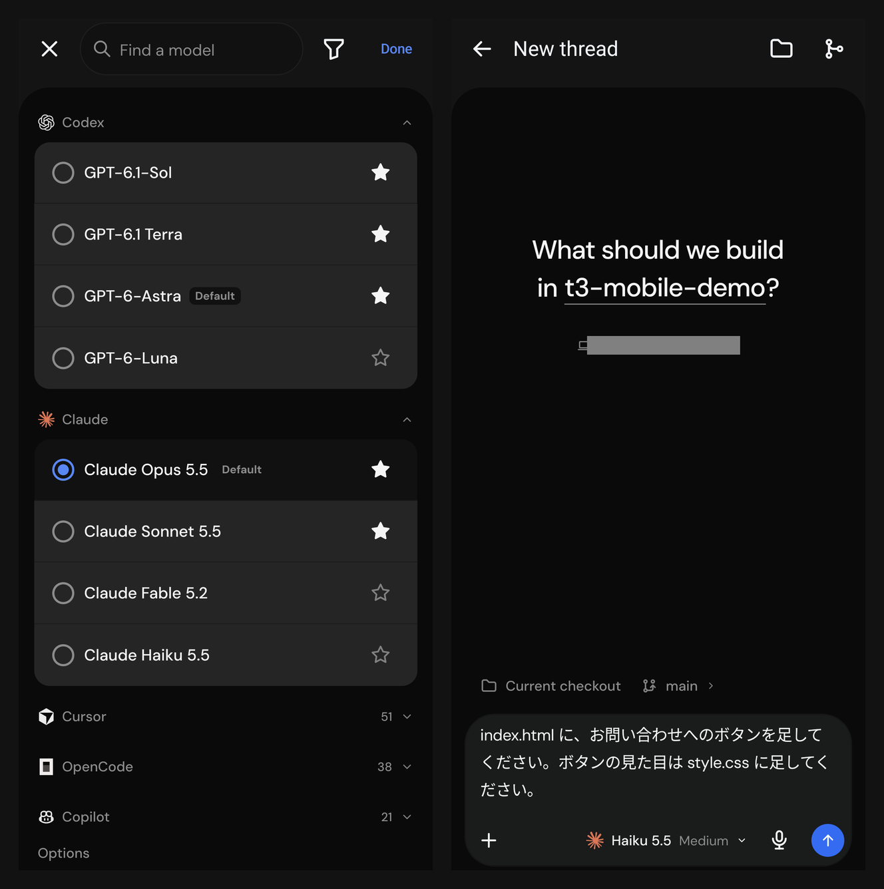
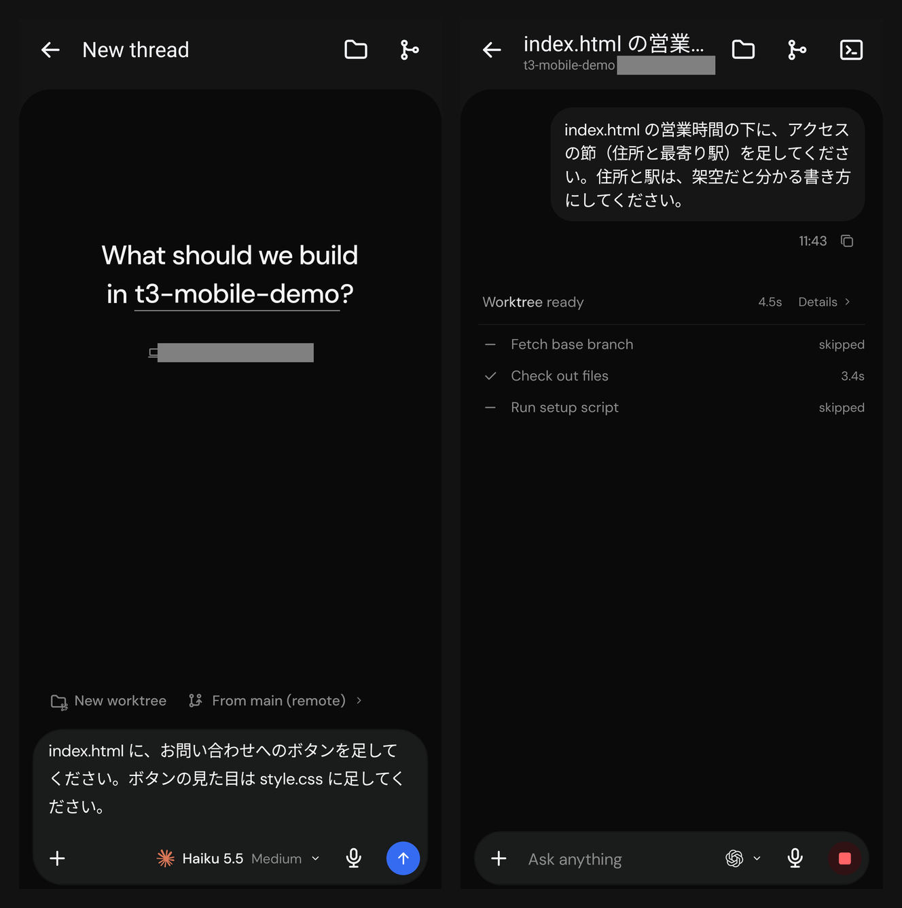
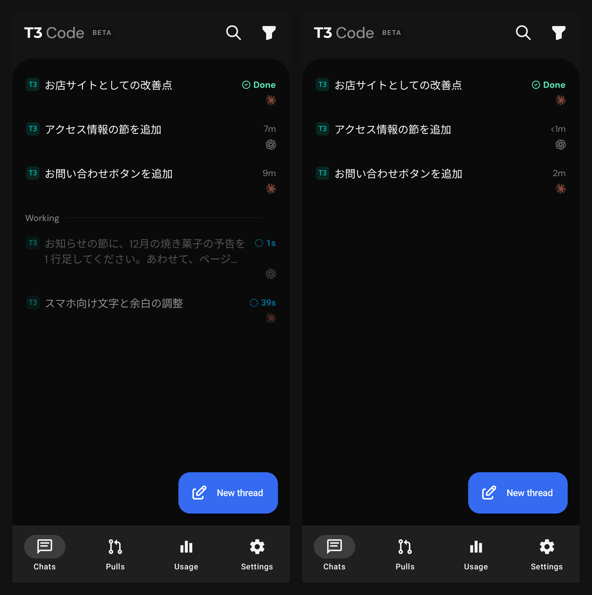
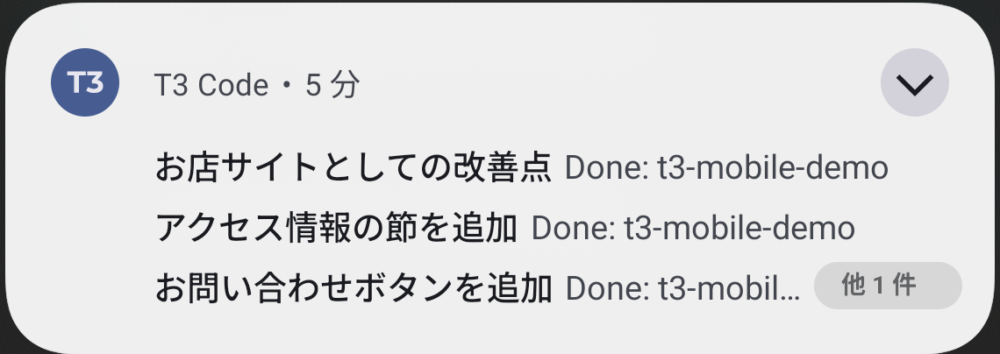
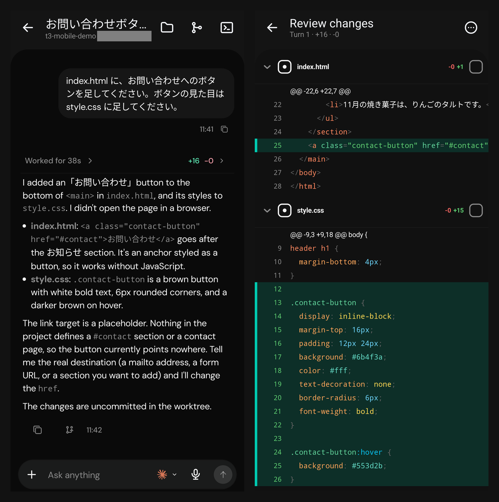
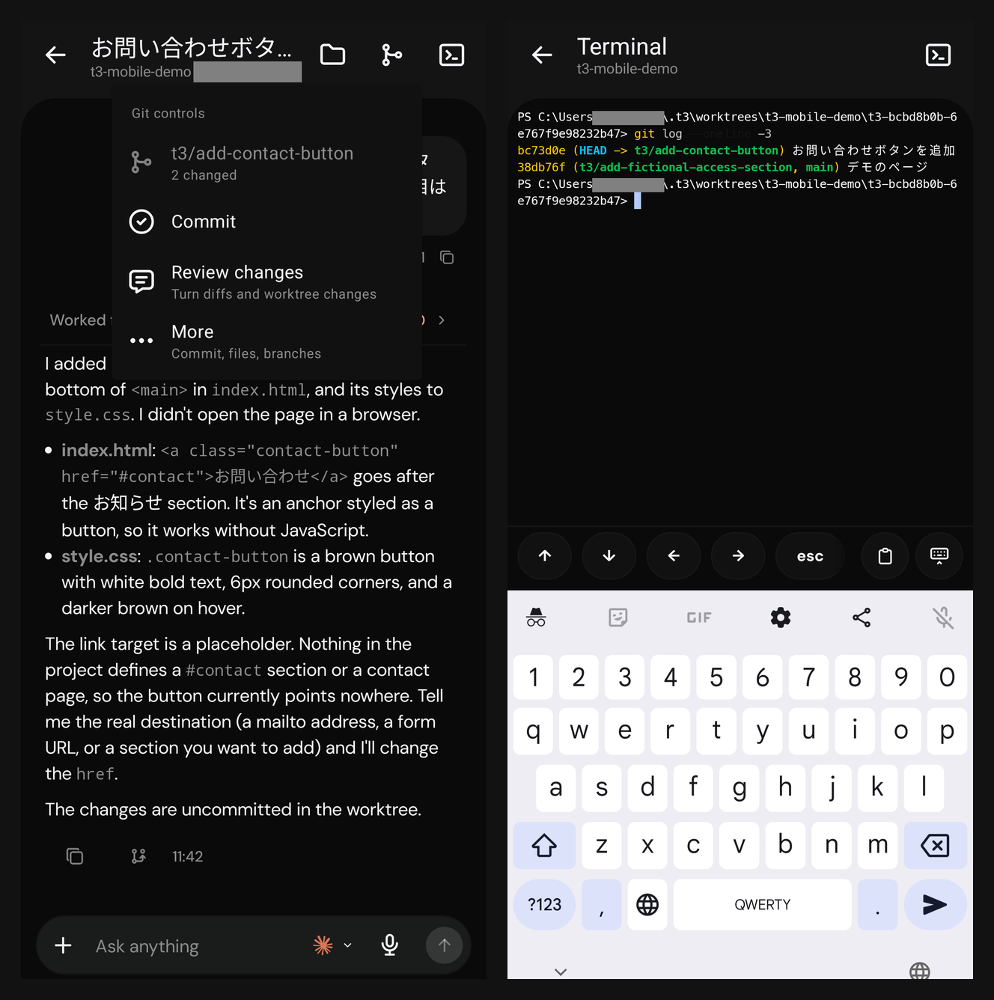

PC で動く AI のコーディングエージェントに、スマホから仕事を頼みたい。
それも 1 つではなく、Claude と Codex のような別々のエージェントに、並べて頼みたい。
私はこれを、T3 Code のスマホアプリで回しています。

福岡で AI による業務改善や自動化、Web 制作などに取り組んでいる Trellis です。
この記事では、Android の実機の画面で、スマホから複数のエージェントを並べて動かし、結果を確かめるまでの流れを紹介します。

この記事で分かること:

- T3 Code のスマホアプリと PC のつなぎ方（SSH の受け口は要らない）
- スマホから、別々のエージェントに作業場所を分けて頼む方法
- 差分の確認・git・ターミナルを、スマホでどこまで扱えるか

インストールの手順と、デスクトップ版の細かい機能は書きません。

## T3 Code とスマホアプリ

### T3 Code はエージェントの操作盤

T3 Code は、Claude Code や Codex などのコーディングエージェントを、1 つの画面から操作するアプリです。
公式サイトには、扱えるエージェントがこう並んでいます。

> Orchestrate Claude Code, Codex, Antigravity, OpenCode, Cursor, and Grok from one surface.
>
> 訳: Claude Code・Codex・Antigravity・OpenCode・Cursor・Grok を、1 つの画面から指揮する。

https://t3.codes



*出典: T3 Code 公式サイト（2026年11月12日に撮影）*

### スマホアプリは PC のリモコン

スマホアプリでは、エージェント自体はスマホの中では動きません。
エージェント・ターミナル・git は PC 側の T3 Code が持ち、スマホはそれを操作するリモコンです。
そのため、作業のあいだは PC を起動したままにしておく必要があります。

:::message
Android 16 のスマホで、T3 Code の Android アプリ 2.3.0（ベータ）を使っています。PC は Windows 11 で、T3 Code のデスクトップ版は 0.1.8（Beta）です。2026年11月12日時点の画面で、どちらも若いアプリなので、画面や動きはこの先変わる可能性があります。
:::

## PC とのつなぎ方

### T3 Connect なら SSH の受け口が要らない

スマホと PC は、T3 Code の中継の仕組みの T3 Connect でつなぎます。
PC の T3 Code で T3 Connect をオンにし、スマホのアプリで同じアカウントにサインインして、PC を選ぶだけです。

T3 Connect は、PC から外向きにトンネルを張ります。
公式のドキュメントによると、中継は接続を取り持つだけで、やり取りそのものは中継しません。

> Our relay sets up the link. It does not proxy your HTTP or WebSocket sessions.
>
> 訳: 私たちの中継はつながりを作るだけです。HTTP や WebSocket のやり取りを中継することはありません。

PC で SSH のサーバーを立てたり、受信のポートを開けたりしなくて済みます。
1 つのアカウントで PC を 3 台までつなげ、スマホとブラウザは台数に数えません。
2026年11月12日時点で、T3 Connect は無料です（公式の FAQ は「for now」と書いています）。

同じネットワークの中なら、QR コードやペアリングの URL で、中継を通さずに直接つなぐこともできます。

左が、スマホの設定の「Environments」の画面です。
T3 Connect の欄に PC が出て、「Connected」になっています。



*2026年11月12日に Android の実機で撮影。PC の名前は灰色で伏せた*

右の通知の画面では、エージェントの終わりを知らせる端末の通知と、作業中の様子を出し続ける「Agent Live Updates」をオンにできます。

### PC はつけたままにする

PC がスリープすると、スマホからは届かなくなります。
前の記事では、Windows では T3 Code をバックグラウンドのサービスとして動かせない、と書きました。
いまの公式のドキュメントでは、Windows でもログインしているあいだはサービスとして動かせると書かれています。

> Windows starts the service when you log in and stops it when you sign out.
>
> 訳: Windows では、ログインしたときにサービスが起動し、サインアウトすると止まります。

https://zenn.dev/trellis/articles/t3code-herdr-mobile-agents

## スマホから複数のエージェントを並べて動かす

ここからは、架空のお店の 1 枚のページ（`index.html` と `style.css`）を使って、スマホから 3 つのエージェントに頼んだ流れです。

| スレッド | エージェントとモデル | 頼んだこと |
| --- | --- | --- |
| 1 | Claude（Haiku 5.5） | お問い合わせのボタンを足す |
| 2 | Codex（GPT-6 Luna） | 営業時間の下に、アクセスの節を足す |
| 3 | Claude（Sonnet 5.5） | お店のサイトとしての改善点を 3 つ挙げる（ファイルは変えない） |

### プロジェクトはスマホからも足せる

まず、作業するフォルダを T3 Code のプロジェクトにします。
これは PC の前に行かなくても、スマホからできます。

新しいスレッドの画面でプロジェクトの名前を押し、右上の「+」を押すと、足し方を選ぶ画面が出ます。
新しい git のリポジトリを作る、PC のフォルダを選ぶ、Git の URL や GitHub から取ってくる、などが並びます。

「Local folder」を選び、PC のフォルダのパスを入れて「Add project」を押すと、プロジェクトに入ります。



*2026年11月12日に Android の実機で撮影*

### エージェントとモデルを選んで頼む

入力欄の右のマークを押すと、エージェントとモデルの一覧が出ます。
Codex と Claude のモデルが並び、その下に Cursor・OpenCode・Copilot も入っていました。
よく使うモデルには星を付けておけます。

選んだら、入力欄に頼みたいことを書いて送ります。
右の画面では、プロジェクトが `t3-mobile-demo`、モデルが Haiku 5.5 になっています。



*2026年11月12日に Android の実機で撮影。PC の名前は灰色で伏せた*

### スレッドごとに作業場所を分ける

複数のエージェントが同じファイルを同時に書き換えると、変更がぶつかります。
T3 Code では、入力欄の上の「Current checkout」を押すと「New worktree」に切り替わり、スレッドごとに別の作業用フォルダと別のブランチで動かせます。

左が New worktree にした状態、右が送った直後のスレッドです。
「Worktree ready」と出て、作業用のフォルダができたことが分かります。



*2026年11月12日に Android の実機で撮影。PC の名前は灰色で伏せた*

PC 側で確かめると、スレッドごとに作業用のフォルダとブランチができていました。
ブランチの名前は、頼んだ中身から付いています。

```text
C:/apps/t3-mobile-demo                                     [main]
<ユーザーのフォルダ>/.t3/worktrees/t3-mobile-demo/t3-...    [t3/add-fictional-access-section]
<ユーザーのフォルダ>/.t3/worktrees/t3-mobile-demo/t3-...    [t3/add-contact-button]
```

ファイルを変えないレビューのスレッド（3 本目）は、作業場所を分けずに Current checkout のまま送りました。

### 動いているスレッドと終わったスレッドを、一覧で見る

スレッドの一覧は、プロジェクトで絞り込めます。
作業中のスレッドは「Working」の欄にまとまり、終わったものは上に並びます。
右の小さなマークで、どのエージェントのスレッドかも分かります。



*2026年11月12日に Android の実機で撮影。左は、続けて 2 本を頼んだ直後*

スレッドの名前は、頼んだ中身から自動で付きます。
3 本は、最後の 1 本を送ってから 1 分ほどで、どれも終わっていました。

エージェントが終わると、スマホの通知にも出ます。
通知はスレッドごとにまとまり、どのプロジェクトのどのスレッドが終わったかが分かります。



*2026年11月12日に Android の実機で撮影。通知の欄から T3 Code の通知だけを切り出した*

## 結果を確かめて、仕上げる

### 答えと差分を読む

スレッドを開くと、エージェントの答えと、変えた行数（+16・-0）が出ます。
行数を押すと「Review changes」の画面になり、ファイルごとの差分を読めます。
ファイルの右のチェックで、見終えたファイルに印を付けられます。



*2026年11月12日に Android の実機で撮影。PC の名前は灰色で伏せた*

このときの Haiku は、日本語で頼んでも英語で答えました。
答えには、変えたファイルと、ボタンのリンク先がまだ仮であること、変更はまだコミットしていないことが書かれていました。

差分は、右上のメニューから、最後のターンの分、指定したターンの分、まだコミットしていない分、などに切り替えられます。

### git の操作とターミナル

スレッドの上のブランチのマークを押すと、git の操作が出ます。
ブランチの名前と変えたファイルの数、「Commit」「Review changes」、ほかの操作の「More」が並びます。

ターミナルのマークからは、そのスレッドの作業用フォルダで、PC のシェル（Windows なら PowerShell）を開けます。
キーボードの上に、矢印・esc・貼り付けのキーが並びます。



*2026年11月12日に Android の実機で撮影。PC の名前とパスのユーザー名は灰色で伏せた*

:::message alert
「Commit」は、押すと確認の画面を出さずに、コミットのメッセージを AI で作ってそのままコミットしました。コミットの作者は、PC の git の設定の名前とメールアドレスになります。押す前に、差分と、どのブランチかを確かめてください。
:::

## herdr のスマホアプリとの違い

前の記事で、herdr の公式スマホアプリを調べました。
同じ「PC のエージェントをスマホから動かす」アプリでも、作りが違います。

https://zenn.dev/akaringo1109/articles/herdr-mobile-app

| 観点 | herdr のスマホアプリ（公式の説明から） | T3 Code のスマホアプリ（実機で確かめた） |
| --- | --- | --- |
| PC とのつなぎ方 | SSH で各マシンの herdr-core に直接 | T3 Connect（PC から外向きのトンネル）か、同じネットワークでの直接のペアリング |
| 画面 | エージェントの実際のターミナル | チャットの画面。ターミナルも開ける |
| 一覧の並び | 対応が要る順（Needs you・Done・Working・Idle） | 作業中は Working の欄、終わったものは上 |
| 作業場所の分け方 | 書かれていない | スレッドごとに作業用のフォルダとブランチを作れる |
| 差分と git | 書かれていない | 差分の確認、コミットまで |
| 知らせ | アプリを開いているときのバナー | 端末の通知 |

herdr のアプリは、ターミナルそのものを持ち歩く作りです。
T3 Code のアプリは、チャットで頼み、結果を差分で確かめる作りです。

## スマホで複数のエージェントを動かすなら、T3 Code を勧める理由

スマホで複数のエージェントを動かす入り口として、私は T3 Code を勧めます。
理由は次の 4 つです。

- **SSH の受け口が要らない**: PC から外向きにつなぐので、PC に SSH のサーバーを立てなくて済む
- **チャットの画面なので、指で読み書きしやすい**: 長い答えも、スマホの幅で折り返して読める
- **作業場所をスレッドごとに分けられる**: 別々のエージェントに同じプロジェクトを頼んでも、変更がぶつからない
- **確かめるところまでスマホで済む**: 差分を読み、git の操作やターミナルまで使える

一方で、気をつけたい点もあります。

- PC とデスクトップ版の T3 Code は、動かしたままにする必要がある
- アプリは Beta で、画面や動きが変わりやすい
- 「Commit」は確認なしでコミットする

## 試すときの最初の一歩

PC の T3 Code で T3 Connect をオンにし、スマホのアプリで同じアカウントにサインインしてください。
そのうえで、消してもよいフォルダをプロジェクトにして、New worktree で 2 本のスレッドを並べて頼んでみると、作業場所が分かれる様子と、一覧の Working の動きを一度に確かめられます。

## Trellis のこと

Trellis は、福岡でホームページの制作と、AI による業務の自動化に取り組んでいます。
記事は Zenn と、Trellis のサイトのブログの両方に載せています。

https://trellis-grow.com/?utm_source=zenn&utm_medium=referral&utm_campaign=t3code-mobile-multi-agent&utm_content=card
