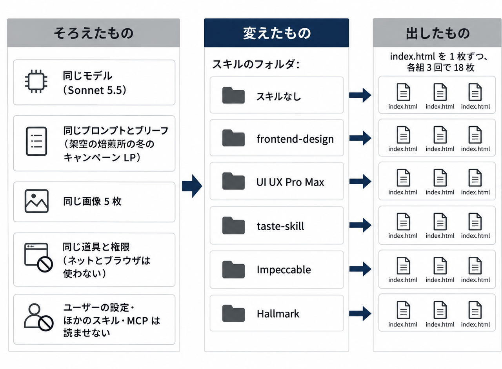
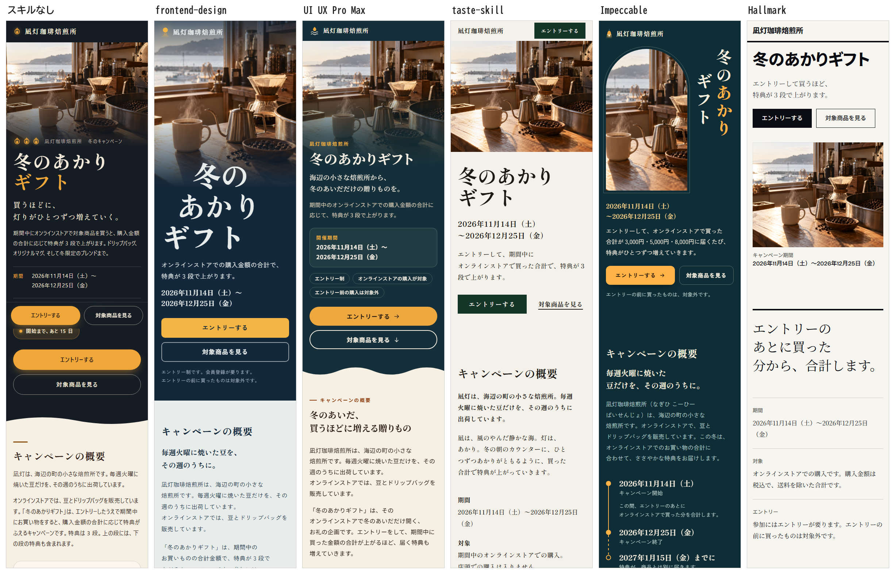
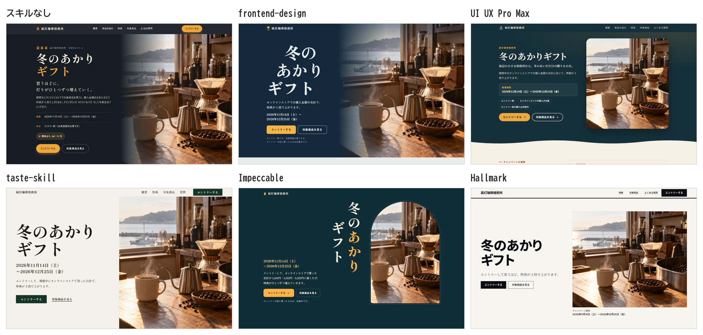
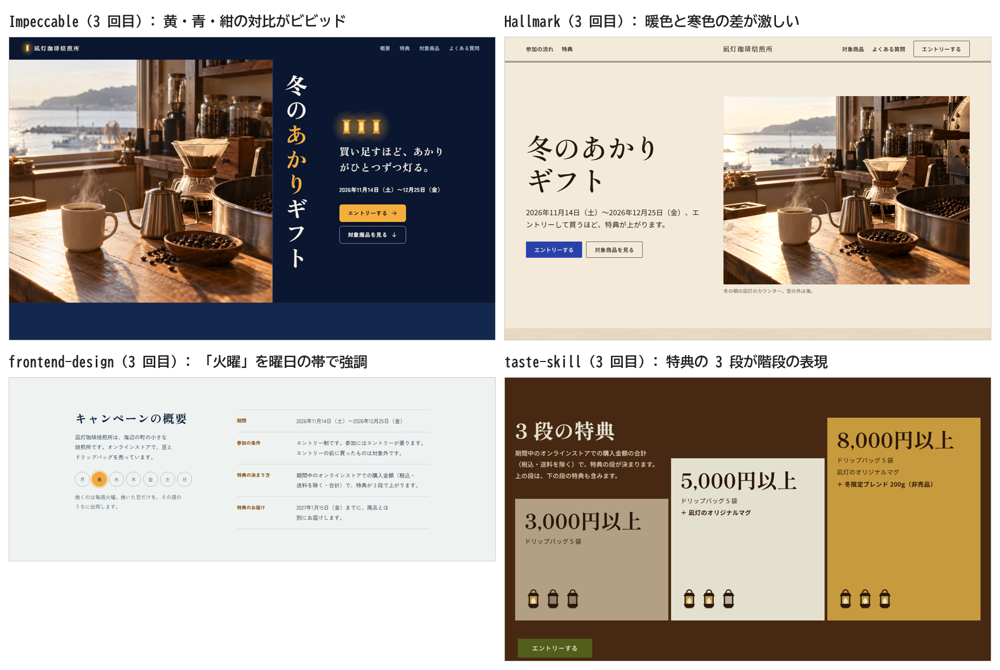
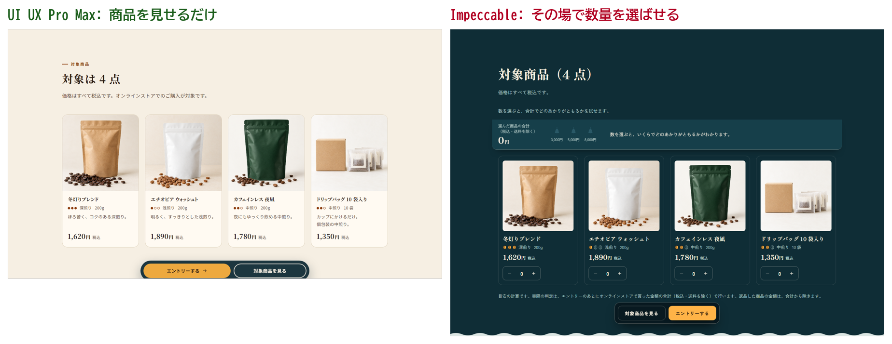
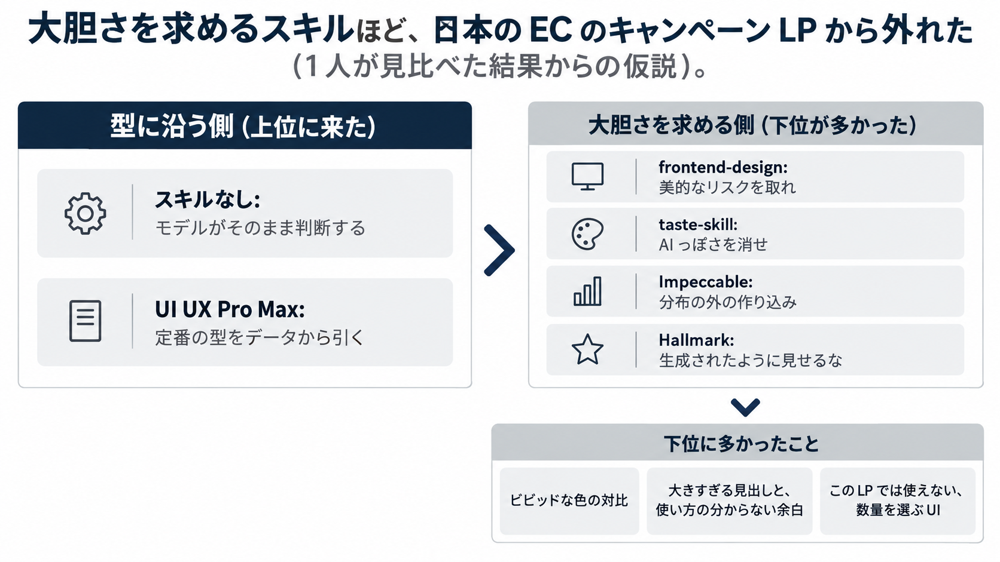

Claude Code 向けの人気の UI スキルを 5 つ選び、スキルなしも入れた 6 組で、同じ LP を作らせました。
モデルもプロンプトも同じにして 3 回ずつ回し、どれがどのスキルかを伏せて、私が見比べました。

3 回とも一番は UI UX Pro Max で、2・3 回目は次にスキルなしが来ました。
残りの 4 つのスキルは、スキルなしより下に見えた回が多くなりました。
taste-skill や Hallmark はもっと良いと思っていたので、意外な結果でした。

この記事で分かることは、次の 3 つです。

- 5 つの UI スキルで、日本語のキャンペーン LP がどう変わったか（実際の画面）
- スキルのほかの条件をそろえて比べる回し方
- スキルなしが案外良かった理由についての、私の考え

厳密な採点はしていない、私 1 人の主観の比較です。
スキルがブラウザで画面を見て直す工程も止め、作るところまでで比べました。

## 比べた 5 つの UI スキル

Claude Code には、UI を作るためのスキルがたくさん出ています。
どれを入れればいいのか、入れると何が変わるのかを知りたくて、人気の上位から 5 つを選びました。

| スキル | ひとことで | スター（10/29） |
| --- | --- | --- |
| [frontend-design](https://github.com/anthropics/skills) | Anthropic 公式。書く前に、美的な方向を 1 つ決めさせる | 184,525（リポジトリ全体） |
| [UI UX Pro Max](https://github.com/nextlevelbuilder/ui-ux-pro-max-skill) | スタイル・配色・書体の組み合わせのデータを検索して、デザインを組む | 142,099 |
| [taste-skill](https://github.com/Leonxlnx/taste-skill) | 「AI っぽさ」を避ける。調べておいた方向性の中から 1 つを選んで当てる | 104,511 |
| [Impeccable](https://github.com/pbakaus/impeccable) | デザインの語彙と、AI っぽい UI を見つける規則を与える | 92,762 |
| [Hallmark](https://github.com/Nutlope/hallmark) | 素材から選んで組み、AI っぽい癖を確かめて仕上げる | 40,768 |

選ぶときは、UI スキルを紹介する記事の上位と、GitHub のスターの数を目安にしました。
どれも 10 月 29 日に GitHub から取った版です。
5 つとも海外の作者のスキルで、中の例も英語です。

## 比べ方: スキルのフォルダのほかは、全部そろえる

比べたいのは、スキルだけで何が変わるかです。
そこで、モデル・プロンプト・画像・道具を 6 組でそろえ、違うのはスキルのフォルダの中身だけにしました。



### 題材は、架空の焙煎所のキャンペーン LP

題材は、海辺の町の架空の珈琲焙煎所「凪灯珈琲焙煎所」の、冬のキャンペーンの LP です。
SaaS のサービスサイトではなく、一般の人に向けた日本語の LP にしました。

キャンペーンの LP には、期間・条件・特典の段・商品・よくある質問と、見せ方の違う中身がそろっています。
どのスキルも中の例が英語なので、日本語の組み方でも差が出ると考えました。

中身は 6 組とも同じブリーフ（店・期間・特典の 3 段・商品 4 点・参加の 3 ステップなど）で渡しました。
商品の写真とキービジュアルの 5 枚は、前もって作って全部の組に同じものを渡しています。

:::details 6 組に渡したプロンプト（スキルの組は、頭に /スキル名 の 1 行を足した）
```text
架空の珈琲焙煎所の、冬のキャンペーンのランディングページを作ってください。

- 中身: このフォルダの BRIEF.md の文言と数字を使う。足りない文言は書き足してよいが、数字・日付・条件は変えない
- 出すもの: このフォルダの index.html 1 枚。HTML・CSS・素の JavaScript だけで書き、ビルドはしない。外の JavaScript や CSS のライブラリは読み込まない。Web フォントの読み込みはよい
- 画像: assets/ にある 5 枚だけを使う（中身は assets/README.md）。ほかの画像は取ってこない・作らない。SVG の飾りやアイコンは自分で書いてよい
- 見る人: 主にスマホ。PC で開いても崩れないこと
- この環境では、ネットへの接続と、ブラウザを動かす検査は使えない
- 質問はしないで、最後まで作る。決めたことと選んだ方向は、NOTES.md に短く書く
```
:::

:::details 6 組に渡したブリーフ（BRIEF.md。店・商品・数字はすべて架空）
```markdown
# ブリーフ: 凪灯珈琲焙煎所「冬のあかりギフト」キャンペーン LP

## 店
- 名前: 凪灯珈琲焙煎所（なぎひ こーひー ばいせんじょ）
- 海辺の町の小さな焙煎所。毎週火曜に焼いた豆だけを、その週のうちに出荷する
- オンラインストアで豆とドリップバッグを売っている

## キャンペーン
- 名前: 冬のあかりギフト
- 期間: 2026年11月14日（土）〜2026年12月25日（金）
- エントリー制。参加にはエントリーが要る。エントリーの前に買ったものは対象外
- 期間中のオンラインストアでの購入金額（税込・送料を除く・合計）で、特典が 3 段で上がる

## 特典（購入金額の合計で決まる。上の段は下の段の特典も含む）
| 購入金額の合計 | 特典 |
|---|---|
| 3,000円以上 | ドリップバッグ 5 袋 |
| 5,000円以上 | ＋ 凪灯のオリジナルマグ |
| 8,000円以上 | ＋ 冬限定ブレンド 200g（非売品） |

## 対象商品（4 点。価格はすべて税込）
| 商品 | 煎り | 量 | 価格 | 画像 |
|---|---|---|---|---|
| 冬灯りブレンド | 深煎り | 200g | 1,620円 | assets/product-winter-blend.png |
| エチオピア ウォッシュト | 浅煎り | 200g | 1,890円 | assets/product-ethiopia.png |
| カフェインレス 夜凪 | 中煎り | 200g | 1,780円 | assets/product-decaf.png |
| ドリップバッグ 10 袋入り | 中煎り | 10 袋 | 1,350円 | assets/product-dripbag.png |

## 参加の流れ（3 ステップ）
1. エントリーする（ボタンから。会員登録が要る）
2. 期間中に対象商品を買う（何回に分けてもよい。合計で判定）
3. 2027年1月15日（金）までに、特典が商品とは別に届く

## よくある質問
（エントリー前の購入・合算・店頭での購入・届く日の 4 つ。省略）

## 注意事項
- エントリーは 1 人 1 回です
- 特典は数に限りがあり、なくなり次第終わります
- 価格はすべて税込です。送料は別で、購入金額の合計には入りません
- 返品した商品の金額は、合計から除きます

## 入れてほしい区画
ヒーロー、キャンペーンの概要、参加の 3 ステップ、特典の段の表、対象商品、よくある質問、注意事項、エントリーと購入のボタン（画面の下に固定するかは任せる）

## ボタン
- 主: 「エントリーする」（リンク先は `#entry`）
- 副: 「対象商品を見る」（リンク先は `#products`）
```
:::

### スキルのほかを切った回し方

ふだんの環境のまま回すと、私の CLAUDE.md やほかのスキル、MCP の道具まで一緒に読まれます。
それでは、スキルの差なのか環境の差なのか分かりません。

そこで、組ごとに空のフォルダを作り、`.claude/skills/` にはその組のスキルだけを入れて、`claude -p` で回しました。
ユーザーの設定と MCP は読ませず、権限は起動の引数で渡しています。

:::details 1 回分の起動のしかた（Claude Code 2.1.314）
```bash
cd <組のフォルダ>   # BRIEF.md・prompt.txt・assets/・.claude/skills/<スキル>/ だけがある
claude -p "$(cat prompt.txt)" \
  --settings <権限の JSON> \
  --model claude-sonnet-5-5 --effort high \
  --setting-sources project \
  --strict-mcp-config \
  --tools "Read,Write,Edit,Glob,Grep,Bash,Skill,Agent,TodoWrite" \
  --permission-mode acceptEdits \
  --output-format stream-json --verbose \
  --no-session-persistence < /dev/null
```

- `--setting-sources project`: ユーザーの設定（CLAUDE.md・出力スタイル・ユーザーのスキル）を読まず、フォルダの中だけを読む
- `--strict-mcp-config`: MCP の設定を渡していないので、MCP の道具は 1 つも入らない
- `--tools`: 6 組で同じ道具にする。WebFetch・WebSearch は入れていない
- プロンプトの頭の 1 行: `/frontend-design`・`/ui-ux-pro-max`・`/design-taste-frontend`（taste-skill）・`/impeccable`・`/hallmark`。呼ばれずに終わるのを防ぐため、名前で呼んだ

権限の JSON は、ふだんの道具を許し、ネットとブラウザに出るものだけを止める形です。

```json
{
  "permissions": {
    "allow": ["Bash", "Read", "Write", "Edit", "Glob", "Grep", "Skill", "Agent", "TodoWrite"],
    "deny": [
      "WebFetch", "WebSearch", "Skill(design)", "Skill(design-sync)", "Skill(dataviz)",
      "Bash(curl *)", "Bash(wget *)", "Bash(npx *)", "Bash(npm *)", "Bash(git *)",
      "Bash(*http://*)", "Bash(*https://*)",
      "Bash(*assets.mjs*)", "Bash(*inspect.mjs*)", "Bash(*imagegen.mjs*)", "Bash(*--render*)",
      "Bash(*chrome*)", "Bash(*puppeteer*)", "Bash(*playwright*)"
    ]
  }
}
```

- `Skill(design)` などは、Claude Code に最初から入っているスキル。比べるスキルに混ざらないよう止めた
- 確かめたこと: 別に 1 回だけ「読んでいる指示は何か」と聞き、私の CLAUDE.md の中身を知らないことを確かめた。最初のリクエストの大きさで、スキルが入ったことも確かめた（スキルなしは 12,774 トークン、スキルの組は 16,025〜26,459 トークン）
:::

途中で 2 つつまずきました。

- `--bare` が一番まっさらに近いのですが、API キーでしか動かず、サブスクの枠では回せませんでした
- フォルダに置いた `.claude/settings.json` の allow は、信頼していないフォルダでは無視されました（deny は効く）。そのため権限は `--settings` で渡しています

ネットとブラウザを止めたので、taste-skill・Hallmark・Impeccable が持っている「ブラウザで画面を見て直す」工程は使えていません。
どれも、作る途中で画面を見て直すのが大事な工程として書かれています。
この比較で分かるのは、その工程を止めて、作るところまでで比べた結果です。

### 見比べ方

1 組 3 回、合わせて 18 枚の LP を、スマホ幅（390px）と PC 幅（1440px）で撮りました。
回ごとに組を A〜F の記号に並べ替え、どれがどのスキルかを伏せて、私が見比べました。

## 結果: 一番は 3 回とも UI UX Pro Max、2・3 回目の次はスキルなし

| 回 | 一番 | 次 | 下のほうに見えた組 |
| --- | --- | --- | --- |
| 1 回目 | UI UX Pro Max | Impeccable | taste-skill・Hallmark・frontend-design |
| 2 回目 | UI UX Pro Max | スキルなし | frontend-design・Hallmark・Impeccable・taste-skill |
| 3 回目 | UI UX Pro Max | スキルなし | frontend-design・Impeccable・Hallmark・taste-skill |

1 回目のスキルなしには、所感を残していません。

1 回目の 6 組の、スマホ幅の最初の 2 画面ぶんです。



*1 回目のスマホ幅（390px）。並びは左から スキルなし・frontend-design・UI UX Pro Max・taste-skill・Impeccable・Hallmark*

PC 幅の最初の画面です。



*1 回目の PC 幅（1440px）の最初の画面*

どの組も、キービジュアルの近くにエントリーの導線を置き、節ごとにボタンを置いていました。
どの案も節の区切りを波線にしていて、これは「凪」と「海辺の町」から海を連想したのだと思います。
世界観の作り方は、スキルよりもブリーフで決まっていた印象です。

価格・期間・特典の段・ボタンの文言は、18 枚とも抜けや書き換えがありませんでした。
ページの文字にブリーフの数字や文言があるかを、機械で照らした結果です。
ブリーフの写しでは差が付かず、差が出たのは見た目と構成でした。

見比べたときに書き留めた所感です。

- UI UX Pro Max: 一番バランスがいい。商品の見せ方も含めて、比較的 AI っぽさがマシ
  - ただ、PC 版の参加の流れで、1 から 3 にかけて箱が小さくなっていく理由はよく分からない
- taste-skill: 「よくある質問」や「注意事項」がデカデカとしすぎ。2 回目は、ちょっとパワポっぽい
  - 3 回目の特典の 3 段は階段の表現になっていて、イメージに近い
- Hallmark: 数字の見せ方が SaaS っぽくて、EC 向きではない。3 回目は暖色と寒色の差が激しすぎる
- Impeccable: 1 回目は UI UX Pro Max と迷うくらい良かったのに、2・3 回目はビビッドすぎて世界観に合わない
- frontend-design: 余白の使い方が分からない。3 回目は「火曜日」にフォーカスが当たりすぎて、情報の強弱が分かっていない
- スキルなし: 2 回目は UI UX Pro Max と迷うくらい。3 回目も悪くない（ただ、PC 幅でキービジュアルと次の節の切れ目に紺の帯が残っていて、そこが惜しい）

3 回目の 4 組で、所感の元になった所です。



*3 回目の PC 幅から切り抜いた所*

## 差が一番出たのは、この LP で何をさせるか

一番の決め手は、見た目より、導線の解釈でした。
ブリーフでは、買うのはオンラインストアで、この LP はエントリーしてもらうためのページです。
この LP にはカートが無いので、エントリーしたあとは、商品ページや別の EC サイトで買う体験になるはずです。
ここで数量を入力させても、買えません。

あとから 18 枚を数えると、LP の中で数量を選ばせる UI（＋／− のボタンや数の入力）を作った回は、次のとおりでした。

| 組 | 数量を選ぶ UI を作った回 |
| --- | --- |
| UI UX Pro Max | 0 / 3 |
| スキルなし | 2 / 3 |
| frontend-design | 2 / 3 |
| Hallmark | 2 / 3 |
| taste-skill | 3 / 3 |
| Impeccable | 3 / 3 |

UI UX Pro Max だけが、3 回とも商品を見せるだけにとどめました。
ほかの組は、数を選ぶと合計と特典の段が分かる、目安の計算を作り込んでいます。



*1 回目の対象商品の節。左が UI UX Pro Max、右が Impeccable*

作り込み自体は丁寧で、いくら買えば特典が上がるかの目安が分かるのは、親切とも言えます。
それでも私は、このページで数量を入れさせるのは、ここで買えるかのように見えてしまうと感じました。
作り込みを促すスキル（taste-skill・Impeccable）ほど、3 回ともこの機能を足していました。

ただし、スキルなしも 3 回のうち 2 回は数量の UI を作っています。
数量の UI で説明できるのは UI UX Pro Max が一番だった理由までで、スキルなしが良かった理由ではありません。
そちらは、次の節で考えます。

## スキルなしが案外良かった理由（私の考え）

ここからは、試した結果からの私の考えです。

### 大胆さを求めるスキルほど、外れた

下のほうに見えた 4 つのスキルは、どれも「ありきたりを避けて、大胆に」と強く求める作りでした。

> make deliberate, opinionated choices about palette, typography, and layout that are specific to this brief, and take aesthetic risk if justified.
> 訳: このブリーフに合わせて、配色・書体・レイアウトを意図して選び、主張を持たせる。理由があれば美的なリスクを取る。

frontend-design の SKILL.md の一節です。

> This skill gives you the tools and permission to make design that earns the name out-of-distribution craft.
> 訳: このスキルは、分布の外の作り込みと呼べるデザインを作るための道具と許しを与える。

Impeccable の SKILL.md の一節で、LP のような「説得する」ページには、全力で大胆にいくよう書いています。
taste-skill は「anti-slop（AI っぽさを消す）」を名乗り、Hallmark は「生成されたものではなく、デザインされたものに見える」ことを目指しています。

どれも「このブリーフに合わせて」「理由があれば」と条件は付けています。
「AI っぽさを避ける」と「派手にする」も、本来は同じではありません。
それでも出てきた画面は、ありきたりを避けようとして、色や見出しを強くする方向に振れていました。

一方の UI UX Pro Max は、79 のスタイル・192 の配色・74 の書体の組み合わせを、データから検索して選ぶ作りです。
今回も 3 回とも、同梱の検索のスクリプトを 4〜5 回呼んでから組んでいました。
大胆さよりも、その業種で定番の型を引いてくる作りです。



*1 人が見比べた結果からの仮説です*

下のほうに多かったのは、ビビッドな色の対比、大きすぎる見出しや使い方の分からない余白、そして LP では使えない数量の入力でした。
「ありきたりを避けよう」とした結果が、派手な装飾と、頼んでいない機能になって出たように見えます。

### この題材には、海外のギャラリーの尖り方が合わなかった

taste-skill は、One Page Love や Awwwards で選ばれたサイトの研究から作ったと書いています。
私の印象では、こうしたギャラリーで目立つのは、尖ったポートフォリオや SaaS のサイトです。

日本の生活者向けの EC の LP では、情報の強弱と、落ち着いた世界観のほうが大事だと私は思います。
5 つとも海外の作者のスキルですが、今回の題材で私の感覚に合ったのは、派手さを求めない UI UX Pro Max と、スキルなしの 2 つでした。

逆に、英語で海外の SaaS っぽいページを作らせたら、Impeccable や Hallmark のほうが上手かったのかもしれません。
これはまだ試していません。

### モデルが良くなると、スキルは薄いほうがいいのかもしれない

スキルなしの Sonnet 5.5 は、ブリーフを読んで、波線の世界観もボタンの置き方も、それなりに組んでいました。
そこに「大胆に」「AI っぽさを消せ」と重ねると、良くなるよりも、外れることのほうが多かった印象です。

以前、自分の Claude Code のスキルを 4 分の 1 の長さまで削ったら、精度はむしろ上がったことがあります。
モデルが良くなると、細かい指示を重ねるより、削ったほうが良い結果になる場面があります。

https://zenn.dev/akaringo1109/articles/claude-code-skill-slimming

今回も、同じことが起きていたのかもしれません。
ただ、モデルの新旧や、同じスキルの長さ違いは比べていないので、確かめたわけではありません。
工程の多いスキルほど時間もかかり、スキルなしの 1.5〜2 倍かかった組もありました。

:::details 組ごとの時間と、費用の目安（3 回の値）
| 組 | 時間（分） | 費用の目安（$） |
| --- | --- | --- |
| スキルなし | 11 / 12 / 11 | 1.35 / 1.58 / 1.38 |
| frontend-design | 13 / 12 / 12 | 1.66 / 1.47 / 1.50 |
| UI UX Pro Max | 14 / 10 / 13 | 1.77 / 1.38 / 1.85 |
| taste-skill | 15 / 15 / 22 | 1.90 / 2.09 / 3.11 |
| Impeccable | 26 / 15 / 15 | 3.36 / 2.13 / 2.00 |
| Hallmark | 24 / 27 / 19 | 2.23 / 3.76 / 2.79 |

費用の目安は、Claude Code が出す API の換算額です。サブスクで回したので、実際には払っていません。
:::

## 比べ方の限界

- 題材は 1 つ（日本語のキャンペーン LP）だけです。ほかの業種や英語のページでは、順位が変わるかもしれません
- 見比べたのは私 1 人で、3 回ずつです
- 2・3 回目は、1 回目で UI UX Pro Max がどれか分かったあとに見ています。見た目で当たりが付いた可能性があります
- ブラウザで画面を見て直す手順を止めたので、それを強みにしているスキル（taste-skill・Hallmark・Impeccable）には不利な条件です
- モデルは Sonnet 5.5 だけです

## まとめ: UI のスキルは、入れる前にスキルなしと比べる

- 人気の UI スキル 5 つとスキルなしを、同じ条件で 3 回ずつ比べた
- 一番は 3 回とも UI UX Pro Max で、2・3 回目の次はスキルなしだった。taste-skill や Hallmark は、期待していたほどではなかった
- 一番差が出たのは、見た目より、この LP で何をさせるかの解釈だった。数量を選ばせる UI を足さなかったのは UI UX Pro Max だけ
- 大胆さを求めるスキルほど、日本語の EC の LP からは外れた。あまりプロンプティングしすぎないほうがいい、というのが今回の私の結論

UI のスキルを入れる前に、まずスキルなしで同じものを作らせて、比べてみるのがおすすめです。
次は、英語で海外の SaaS っぽいページを題材にして、順位が入れ替わるかを試してみたいです。

## Trellis のこと

Trellis は、福岡でホームページの制作と、AI による業務の自動化に取り組んでいます。
記事は Zenn と、Trellis のサイトのブログの両方に載せています。

https://trellis-grow.com/?utm_source=zenn&utm_medium=referral&utm_campaign=ui-skill-same-prompt-comparison&utm_content=card
